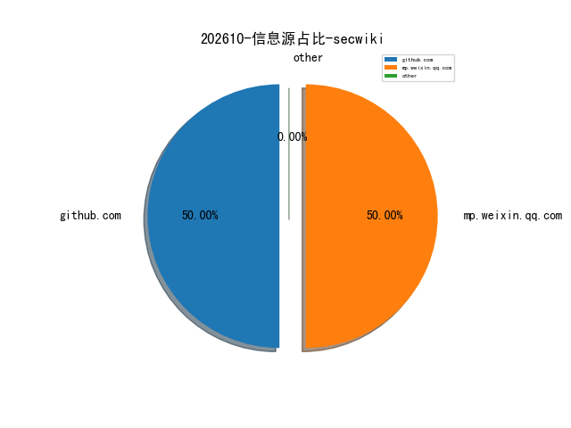
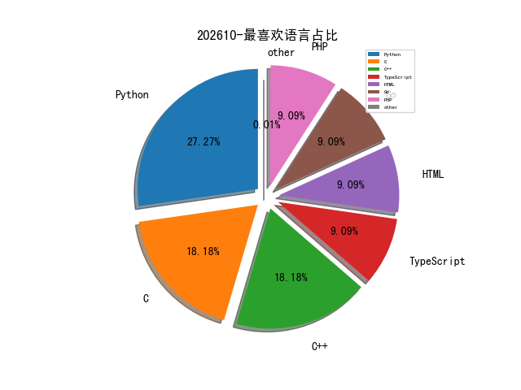

# [数据--所有](README_20.md)
# [数据--年度](README_2026.md)
# 202610 信息源与信息类型占比

# 网络安全书籍 推荐
| date_added | language | title | author | link | size| 
| --- | --- | --- | --- | --- | ---| 
| 2026-10-21 18:37:01 | English | Securing Enterprise AI Agents | unknown | https://www.wowebook.org/securing-enterprise-ai-agents/ | unknown| 
| 2026-10-21 09:09:25 | English | Siri AI Visual Bible | unknown | https://www.wowebook.org/siri-ai-visual-bible/ | unknown| 
| 2026-10-21 06:23:41 | English | Mastering Elastic Kubernetes Service on AWS, 2nd Edition | unknown | https://www.wowebook.org/mastering-elastic-kubernetes-service-on-aws-2nd-edition/ | unknown| 
| 2026-10-19 18:03:02 | English | Mastering Oracle Autonomous AI Database | unknown | https://www.wowebook.org/mastering-oracle-autonomous-ai-database/ | unknown| 
| 2026-10-18 19:31:17 | English | Programming Rust, 3rd Edition | unknown | https://www.wowebook.org/programming-rust-3rd-edition/ | unknown| 
| 2026-10-18 19:08:44 | English | Ultimate Apache Camel for Enterprise AI Integrations | unknown | https://www.wowebook.org/ultimate-apache-camel-for-enterprise-ai-integrations/ | unknown| 
| 2026-10-18 17:21:18 | English | Ultimate GraphRAG for AI Engineers | unknown | https://www.wowebook.org/ultimate-graphrag-for-ai-engineers/ | unknown| 
| 2026-10-18 17:01:02 | English | Ultimate Agentic AI for Event-Driven Architecture | unknown | https://www.wowebook.org/ultimate-agentic-ai-for-event-driven-architecture/ | unknown| 
| 2026-10-18 14:56:39 | English | Practical Conformal Prediction with Python | unknown | https://www.wowebook.org/practical-conformal-prediction-with-python/ | unknown| 
| 2026-10-18 12:59:32 | English | Enterprise Cloud Strategy and Architecture in the Age of AI | unknown | https://www.wowebook.org/enterprise-cloud-strategy-and-architecture-in-the-age-of-ai/ | unknown| 
| 2026-10-06 19:38:40 | English | AI Ethics in Action | unknown | https://www.wowebook.org/ai-ethics-in-action/ | unknown| 
| 2026-10-06 08:48:38 | English | AI Governance in Practice | unknown | https://www.wowebook.org/ai-governance-in-practice/ | unknown| 
| 2026-10-04 09:07:04 | English | Hands-On Time Series Analysis with R | unknown | https://www.wowebook.org/hands-on-time-series-analysis-with-r/ | unknown| 
| 2026-10-04 20:05:33 | English | Agentic AI for Platform Engineering | unknown | https://www.wowebook.org/agentic-ai-for-platform-engineering/ | unknown| 
| 2026-10-03 07:41:23 | English | Python for AI and Data Analysis: The Practical Guide for Business and Science | unknown | https://www.wowebook.org/python-for-ai-and-data-analysis-the-practical-guide-for-business-and-science/ | unknown| 
| 2026-10-01 19:18:24 | English | Transformation Enterprise Architecture with Agentic AI | unknown | https://www.wowebook.org/transformation-enterprise-architecture-with-agentic-ai/ | unknown| 

# 微信公众号 推荐
| nickname_english | weixin_no | title | url| 
| --- | --- | --- | ---| 
| 360漏洞研究院 | 360漏洞研究院 360漏洞研究院 | PHP2Shell 漏洞已遭在野利用， 默认配置利用代码已公开 | https://mp.weixin.qq.com/s/MB5jIXANMt4njRgkyf6O9Q | 4| 
| AI+网络安全笔记 | 渊渟鹤峙 渊渟鹤峙 | Mythos 崛起之后：网络信息安全的技术防御清单，与安全行业的下一个十年 | https://mp.weixin.qq.com/s/9VQqJsfXGM2w2jpJA_ynPw | 2| 
| AI和提效工具实验记 | 安全情报官 安全情报官 | 银狐木马同一个载荷塞进两种容器：25KB跳板横跨VHD和ISO，控制端首次搬进阿里云新加坡 | https://mp.weixin.qq.com/s/AkOrmmFddA2p3XpkB_5GAQ | 4| 
| AI安全推进计划 | H H | 智能体越权防护研究，从过度代理到能力最小化：AI Agent 权限治理的形式化方法与工程落地 | https://mp.weixin.qq.com/s/aZbdRY1DuwoaLNlPdi8D9Q | 7| 
| AI紫队安全研究 | AI紫队安全研究 AI紫队安全研究 | 重磅事件｜不入侵、不爆破！直接“应聘入职”，FBI突袭“笔记本农场”！揭秘朝鲜Famous Chollima 渗透，牟利300万美元 | https://mp.weixin.qq.com/s/CVgBcXpxGggTZPDxfnX5uw | 7| 
| Coder小Q | Litt1eQ Litt1eQ | 【密码学·采样】Bernoulli、Ziggurat、卷积与高斯拒绝采样 | https://mp.weixin.qq.com/s/JHfalCMsKwCQ5vjXgzNutg | 1| 
| CyberOk |  | 疑普华永道遭遇勒索：威胁公开590GB\"数据库\" | https://mp.weixin.qq.com/s/JfKm3Ws17J1Wt1vlS24FUA | 5| 
| GTG网络安全实验室 | GTG-Hardy GTG-Hardy | 智能眼镜出海欧盟：告别无声录制背后，GDPR合规生死题 | https://mp.weixin.qq.com/s/Yx5zGnOm_nwWUIPkeFOM-Q | 5| 
| HACK之道 | 1nceSec 1nceSec | AI 驱动的自动化渗透测试平台 | https://mp.weixin.qq.com/s/Gpeag9qr5pKFXWrG6TV8XA | 3| 
| Hacking黑白红 | 隐雾安全 隐雾安全 | PHP核弹级漏洞，是哪家AI挖出来的？日本首相高市早苗都被惊动 | https://mp.weixin.qq.com/s/s3v0pl8aGlzWasCLql95SQ | 15| 
| Hunter取证 |  | 【问迹战法】“专家智能体”让办案人员从单打独斗走向专家协同 | https://mp.weixin.qq.com/s/459oSDiXuxUXCEZsV4PWCQ | 3| 
| Ice ThirdSpace |  | 学习100篇 Web3 安全文章 , 区块链运营私钥安全 ④ , 第四篇：区块链运营中的私钥安全现状——审批与策略 | https://mp.weixin.qq.com/s/NORhMPApUnftN8vlFg6HTA | 1| 
| IoT物联网技术 |  | 15 家伙伴、31 所高校，施耐德电气把开放自动化送进现场 | https://mp.weixin.qq.com/s/qcln8A3l9Hl7PMjKLWzmtQ | 7| 
| Khan安全团队 | 作者 作者 | sci论文一直投不中？大牛帮指导选刊投稿返修后，被拒的SCI全中了！ | https://mp.weixin.qq.com/s/LlLyuvnk33li-NsNvSjIzQ | 20| 
| Nday Poc | Superhero Superhero | itC 中心管理服务器 viewServer.do 敏感信息泄露 | https://mp.weixin.qq.com/s/zB-Zdj1AuBhgA5YZx1k-Yw | 1| 
| Web安全工具库 |  | AI 自动渗透攻击 -- ai-auto-pentest（10月23日更新） | https://mp.weixin.qq.com/s/FFw2Aro87APwyWgNWMs06w | 1| 
| e安在线 | e安在线 e安在线 | OpenAI推出五阶段高危漏洞响应框架，应对AI发现漏洞增长趋势 | https://mp.weixin.qq.com/s/4fXPI-R50LZhVmQ6gQYMYA | 2| 
| fullbug | xiejava xiejava | 告警堆到 100 万条那天，我决定自己写一个“会用 AI“的安全运营中心 | https://mp.weixin.qq.com/s/48sNHpas4YxNkltYS4oGDw | 5| 
| wavecn | SenderSu SenderSu | 许愿式编程：当所有人都能造轮子，轮子还值钱吗？ | https://mp.weixin.qq.com/s/JuUIhekwFPcx4gmFQaRmdw | 1| 
| 中国电信安全 |  | 霜降渐寒防风险，云端筑盾护安全 | https://mp.weixin.qq.com/s/693kbCbsrQ7bBTd4YQS5ug | 4| 
| 中孚信息 | 中孚信息 中孚信息 | 层层解密中孚AI布局，不止产品，更是战略 | https://mp.weixin.qq.com/s/OhXM_Kul7_pal58beR-VFQ | 1| 
| 乌雲安全 | sywinksvg sywinksvg | 一套面向 CNVD 通用型未授权漏洞挖掘的开源便携工具包 | https://mp.weixin.qq.com/s/rEg0aKWvmG_CaHAg_Q2ClA | 2| 
| 亿人安全 | None | AI真能挖到高危漏洞吗？ | https://mp.weixin.qq.com/s/niUxIKuqA_lEkD9fCQc1_g | 1| 
| 信息安全大事件 |  | 关于PHP远程代码执行漏洞分析及修复建议的安全公告 | https://mp.weixin.qq.com/s/IZPDw6xt708N2ad69kj1sg | 1| 
| 倬其安 | Hash先生 Hash先生 | 企业安全技术防护体系的建设顺序 | https://mp.weixin.qq.com/s/OcqGtTqyIbJ7UYzEbbZY-g | 5| 
| 内生安全联盟 |  | 江苏省发券！省发改委等五部门印发，词元（Token）券、语料券、模型券，速看→ | https://mp.weixin.qq.com/s/7LECoDJBJETN4owDhbBk8A | 9| 
| 利刃信安 |  | 武大杨*媛在教材中仍是受害者？这不是岁月史书，而是意识共同体 | https://mp.weixin.qq.com/s/iwGGfD6QXwU6Yqr5vY7a9Q | 10| 
| 北京路劲科技有限公司 | 北京路劲科技 北京路劲科技 | 等保测评命令——锐捷网络设备（RGOS） | https://mp.weixin.qq.com/s/Lcj_xJjGEJDeruT_N7rZQQ | 1| 
| 升斗安全 | 升斗安全XiuXiu 升斗安全XiuXiu | 你下的安装包，竟是赏金局 | https://mp.weixin.qq.com/s/O76OHErsjs7IFVbpvYrqIQ | 2| 
| 华顺信安威胁情报中心 |  | 【热点安全风险】10月23日｜LiteLLM 1.107.0 官方包被植入后门，攻击者可窃取云密钥与模型凭据 | https://mp.weixin.qq.com/s/3bHFzDYm11zgslZT2yJGAw | 4| 
| 君哥的体历 | 群秘 群秘 | 广州期货交易所科技有限公司诚招安全人才！｜总第69期 | https://mp.weixin.qq.com/s/LosklpDMpDhP4GOSOOualA | 1| 
| 君说安全 |  | 行业资讯｜绿盟科技第二期股权激励归属：438人获1107万股归属，2025 年业绩踩线达标 | https://mp.weixin.qq.com/s/GNdCXExF_hmcgRUYgvnFuQ | 11| 
| 围巢安全笔记 | 围巢安全笔记 围巢安全笔记 | Redis未授权访问一个配置错误就能丢服务器 | https://mp.weixin.qq.com/s/gZPyUcSIyOjleN_R_Prs5A | 3| 
| 国瑞电磁空间安全实验室 | 大佬刘 大佬刘 | 工位上那台 “看家” 摄像头，真的安全吗？ | https://mp.weixin.qq.com/s/zo6dHuAFTASm8PalQhDR8Q | 2| 
| 国舜科技 |  | PHP2Shell高危漏洞爆发！全球七成网站受威胁：安全不能只靠事后救火 | https://mp.weixin.qq.com/s/wYbnSVS2Z2PacC709WcmLw | 1| 
| 夜组OSINT | NightTeam NightTeam | 委内瑞拉陆军全军人员与业务数据库泄露威胁情报分析 | https://mp.weixin.qq.com/s/ruhnQXbQ5mdspWOuIRh_ag | 6| 
| 夜组安全 | NightTeam NightTeam | LiteLLM 1.107.0 遭供应链攻击入侵：凭据窃取器与后门通过 PyPI 与 Docker 分发 | https://mp.weixin.qq.com/s/Xl8zPcc-YRmi6P2iZp0AmA | 2| 
| 天御攻防实验室 | 天御 天御 | 俄罗斯GRU黑客入侵特朗普女婿手机，荷兰国防情报与安全局随后获得访问权限 | https://mp.weixin.qq.com/s/lX84wlTquZWFozwdraA-rw | 4| 
| 天融信 |  | 持续推进智能体安全落地！天融信再发布政务AI一体化安全方案 | https://mp.weixin.qq.com/s/6jimHbMR0G3XQy2lMaXBLw | 7| 
| 奶牛安全 | debugeeker debugeeker | 数据泄露情报2026.10.23 - 美国大型数字健康企业sharecare 25G数据泄露 | https://mp.weixin.qq.com/s/AeozSChwdrzyTHBKaVJyUQ | 2| 
| 好靶场 | 好靶场 好靶场 | 周日晚上八点-好靶场基础课第二节 | https://mp.weixin.qq.com/s/rd0AqfmUDAQ6aeiTnSdAFQ | 2| 
| 安全值班室 | 安全值班室 安全值班室 | 靶场实战 16｜输入框暗藏命令注入，一句话拿下权限（附 Docker 靶场） | https://mp.weixin.qq.com/s/tdLvAa79YmxdVlepSBGXrQ | 3| 
| 安全圈 | 安全圈 安全圈 | 【安全圈】老乡鸡小程序又崩了 | https://mp.weixin.qq.com/s/FKmnKa63YPe3olqP8MbNTw | 14| 
| 安全客 | 欢迎关注→ 欢迎关注→ | 你的对手不是人了：Claude+Grok组队，400家金融机构被AI全自动攻破 | https://mp.weixin.qq.com/s/7koT3B-H5yQwbiJRiZMn-g | 2| 
| 安全新说 | 安全新说 安全新说 | 1253万元！中国移动采购APP安全支撑 | https://mp.weixin.qq.com/s/kMBB6yj4T-reForGnLEvWw | 4| 
| 安全牛 |  | 【调研启动】《医疗行业数据安全能力建设应用指南（2026版）》 | https://mp.weixin.qq.com/s/Bgq25NQAsX_tscrN815xIA | 4| 
| 安天集团 |  | CVE-2026-109618、CVE-2026-109619（PHP2Shell）漏洞FAQ | https://mp.weixin.qq.com/s/K0tf1wK4g1f0O1kDL8c7pg | 4| 
| 安恒信息 |  | 企业AI转型五大短板、三大共识、三步落地路线图，一一拆解给你看 | https://mp.weixin.qq.com/s/VAxbR0RJyUxkzyMgpCxjNQ | 7| 
| 小安伴你行 | 小安伴你行 小安伴你行 | 如何应对AI时代的安全攻防加剧问题 | https://mp.weixin.qq.com/s/1En5Ul0L4Tj1-AaoZXJc4A | 6| 
| 小白安全成长记 | 小白哥 小白哥 | 漏洞预警,Java也出高危漏洞了CVE-2026-91403  还让不让人活了，又是eMudhra证书问题引起的 | https://mp.weixin.qq.com/s/KknGvNS7Pu6JMqggHPaF2w | 5| 
| 工业安全产业联盟平台 |  | 一图读懂 , 产业基础能力提升“十五五”规划 | https://mp.weixin.qq.com/s/cfgQdra9lcOmMnTnDJjNoQ | 3| 
| 广州网警 |  | 净网专项行动 ,xa0王某某造谣“艺人肖某演唱会第一排门票25万元”被依法查处 | https://mp.weixin.qq.com/s/nYOsh8cSSRXmX9yj-wdPGQ | 3| 
| 开源情报技术研究院 | 暗网分析师 暗网分析师 | 暗网泄露:米国票务网站数据信息 | https://mp.weixin.qq.com/s/Yv1udLRi1reQXdUxo9C3VQ | 7| 
| 微步在线 | 微步在线 微步在线 | 从单人提效到团队起飞，安全运营如何超进化 | https://mp.weixin.qq.com/s/3XZUi0A7sCkHMmbrmo1Hug | 1| 
| 悬镜安全 | 领航AI原生安全的 领航AI原生安全的 | AI原生安全标杆 , 问境AgentAI入选2026AIIA人工智能先锋实践！ | https://mp.weixin.qq.com/s/MZwqrU1dGpW9yuDrrnmsjA | 2| 
| 数世咨询 |  | 威胁情报下半场，不能只有IOC！ | https://mp.weixin.qq.com/s/w48xxojg42gOHoorfJXl8w | 7| 
| 星落安全团队 | R4gd0ll R4gd0ll | 工具推荐 , 470+漏洞一键检测！专为国内主流OA打造的漏洞检测利器 | https://mp.weixin.qq.com/s/QSRX4PUyoYlEgSziSxt21w | 1| 
| 晟晖科技 |  | 霜降凝清露，守网筑平安 | https://mp.weixin.qq.com/s/uEBz5dspPJzLmjTMy_gJ_A | 4| 
| 暗镜 | ZM ZM | 谷歌Chrome浏览器155次更新修复了严重的“免费后使用”漏洞及其他九个安全漏洞 | https://mp.weixin.qq.com/s/D9e3-lQ7bPOwzR21no6B_A | 8| 
| 机事儿 | 机事儿 机事儿 | 排查服务器是否存在PHP组件方法 | https://mp.weixin.qq.com/s/6BlFpQqtIDe_AjYhf0Dkag | 1| 
| 棉花糖网络安全工具箱 | 棉花糖糖糖 棉花糖糖糖 | 一把梭！把端口扫描、指纹识别、漏洞验证、密码爆破、请求走私全焊进一个 Go 二进制，这扫描器猛到能把整个资产清单犁一遍 | https://mp.weixin.qq.com/s/CWLKdr4MErvyFnog9zZETA | 6| 
| 永信至诚 |  | AI Agent测评丨永信至诚以ISAC标准助力政企用户筑牢AI「原生安全」防线 | https://mp.weixin.qq.com/s/FlPpal23o1bjsPkYWTfTNQ | 1| 
| 浅安安全 | 浅安 浅安 | 工具 , AutoHunter | https://mp.weixin.qq.com/s/5Q7Zm9VIDPwpprjJeVQ0JQ | 3| 
| 清华大学学生网络安全技术协会 | THUCTF2026 THUCTF2026 | THUCTF十年之约，清华同学，准备好与 AI 同台竞技了吗？ | https://mp.weixin.qq.com/s/gS4G20yp2ZIt3Ic_WZCWTg | 1| 
| 渗透安全HackTwo | RynezzZ RynezzZ | 红队应急神器 TrafficAnalyzer，集成流量还原、威胁检测、WebShell 解密 Fuzz、Java 反序列化一站式排查 | https://mp.weixin.qq.com/s/D3Ld_80qHUOrNJQeGb8i3Q | 3| 
| 潇湘信安 | 潇湘信安 潇湘信安 | 抱歉，团队准备解散了！ | https://mp.weixin.qq.com/s/SdEot-ZcGZ37FQDy3Ugtzg | 1| 
| 爱坤sec | chicken chicken | 【每日漏洞预警】10月23日 · GitLab 10.0 未授权 RCE，8 组 ≥9.5 全收录 | https://mp.weixin.qq.com/s/6zDgYZQUKa6r7uN64vWeug | 1| 
| 爱拍照的老李 | 爱拍照的老李 爱拍照的老李 | 印度一家公司在制作高级加密证书时犯下严重错误 | https://mp.weixin.qq.com/s/gAMG9_3mgIBSS3CNdh1Ibg | 3| 
| 犀牛安全 | Rhinoer Rhinoer | 日本哥伦比亚恶意软件事件导致860万卡拉OK粉丝记录泄露 | https://mp.weixin.qq.com/s/nyH-Ad4C6LLGKKt5En4lvA | 6| 
| 独眼情报 | 🅼🅰🆈 🅼🅰🆈 | 五角大楼正在悄悄组建一支精锐的新型科技破坏机构 | https://mp.weixin.qq.com/s/ghgoM0xB0eOGzpqfY-aiOA | 10| 
| 生有可恋 | hyang0 hyang0 | AI 连续跑8个小时会用多少token | https://mp.weixin.qq.com/s/XkuIu9KYeGmfe8JSZesInw | 8| 
| 白帽子 |  | 潜伏两月突然发难：Tor 近10%出口中继被黑客控制 | https://mp.weixin.qq.com/s/BxqMfZabVGioCs1vlUT3Kw | 4| 
| 白泽安全实验室 | BaizeSec BaizeSec | 俄背景APT组织Swallowtail瞄准北约成员国展开攻击活动 | https://mp.weixin.qq.com/s/PSvlUbdx9MoG7u6UnT2rSQ | 1| 
| 知攻善防实验室 | ChinaRan404 ChinaRan404 | 全链哨兵已更新支持 iOS app 安全测试 | https://mp.weixin.qq.com/s/xMpBPgqt-t9qSlMeFo53sg | 3| 
| 知树安全团队 | 鼹鼠 鼹鼠 | 内网穿透横移课程（附链接） | https://mp.weixin.qq.com/s/8lnW_DltCCYR8qctPq5JGQ | 4| 
| 知白守黑1024 | 大白 大白 | 50合一的渗透工具箱：从查资产到AI挖洞，一个平台全干完 | https://mp.weixin.qq.com/s/_8eMCZd3gqZI5fcnoC04rw | 5| 
| 知远战略与防务研究所 | 知远所 知远所 | 【推荐】知远蓝军战术态势数据系统系列产品 | https://mp.weixin.qq.com/s/o4RDqKGWU2GYq2yHCRyLNQ | 16| 
| 神农Sec | Level718 Level718 | 【众测实战】某APP存储型XSS完整挖掘&amp;WAF绕过思路复盘 | https://mp.weixin.qq.com/s/186s46RTUXoFvzyEjgQWkg | 5| 
| 祺印说信安 | 宁夏网警 宁夏网警 | 宁夏公布“护网2026”典型行政案例 | https://mp.weixin.qq.com/s/TrxAi78aDWv3B084SrevKQ | 5| 
| 秦安战略 | 秦安战略 秦安战略 | 牟林：中美俄三方领导人会晤，中方为何不做确定性的回应？ | https://mp.weixin.qq.com/s/gLDsysEm6-FNSY4CNtcoBg | 33| 
| 简单读写 | Uysieot Uysieot | 关于分析关系的几何暴算 | https://mp.weixin.qq.com/s/dh31tkBU9uP8q7GUNzc0-w | 1| 
| 紫禁玄科 | 紫禁 紫禁 | 假微软客服的13分钟通话录音 骗子的调度后台被扒开了 | https://mp.weixin.qq.com/s/ZdkJtgJabvUYqs3aQ550ag | 7| 
| 红队工坊 | aeverj aeverj | 让「安全」的 Rust 执行「不安全」的代码 | https://mp.weixin.qq.com/s/SzOthMlrHrWz25LK8LS6MQ | 1| 
| 网空闲话plus | 网空闲话 网空闲话 | “不是搜索，只是查询”：美国如何用第702条监控本国民 | https://mp.weixin.qq.com/s/WRHU2RhGRkyQY9CJ_2-8eA | 13| 
| 网络与信息安全参考 | Editorial Team Editorial Team | PHP漏洞:远程代码执行威胁 | https://mp.weixin.qq.com/s/wkMzwLrHmHufCxkKzN4ICQ | 1| 
| 网络侦查研究院 | 子午猫 子午猫 | 黑灰产资金链四层解剖，归集过渡洗白变现识别要点 | https://mp.weixin.qq.com/s/Hdpxp_Eyr7emxD9FbEHFTw | 18| 
| 网络安全与等保测评 | 糖果 糖果 | 易证通平台做了重大更新！！！ | https://mp.weixin.qq.com/s/Vt3WY1Frrc209mxWdX0cAQ | 4| 
| 网络安全老宋 | 宝十八 宝十八 | 做安全运营的同学注意： 可别日志一条不少，证据一条没有 | https://mp.weixin.qq.com/s/pjjX7cWogAx-xAOf5iTSgQ | 14| 
| 网络安全透视镜 | 网络安全透视镜 网络安全透视镜 | 大模型部署工具Ollama目录穿越漏洞，可远程命令执行 | https://mp.weixin.qq.com/s/jHsSOVYMne1X2qjzhD3Tag | 5| 
| 网络技术联盟站 | wljslmz瑞哥 wljslmz瑞哥 | 2038年电脑可能把未来认成1901年，老旧系统该提前准备了 | https://mp.weixin.qq.com/s/M1c802nG2iGAwXlii_IasA | 5| 
| 羽泪云小栈 | 羽泪云小栈 羽泪云小栈 | 理论：从0学习大模型的输入与输出 | https://mp.weixin.qq.com/s/oHoG4vXoN8zNFY0s7wUQsQ | 1| 
| 老登的安全观 | iconic iconic | 《网信办一次通报 10 个案例，把数据安全的\"4\"法集齐了》 | https://mp.weixin.qq.com/s/BcIxqpHHANoVLFVm9QqxWw | 2| 
| 老白说攻防 | 老白说攻防 老白说攻防 | ATT&amp;CK实战 红队评估(上) | https://mp.weixin.qq.com/s/c40rgRq2Bghc52DwPP-KRw | 1| 
| 苏州龙信信息科技有限公司 | None | 时至秋日终，霜降柿子红 | https://mp.weixin.qq.com/s/XqmJZjUVVsGUTPV-94XkoA | 3| 
| 菜鸟学信安 | 1y0n 1y0n | 全新AI驱动红队C2！Oktos后渗透平台 | https://mp.weixin.qq.com/s/pm7mIv5kyjHvibeu_CAG1Q | 2| 
| 菜鸟学安全 | 炫彩之星 炫彩之星 | Windows反弹Shell：三种姿势与免杀实测 | https://mp.weixin.qq.com/s/SgJXXSkTgg7iLiLParfBfA | 2| 
| 蓝军开源情报 | 006 006 | 【会员下载】美智库解析蜂群作战三阶段战役框架 | https://mp.weixin.qq.com/s/baBcr_Eo5aWHTjPzBF9SOw | 38| 
| 蓝星安全 | 蓝星安全 蓝星安全 | 蓝星安全数据安全专栏正式上线了 | https://mp.weixin.qq.com/s/IVC-IhjW58TA-y-LqdTgDQ | 4| 
| 观初科技 | 小铭团队 - M 小铭团队 - M | 智赋安全-大模型浪潮下的安全运营变局 , 参会须知及直播链接 | https://mp.weixin.qq.com/s/zesgmBcaqRv_RW04ju2w0A | 3| 
| 计算机与网络安全 |  | AI把攻击推入“分钟级”，安全架构到了必须重构的时候 | https://mp.weixin.qq.com/s/2zHUsoIBAeQYXdzm3ts4Pw | 5| 
| 谷安培训 | OFFSEC OFFSEC | OSCP+ 评分更新：你需要了解的内容 | https://mp.weixin.qq.com/s/f6ZvZ5IPDZWwe8Qs-KeC3Q | 4| 
| 赛查查 |  | 2026数信杯个人区域赛wp（下）：应急响应 / 无人机 / Reverse / Misc / 移动安全 / OpposeAI | https://mp.weixin.qq.com/s/eLhcmQ0vFvC1bE2MNiip9w | 32| 
| 赛欧思安全研究实验室 | SOC SOC | AI加速网络漏洞挖掘与攻击利用，全球网络安全防护面临新挑战 | https://mp.weixin.qq.com/s/tzOWDnKpL2pKjcTh1ja4UA | 3| 
| 赤霄攻防实验室 | 赤霄攻防实验室 赤霄攻防实验室 | Cloudflare开源了自家挖洞系统：38k星Agent审计技能包 | https://mp.weixin.qq.com/s/9wiPb2L5rseOApSw3qtHWw | 4| 
| 逆向有你 | Mengzek7 Mengzek7 | 安卓逆向 -- 某box启动检测绕过+广告绕过 | https://mp.weixin.qq.com/s/5AiN5qUzNqJfgyYCvTfj5A | 2| 
| 银遁安全团队 | 永科 永科 | 公开征集45名网络安全从业者升名校研究生！基层人员均可报名参加！ | https://mp.weixin.qq.com/s/FTH7B0wSzToJkDI7zfu1_g | 2| 
| 隐雾安全 | 隐雾安全 隐雾安全 | 没有对盗版的恐惧全是被认可的喜悦 | https://mp.weixin.qq.com/s/AVS1GfYHl-K_WyO-6294tA | 1| 
| 雷池SafeLine |  | PHP 高危漏洞，雷池率先发布应对规则 | https://mp.weixin.qq.com/s/tipi6YIIlWddHCFcHjQeAA | 1| 
| 魔方安全 |  | 紧急！PHP 引擎层爆出两个 9.2 分严重漏洞，速查！ | https://mp.weixin.qq.com/s/4J2AxjJjMgIV-kIYN5sKqg | 1| 
| 黑卷的IoT攻防日记 | 黑卷 黑卷 | 打印机默认密码靠序列号算：Brother 三条漏洞拼出未认证 RCE | https://mp.weixin.qq.com/s/53rFwboLyVYqMEKz7XI5Tw | 4| 
| 龙哥网络安全 | 龙哥网络安全 龙哥网络安全 | 有计算机底子转网安，别再从“零基础”开始学 | https://mp.weixin.qq.com/s/VgU0Itl8o4pIi51X9SZpRA | 6| 
| 360数字安全 |  | 打通AI落地最后一公里，FDE+360智能体工程师专项培训正式开班 | https://mp.weixin.qq.com/s/fcn1baglh1cwVg3_Ii-Ung | 3| 
| ADLab | 启明星辰 启明星辰 | 【复现】php2shell（CVE-2026-109618/109619）PHP 远程代码执行漏洞 | https://mp.weixin.qq.com/s/1fQz6J1Fo7lt5_xRCCBPbQ | 2| 
| AI 数智化实验室 | FDE-Watson FDE-Watson | 数据都在 ERP 里，但老板还是看不清经营 看看 Ai 加持后这件事可以怎么解决 | https://mp.weixin.qq.com/s/XRynKYhBbUOoVQK4skat5g | 1| 
| AI与安全 | 老孙 老孙 | 智能体架构及威胁分析和防护模型-伯克利论文 | https://mp.weixin.qq.com/s/eVTXLw41JniqcKOzzHqK9Q | 1| 
| APT-101 | APT-101 APT-101 | PHP2Shell：PHP 引擎级双 UAF，从 5.4 潜伏到 8.5 | https://mp.weixin.qq.com/s/ErLfg3oIiJ7cdEGy1resNw | 1| 
| AnWangsec | 驰骋chicheng 驰骋chicheng | 新注册送一个月免费额度，需实名 | https://mp.weixin.qq.com/s/Y-PCpol72vSrt6Ft-DFRhg | 2| 
| Attacker安全 | Attacker安全 Attacker安全 | 一夜拔网线：php2shell 双 RCE 全分析 | https://mp.weixin.qq.com/s/09Y1WId0D-eG6he81aAwDw | 1| 
| CH1N安全 | CH1N CH1N | 《容器与K8s安全入门：从Docker逃逸到集群接管，云原生环境的“内网渗透”》 | https://mp.weixin.qq.com/s/Ts1frI15ZmETK5SrccRRdA | 1| 
| CKCsec安全研究院 | None | 【已复现 RCE】PHP2Shell：PHP 核心内存破坏致未认证远程代码执行（CVE-2026-109618 / CVE-2026-109619） | https://mp.weixin.qq.com/s/4BKn-25si4tUQVT9b4kUVg | 1| 
| CNVD漏洞平台 | CNVD CNVD | 关于PHP远程代码执行漏洞分析及修复建议的安全公告 | https://mp.weixin.qq.com/s/NbxXC4ios-2GA9Fe8tLevw | 2| 
| CUIT网络空间安全学院 | None | 今天，纪念伟大胜利！ | https://mp.weixin.qq.com/s/2u7zWviym_evzJ3rxHhKuw | 1| 
| CertiK | CertiK CertiK | 换台设备，AI的后门就醒了？CertiK将在SDC2026揭示背后机制 | https://mp.weixin.qq.com/s/yC1sRNi-Jivpd_qUixJHVQ | 2| 
| CodeWisdom | 彭鑫 彭鑫 | AI抽走了成长的梯子，软件工程课该怎么教？ | https://mp.weixin.qq.com/s/5xdTO0pqyg9P49VTmORpsQ | 1| 
| CppGuide | 交易系统研究员 交易系统研究员 | 用 AI 从零开发一套交易系统系列导读 | https://mp.weixin.qq.com/s/he47wQ3gF6eRdX9v-q96ig | 1| 
| FreeBuf |  | GitLab修复12年历史严重漏洞，可致自托管服务器未授权代码执行 | https://mp.weixin.qq.com/s/MOYRtuVKSXpC4V_OKs7F2A | 25| 
| GGDog Sec | GGDog Sec GGDog Sec | 27届网安校招进度同步篇：一名互联网大厂实习，SRC年榜top的双非本科 | https://mp.weixin.qq.com/s/R9W1Y3rZ7BYFaXoX7blODw | 4| 
| HackSee安全生活 | None | 手机这个开关一定要关闭 | https://mp.weixin.qq.com/s/mIumpmrkllxqOlEFP-Aw5A | 7| 
| Hx0战队 | asaotomo asaotomo | PHP2Shell 紧急预警：两枚 9.2 分 RCE 藏在 PHP 内核，补丁已发布 | https://mp.weixin.qq.com/s/NgcArHRCC2XMVfnW3kEgGQ | 1| 
| Hx0极客圈 |  | PHP2Shell 紧急预警：两枚 9.2 分 RCE 藏在 PHP 内核，补丁已发布 | https://mp.weixin.qq.com/s/PoM1Eb_Bzati3VxmJJMSJQ | 4| 
| ISC2网络安全 | ISC2 China ISC2 China | 一文看懂 CPE 提交｜配套中文版操作系列视频 | https://mp.weixin.qq.com/s/3MVGfDJ7MlGmKsnsQg_maA | 4| 
| KCon 黑客大会 | KCon 组委会 KCon 组委会 | KCon 2026 议题前瞻（二）：AI 已经开始\"动手\"了，防线该往哪挪？ | https://mp.weixin.qq.com/s/dq6G1ktqcFNDRr3OpiFqtA | 3| 
| Kratos Sec | Kratos Kratos | PHP2Shell 代码分析：一个没初始化的桶，把 OOM 变成 system() | https://mp.weixin.qq.com/s/C2gZkODnJx59VyoRoykNiQ | 1| 
| MessFreeSecurity | messfree messfree | PHP2Shell 三更：哪些打法能落地？附带防御规则 | https://mp.weixin.qq.com/s/8YbU1vk9dZZSQSwV8GWziQ | 7| 
| OSINT情报分析师 | 威胁猎人 威胁猎人 | 261021-全球&amp;涉我威胁态势 | https://mp.weixin.qq.com/s/i18FVnxhfCDU1zb_ojFmVw | 4| 
| QAQ的奇怪角落 | QAQ QAQ | 精武杯(计算机) | https://mp.weixin.qq.com/s/7Gpqb_mnD5-CZEwX3hFVzw | 1| 
| SQ安全渗透 | SQ SQ | 免杀分层加载器架构设计 | https://mp.weixin.qq.com/s/SJbrHxhi9WpC3ZMdL2UHqA | 1| 
| SeeUSec | SeeUSec SeeUSec | 警察大学“精武杯”电子数据取证技能比武获奖名单正式出炉！！ | https://mp.weixin.qq.com/s/toY7yEw2Ww9TrHtl9eTBPQ | 1| 
| XatuSec | XATUSEC XATUSEC | 2026-2027学年第一学期西安工业大学网络空间安全协会第二次沙龙成功举办 | https://mp.weixin.qq.com/s/mLioNqG6j4AmD6qp_ct23g | 1| 
| YMs0ra的安全漫路 | YMsora YMsora | CVE-2026-109618深度分析 | https://mp.weixin.qq.com/s/T8eONtlvgfVhYbbqm3-dIQ | 1| 
| YNsec安全实验室 | YNsec YNsec | 9.2 分，但没有通杀 PoC：PHP2Shell 的两个内存缺陷与真实门槛 | https://mp.weixin.qq.com/s/guR7kDWB97rYussDRTQx_w | 1| 
| allby森林之家 | 森林之家zbs 森林之家zbs | php2shell最新进展：PHP Core 远程代码执行漏洞详解 | https://mp.weixin.qq.com/s/bt4SAtFQif7pjoDxbRZEXw | 3| 
| ljnljn学习之路 |  | 警察大学“精武杯”电子数据取证技能比武获奖名单正式出炉！！ | https://mp.weixin.qq.com/s/XQOufnCRSvVwJgGhuIFxng | 2| 
| 三千网安 | None | 漏洞篇｜php2shell&amp;CVE-2026-109618&amp;CVE-2026-109619原理及复现 | https://mp.weixin.qq.com/s/5qYk0j7JCCj2DPMJTpw3Lw | 1| 
| 中国信息安全 |  | CNNVD , 关于PHP资源管理错误漏洞的通报 | https://mp.weixin.qq.com/s/gt7ZHi8uvJNF7qGp-GyEvA | 23| 
| 中国软件评测中心 | 评测中心工会 评测中心工会 | 踏秋揽山河 聚力启新程——评测中心工会组织开展主题秋游活动 | https://mp.weixin.qq.com/s/PocEfXd4MZ60uGRjPMxNEQ | 6| 
| 中成信息 | 安全实验室 安全实验室 | 【已复现】漏洞通告 , GitLab 正则表达式编译器整数溢出远程代码执行漏洞  (CVE-2026-97229) | https://mp.weixin.qq.com/s/c40rbfHmnKXOqcQqAUQu6A | 4| 
| 中泊研安全应急响应中心 | None | 核弹级 PHP远程代码执行漏洞（CVE-2026-109618/109619） | https://mp.weixin.qq.com/s/Qzwdz4pFIhK1YeYS1hjp7A | 1| 
| 中科天齐软件安全中心 |  | Gartner发布2027年十大战略技术趋势 | https://mp.weixin.qq.com/s/CimqU0oROjnbFHfRnF2i6g | 1| 
| 云南启安科技 | 云南启安 云南启安 | PHP 远程代码执行漏洞(CVE-2026-109618、CVE-2026-109619) | https://mp.weixin.qq.com/s/z-UO4ubME1XWr56hJus0Jw | 1| 
| 代码卫士 | Ravie Lakshmanan Ravie Lakshmanan | LiteLLM 被纳入供应链攻击，传播凭据窃取器和后门 | https://mp.weixin.qq.com/s/2Jql1YnttdIvjTQ_XLaMZA | 9| 
| 企业安全实践 | MasterC MasterC | 勒索事件日报：2026年-10月-21日 | https://mp.weixin.qq.com/s/IoEJhB-v1Ac-_0tEGjtmKw | 4| 
| 众智维安 |  | 《日本经济下行的深层原因分析与未来走势预测报告》系列下篇 | https://mp.weixin.qq.com/s/TCXuZB1nIeXFuHBHxMhzKA | 6| 
| 信安世纪 | 点击关注→ 点击关注→ | 信安世纪入选《数据安全分类分级调研报告》代表性供应商 | https://mp.weixin.qq.com/s/ysjNLY5U2xp3UgT6Zua8vQ | 4| 
| 信息安全国家工程研究中心 | NERCIS NERCIS | 联合国独立科学小组提示AI失控风险加剧，老办法可能不够用了 | https://mp.weixin.qq.com/s/JaQXtRyCQJGk4hZyozmykw | 4| 
| 公安部网安局 |  | 全国公安机关大力弘扬伟大长征精神，在新的长征路上继续奋勇前进 | https://mp.weixin.qq.com/s/GLf4POHHjpezT9Dok1Oulg | 10| 
| 六边形攻防安全 |  | 讲解一下这次PHP核弹级别漏洞的原理 | https://mp.weixin.qq.com/s/kBrtZrQzq_EpF8DvnivokA | 1| 
| 关键漏洞目录 | 摄星科技 摄星科技 | 「关键漏洞目录」新增「PHP Core php2shell远程代码执行漏洞(CVE-2026-109618)」等8个漏洞 | https://mp.weixin.qq.com/s/LxRDqvK7a8dGdbNjP0RXsA | 2| 
| 内存余响 | 曾董 曾董 | 好靶场杯第一届综合赛-古法赛道-流量分析webshell3-上 | https://mp.weixin.qq.com/s/53Z48tB8wbFw3i2h6klMCw | 2| 
| 凌晨一点零三分 | Crypt0 Crypt0 | Crypt0xa0资金行情日报2026-10-22 | https://mp.weixin.qq.com/s/lMBxDecZDEnBIJhALC0Mjw | 3| 
| 创宇安全智脑 | 创宇安全智脑 创宇安全智脑 | 关于 “史诗级漏洞”PHP2Shell  你应该了解的事实 | https://mp.weixin.qq.com/s/NZ-Lzm3XkWwwooUg2ZPwsA | 1| 
| 华为安全 |  | 深度分析 , AI发现潜伏十余年PHP高危漏洞，华为星河AI网络安全已实现防护覆盖 | https://mp.weixin.qq.com/s/bwneXlRHMe79u-stGxT26w | 1| 
| 华青融天 | None | AI+金融运维实战检验！华青融天AIGC全流量观测、数据库AI全栈诊断方案入选《深圳金融 AI 解决方案集》 | https://mp.weixin.qq.com/s/my2KTzhcztkwdzhVflDAmQ | 2| 
| 博智非攻研究院 | 博智非攻研究院 博智非攻研究院 | 【漏洞复现】PHP Core 远程代码执行漏洞（CVE-2026-109618/109619） | https://mp.weixin.qq.com/s/T9WNT1BMJNBoGRcS6kjOUA | 1| 
| 取证与溯源 |  | 讲解一下这次PHP核弹级别漏洞的原理 | https://mp.weixin.qq.com/s/BpI-ShQijA4frZV7b0CsiQ | 2| 
| 句芒安全实验室 | 句芒安全实验室 句芒安全实验室 | 「AI渗透测试+Pentest-AI拆解：漏洞必须机器复现，Agent说了不算」 | https://mp.weixin.qq.com/s/u0vOHAffOi-J7VbONWiATQ | 6| 
| 只会看监控的实习生 | 菜狗 菜狗 | 北京初中级都招，深圳驻场14K起 | https://mp.weixin.qq.com/s/bpS_ZsLt96FzKk8I5a1rzg | 5| 
| 可乐攻防手记 | 可乐攻防手记 可乐攻防手记 | 目光敏锐的IT人早就发现，这条邪修路子了！一周2k-5k，不要太香了....... | https://mp.weixin.qq.com/s/q2jqhQFSP-ckrg8PHm45xQ | 1| 
| 君陌社区渗透安全笔记 |  | 山东济南人工智能无人驾驶数据标注师招聘公告 | https://mp.weixin.qq.com/s/JKTv0Ihw8Ultxew8gf6aNg | 2| 
| 启明星辰集团 |  | PHP严重远程代码执行漏洞来袭，启明星辰提供解决方案 | https://mp.weixin.qq.com/s/t1hp-IFIjM0pj0W1FNnIfg | 4| 
| 嘉哥讲出海 | 嘉哥 嘉哥 | 别再\"双清包税\"当甩手掌柜了！IOR 新规已经落地 | https://mp.weixin.qq.com/s/E30E7lHuEc66GJigxYpX3Q | 2| 
| 国家互联网应急中心CNCERT |  | 关于PHP远程代码执行漏洞分析及修复建议的安全公告 | https://mp.weixin.qq.com/s/0pz73RAqoliAPYhM6MASbg | 3| 
| 国家网络安全通报中心 |  | PHP远程代码执行高危漏洞预警 | https://mp.weixin.qq.com/s/cXM7r7DjLE9C-oKBItY-nQ | 1| 
| 墨云安全 |  | PHP远程代码执行漏洞分析：漏洞预警 | https://mp.weixin.qq.com/s/zqkR5bhjtnLm7b3k7fd8nQ | 2| 
| 复旦白泽战队 | 复旦白泽战队 复旦白泽战队 | Skill Trojan Horse：二进制文件实现隐蔽的恶意代码注入 | https://mp.weixin.qq.com/s/NwNLrhvHNIH_mjvi-Nmo5g | 2| 
| 大眼睛网络安全 | bigeye_sec bigeye_sec | 对暗网某10TB数据泄露事件的简单分析 | https://mp.weixin.qq.com/s/DvCs1xdsaUnKeDG6OuPLeQ | 2| 
| 天唯信息安全 | 天唯科技 天唯科技 | 从几千到几百万，只用了两小时：PHP2Shell漏洞全解析 | https://mp.weixin.qq.com/s/gcctsZo4cPEMiHm-ZXKZJA | 1| 
| 天威诚信 | 数字信任云服务商 数字信任云服务商 | 应对\"47天时代\"：SSL证书自动化管理的落地思路 | https://mp.weixin.qq.com/s/w4DWsY4x2BHNUMSTt2XUuA | 2| 
| 天融信阿尔法实验室 | 天融信应急响应 天融信应急响应 | 【漏洞复现】天融信关于PHP远程代码执行漏洞CVE-2026-109618/CVE-2026-109619(PHP2Shell)的风险提示 | https://mp.weixin.qq.com/s/WM9gxSr0zIjtu-DkHeCNAQ | 1| 
| 奇安信威胁情报中心 | 威胁情报中心 威胁情报中心 | 补丁未至，攻击先行：PHP2Shell 在野攻击全记录 | https://mp.weixin.qq.com/s/VMk5o23AC-tTptFM5rU8pg | 3| 
| 奇安信集团 |  | “PHP2Shell”敲响企业漏洞警钟，奇安信天戟提供一键速查方案 | https://mp.weixin.qq.com/s/SCsMXkzpzEHNJK56VqTHAQ | 8| 
| 奇安网情局 | 奇安侦察兵 奇安侦察兵 | 美军网络部队加速发展AI赋能进攻性网络作战能力 | https://mp.weixin.qq.com/s/TGfi1JGx5A5EMZgwepe5Aw | 1| 
| 威努特安全网络 | 攻防实验室 攻防实验室 | PHP「php2shell」高危漏洞复现验证与工控场景风险分析 | https://mp.weixin.qq.com/s/6A1WXY7q8okmw7UIhP1XEg | 3| 
| 威胁情报Z分析 |  | 确实 | https://mp.weixin.qq.com/s/r8Q5RqtRuvs_74UtHl_zTA | 8| 
| 字节脉搏实验室 | tcode tcode | 法院认定数据承诺误导用户，Meta为何要付250亿美元 | https://mp.weixin.qq.com/s/vcR9hpefhzfz86rRvuIlMg | 3| 
| 字节跳动技术团队 | 字节跳动数据库 字节跳动数据库 | 火山引擎云数据库 Lakebase 正式发布：让 Agent 高效访问库、湖数据 | https://mp.weixin.qq.com/s/lCRF2H70BduiKolPC3GpwQ | 3| 
| 安世加 |  | PHP 高危漏洞已修补 | https://mp.weixin.qq.com/s/E4wQF_42BUZ8ZZHBQtznWA | 5| 
| 安全419 | 安全419 安全419 | 安全419观察｜公安部176号令之后 区域安服公司将如何发展？ | https://mp.weixin.qq.com/s/KnDxjlfskH6MMculv1McXA | 3| 
| 安全内参 |  | CNCERT：关于PHP存在远程代码执行漏洞的安全公告 | https://mp.weixin.qq.com/s/HzyiWz4Cp5Cg0wMfN5ZsCw | 8| 
| 安全研究GoSSIP | Kaikai Zhang Kaikai Zhang | G.O.S.S.I.Pxa0阅读推荐xa02026-10-22 如何对抗 AI 黑客的攻击 ？港科大团队最新研究 RedHerring | https://mp.weixin.qq.com/s/stsE7sLk3o3IlNsWbZ1cGg | 1| 
| 安在 | 管窥蠡测 管窥蠡测 | 高市早苗半夜发推、多国政府排队拔网线：AI挖出的PHP“惊天漏洞”，正在改写网络安全的规则 | https://mp.weixin.qq.com/s/2ht2aP1d6P5zbc38sZOvlw | 9| 
| 小新聊攻防 | 小新聊攻防 小新聊攻防 | AI 名字正式写进 CVE finder 字段：PHP2Shell 事件全复盘 | https://mp.weixin.qq.com/s/ULJnMnFLpymnkzJe3ZzQag | 3| 
| 小红书技术REDtech | REDtech REDtech | 小红书 NeurIPS 2026｜用推理模型自己的思维链作 hint，1000 条数据教会模型“少想” | https://mp.weixin.qq.com/s/de5xpcmpNpoMKEGSa4CZJA | 1| 
| 小谢取证 | 美亚柏科 美亚柏科 | 赛前抢先看！明星讲师直播解读“美亚杯”案情资料与备赛要点 | https://mp.weixin.qq.com/s/iRhNyH6IxpGMlJ_akZ_rbQ | 6| 
| 山石网科 | 山石网科 山石网科 | 安全通告｜PHP2Shell远程代码执行漏洞（CVE-2026-109618、CVE-2026-109619） | https://mp.weixin.qq.com/s/RBfOWYR5OJ174PFZmhTj9Q | 2| 
| 山石网科新视界 | 山石网科 山石网科 | 数据安全这行，敢把活儿交给AI吗？ | https://mp.weixin.qq.com/s/_sKo0PzsAkrqZrj5MKE4rg | 5| 
| 工联安全众测 |  | 工联安全大讲堂第四十二期即将开讲！ | https://mp.weixin.qq.com/s/730dGRZSmFcyF8bYjcL8rA | 2| 
| 师傅爱喝水 | 师傅爱喝水 师傅爱喝水 | 【AI逆向】破解付费游戏 | https://mp.weixin.qq.com/s/KEAWF0EEluECP2_rxrchsA | 1| 
| 广东网警 | 公安部网安局 公安部网安局 | 净网专项行动 ,xa0王某某造谣“艺人肖某演唱会第一排门票25万元”被依法查处 | https://mp.weixin.qq.com/s/S-fwWLVA9Ad13fuDkXi6Zw | 1| 
| 强网竞赛 |  | 第十届“强网杯”行业领域专项赛量子与抗量子赛道参赛手册 | https://mp.weixin.qq.com/s/EgeV84T91pPWn2r2XQ-MBw | 3| 
| 微步在线研究响应中心 | 微步情报局 微步情报局 | 二次更新 , php2shell RCE 的最新验证结果 | https://mp.weixin.qq.com/s/myL_McGfa0cwby-DNhPnnQ | 1| 
| 悟安 | 慧等保 慧等保 | 大数据安全建设方案 | https://mp.weixin.qq.com/s/3W3gbkZoVEzoRLogFSBz2w | 3| 
| 慢雾科技 | 慢雾安全团队 慢雾安全团队 | PHP 爆出\"互联网级\"高危漏洞，Web3 的\"链下软肋\"该怎么补？ | https://mp.weixin.qq.com/s/2Iz7LbazxI6teqDTLGXv0g | 1| 
| 懒虫零信噪 | 懒虫零信噪 懒虫零信噪 | 威胁情报 , 威胁行为者声称窃取某知名新能源车企用户数据并公开兜售 | https://mp.weixin.qq.com/s/9nmlhbeRkGkoqDIdzKTDHA | 2| 
| 挽风安全 | 挽风 挽风 | 日本首相高市早苗提醒你该修复漏洞了 | https://mp.weixin.qq.com/s/qaBHImQiQ7nw7wq0HZMx8Q | 2| 
| 攻城狮成长日记 | didiplus didiplus | 还在每天手动给掘金签到？这个小工具帮你全自动搞定 | https://mp.weixin.qq.com/s/UN4TbFQNCCflwU4azbN0RA | 3| 
| 斗象科技 | None | IDC报告：斗象科技入选中国NDR市场份额TOP5厂商 | https://mp.weixin.qq.com/s/RWNyFH1rPJ7aW8t3wWtzuA | 3| 
| 昆仑AI安全实验室 | KLSEC KLSEC | 穷举后台与phpMyAdmin getshell：从弱口令爆破到绕过杀软拿Shell的完整实战 | https://mp.weixin.qq.com/s/62Nyzt0p7ECwAYUxyp3Vxg | 5| 
| 明焰安全 | FYRE SHLD FYRE SHLD | 634支AI战队角逐！第三届腾讯云智能攻防挑战赛奇盾信息初赛攻防赛第三名！ | https://mp.weixin.qq.com/s/Gqw5jjAKjH3xCKrZw_zOjg | 1| 
| 晨星安全团队 | 晨星安全团队 晨星安全团队 | PHP Json Serializer UAF漏洞：绕过disable_function本地提权 | https://mp.weixin.qq.com/s/3T5FnUAZVs5YhlXSL421YQ | 1| 
| 暗网哨兵 | 暗网哨兵 暗网哨兵 | 2034沙特世界杯场馆建设项目疑遭重大数据泄露：17TB工程文件曝光，超15万名员工信息被指涉及 | https://mp.weixin.qq.com/s/zs95ovDSSoAOsENIxpexcg | 3| 
| 李白你好 |  | PHP 远程命令执行漏洞刷屏：看似核弹，实则跳蛋？ | https://mp.weixin.qq.com/s/SCtl4aEO-meKy2PsAZaRHw | 2| 
| 松杨网络安全资料库 |  | SmarterMail 漏洞链（CVE-2026-104082/083/084）：一封日历邀请换 SYSTEM Shell | https://mp.weixin.qq.com/s/BXFpbSRsBTbh6phI1twLMg | 2| 
| 极验 | 极验 极验 | 全能注册机之后，游戏风控的战场变了 | https://mp.weixin.qq.com/s/pXSknk0ZTN9aT53BJXBxxw | 2| 
| 梆梆安全 | 梆梆安全 梆梆安全 | 金融App暗藏SDK风险，供应链安全该如何治理？ | https://mp.weixin.qq.com/s/urzOM-6ZAj2A1WlhRHH5lQ | 2| 
| 梓陌说科技 |  | CarMore 更新：安卓 4.4 老车机也能无线连 CarPlay 了 | https://mp.weixin.qq.com/s/RFNq-v2Ze3-y4f0v6WpxFw | 19| 
| 武汉网络安全 | 武汉网络安全 武汉网络安全 | 网络安全知识小讲堂 , 一条更近的路，通向的不是你要的网站 | https://mp.weixin.qq.com/s/KXg8YcCCw4HS8mYQJKymgQ | 7| 
| 沉思安全 | None | WIM挂载脚本 | https://mp.weixin.qq.com/s/1RBDod-gHHAk7noDDusylA | 3| 
| 沧海讲安全 |  | 最近AI挖漏洞爆火，一篇带你了解用Work Buddy挖漏洞的全流程！ | https://mp.weixin.qq.com/s/gi--EgXgSVhNPt7p6ZnBqQ | 4| 
| 治愈励志熬过所有 | 治愈励志熬过所有 治愈励志熬过所有 | 最近没发新文章的事 | https://mp.weixin.qq.com/s/V_liNNwa2bDBMnXDKh_Y2w | 1| 
| 海云安 |  | AI 原生安全再获权威背书｜海云安上榜安全 419《甲方安全建设精品采购指南白皮书（2026）》 | https://mp.weixin.qq.com/s/_QSwgPqsQgshtVoeqC25Ew | 1| 
| 海狼风暴团队 | WorkBuddy WorkBuddy | php2shell：这个 9.2 分的 PHP 漏洞到底够不够\"核弹级\"？ | https://mp.weixin.qq.com/s/IiaNHTj2ETHtBu9a6iNsnA | 1| 
| 深信服千里目安全技术中心 | 深瞳漏洞实验室 深瞳漏洞实验室 | 【已复现】远程代码执行漏洞(CVE-2026-109618/CVE-2026-109619) | https://mp.weixin.qq.com/s/OPDERn6R62KS7jGtPFN69A | 4| 
| 深信服科技 |  | 【直播报名】CAD联盟元老现身，深度对谈芯片设计的存储底座演进，10月28日见 | https://mp.weixin.qq.com/s/cYg2ocA12TfQ4Jq44mFPtg | 2| 
| 深圳网安培训学院 | 啊斋 啊斋 | 关于 CPDA 数据分析师 2026 年新课首发渠道招生活动政策的通知 | https://mp.weixin.qq.com/s/G1b0wu-MVM735xkbWyi6DQ | 1| 
| 湖南金盾评估中心 | 湖南金盾 湖南金盾 | 喜报！公司自主创新再添硕果！金盾密评报告系统入选湖南省首版次软件拟认定名单 | https://mp.weixin.qq.com/s/pzXHMOTcmPvnIMa95kazKA | 1| 
| 满天星星的AI+红队梦 | 满天星星 满天星星 | PHP是世界上最好的语言吗——php2shell | https://mp.weixin.qq.com/s/DRBO9st50eKdwSpM6FyJ2w | 1| 
| 爬虫逆向小林哥 |  | 缺 人：13 80/周 可 日结 | https://mp.weixin.qq.com/s/D91y2Q0ZBvMJKvsdOvmKgw | 1| 
| 猫头鹰OSINT | Owllntel Owllntel | 伪装成商人搜集情报，五角大楼酝酿秘密行动 | https://mp.weixin.qq.com/s/EjvhonjLl4JfoqncqTY6-Q | 2| 
| 珞安科技 | 自主研发技术驱动 自主研发技术驱动 | 筑牢地铁AFC系统安全防线｜AFC系统等保建设方案，护航票务运营安全合规 | https://mp.weixin.qq.com/s/KCeVYpSjOHIytBMg9XVTEg | 2| 
| 瑞星 |  | “.doc”后面多了个“.weax”？那么你已经中勒索了！ | https://mp.weixin.qq.com/s/9pIRIYllCvqqVs47823uEA | 1| 
| 盛邦安全WebRAY |  | 漏洞预警丨PHP session.upload_progress 远程代码执行漏洞（CVE-2026-109618 / CVE-2026-109619） | https://mp.weixin.qq.com/s/bNrZ9BvRl4m9ot9efo5qzg | 2| 
| 等保测评和商密评估 | 糖果 糖果 | 易证通平台做了重大更新！！！ | https://mp.weixin.qq.com/s/p3CjJSdWkhbDXR4d-q9fJQ | 2| 
| 红队安全圈 | 红队安全圈 红队安全圈 | Totolink 路由器栈溢出 RCE：一个参数写穿栈（CVE-2026-42020） | https://mp.weixin.qq.com/s/w-3adi7eafh43ef5O3KLJw | 7| 
| 绿盟科技CERT | NS-CERT NS-CERT | 【已复现验证】PHP远程代码执行漏洞（CVE-2026-109618/CVE-2026-109619） | https://mp.weixin.qq.com/s/dGj9YbkTvbinSim761_hrA | 1| 
| 网安之家-CyberHomestead | None | php2shell（CVE-2026-109618 / CVE-2026-109619） | https://mp.weixin.qq.com/s/CgrJPiqhdzv2pNpG1gi-XA | 5| 
| 网御星云 | None | PHP 严重远程代码执行漏洞来袭，网御星云提供优选解决方案 | https://mp.weixin.qq.com/s/6aYvl9pKIlqJOX-_wMN6vA | 1| 
| 网络个人修炼 | ralap ralap | 印度这家 CA，把全球信任库当成了厕纸 | https://mp.weixin.qq.com/s/VZFMwtLSIeDhKqV6fkdOww | 3| 
| 网络安全威胁和漏洞信息共享平台 | NVDB NVDB | 关于防范PHP远程代码执行超危漏洞的风险提示 | https://mp.weixin.qq.com/s/g-xD-gNQm8Hsy7IJmdNEsA | 1| 
| 网络安全学习室 | 网安学习室 网安学习室 | AI挖洞实战 09 , Workbuddy+Skill技能库，逻辑越权之订单篡改漏洞 | https://mp.weixin.qq.com/s/TcLtvWw-7M5xicAjNltELw | 2| 
| 网络安全零零 |  | 588页Kali Linux渗透测试全流程详解 | https://mp.weixin.qq.com/s/qBa65CBBa3SRYteQlWvTIQ | 3| 
| 美亚柏科 | 美亚柏科 美亚柏科 | 赛前抢先看！明星讲师直播解读“美亚杯”案情资料与备赛要点 | https://mp.weixin.qq.com/s/LNaDx0MHLOd4djUBWScs6A | 2| 
| 聚铭网络 |  | 紧急！PHP2Shell高危漏洞来袭，全球超七成网站面临未授权RCE威胁 | https://mp.weixin.qq.com/s/Uv7h4_StquKukMpi-w47gA | 4| 
| 蚁景网安 |  | Gemini-mcp-tool 命令注入漏洞深度分析（CVE-2026-0755） | https://mp.weixin.qq.com/s/b-1Nx2mETFsGQGp1_NkRqg | 2| 
| 蚁景网络安全 |  | 【免费领】网安岗位从业必备：最全Linux应急响应实操教程 | https://mp.weixin.qq.com/s/nJ7p3nuLD-BGyJYav5xGIA | 6| 
| 观安信息 |  | 观安信息唐海龙受聘上海市国防动员发展促进会网络信息专委会主任委员 | https://mp.weixin.qq.com/s/EEj5Bwg6qa6WtZjX02acrg | 3| 
| 观安无相实验室 | 观安MSS运营团队 观安MSS运营团队 | 关于 PHP 远程代码执行漏洞 PHP2Shell（CVE-2026-109618、CVE-2026-109619）的安全通告 | https://mp.weixin.qq.com/s/9r1JisGpK1EgHxoZH7Qchg | 2| 
| 谈思实验室 | None | 车载网络安全威胁分析与风险评估全流程 | https://mp.weixin.qq.com/s/jdkvRpr8C3_IVIpENSpJuQ | 20| 
| 赛博研究院 | 赛博研究院 赛博研究院 | Gartner观点：2027年十大战略技术趋势 | https://mp.weixin.qq.com/s/EujB5swd9hXIoFd5l2xDEw | 8| 
| 迪普科技 |  | 【漏洞风险通告】PHP远程代码执行漏洞 | https://mp.weixin.qq.com/s/ve7HQVFjI1rLdXHVCRI5yQ | 2| 
| 金天的网络安全 |  | PHP重大漏洞遭泄露，多国网站紧急下线 | https://mp.weixin.qq.com/s/ZE3pMIovS3_n1ZkOyaRbcA | 1| 
| 金盾信安 |  | 工信部等八部门印发《产业基础能力提升“十五五”规划》 | https://mp.weixin.qq.com/s/AeEp1BsrjzvnxnZAtt7Qtw | 3| 
| 金盾检测股份 | None | 全球紧急响应！PHP两个9.2分漏洞可绕过所有上层应用防护，请立即排查！ | https://mp.weixin.qq.com/s/OavjtYhSF-NcIL6QHI5xlg | 3| 
| 银河哈希 | Josh Josh | 漏洞预警｜Node.js突发大量漏洞 | https://mp.weixin.qq.com/s/r2Er7x-K_9ZuGvCt92LXdg | 1| 
| 长亭安全应急响应中心 |  | 【已复现 RCE】php2shell：PHP Core 远程代码执行漏洞（CVE-2026-109618/109619） | https://mp.weixin.qq.com/s/3sAYQohzQYucPd3BIjU1BQ | 1| 
| 长亭安全观察 | 夺旗猫 夺旗猫 | 速查！PHP 核心爆出超危漏洞，长亭已复现验证，全系产品支持检测 | https://mp.weixin.qq.com/s/Q2n-wcLkrRWcMH8u8xmZqA | 3| 
| 问鼎安全应急响应中心 | 问鼎安全 问鼎安全 | 【攻防实录】一起国内头部红队的真实样本拆解... | https://mp.weixin.qq.com/s/aWodwABxZalHJZh3AnIfqA | 2| 
| 阿里云安全 |  | Nodejs Brotli decoder 代码执行漏洞 (CVE-2026-111497)10629 | https://mp.weixin.qq.com/s/Ni5M7P7ggHdRQEl6q_v3Pw | 2| 
| 陌笙不太懂安全 | hkl1x hkl1x | 后渗透测试-权限提升思路分享 | https://mp.weixin.qq.com/s/6X44VrPEIhIXnGwpWkeYSA | 4| 
| 青藤实验室 | 青藤实验室 青藤实验室 | PHP2shell 远程代码执行漏洞(CVE-2026-109618/109619) | https://mp.weixin.qq.com/s/gzAWKR_es8hwQhRW3jZAuA | 1| 
| 飓风网络安全 | jufeng jufeng | 【高危漏洞复现】PHP 远程代码执行漏洞(CVE-2026-109618、CVE-2026-109619) | https://mp.weixin.qq.com/s/EeY7LrZFhwAXqSCB3pN-pg | 3| 
| 飞天诚信 | 飞天诚信 飞天诚信 | 飞天诚信出席海淀区市监局“世界标准日”主题宣传活动 | https://mp.weixin.qq.com/s/i0J3vQOSGamTsgR6CDxCvg | 1| 
| 首席安全官 | 小编 小编 | PHP两项9.2分严重漏洞引发全球性安全警报 | https://mp.weixin.qq.com/s/3Wdos3XfHaV-sliXyMxWSg | 1| 
| 马哥网络安全 | 点击关注👉 点击关注👉 | 收藏！超全的渗透测试资源集合清单 | https://mp.weixin.qq.com/s/nUiYzMqTmloqwrbqNRXyLQ | 11| 
| 骇极安全 |  | 高危预警！PHP高危漏洞来袭，请立即排查加固 | https://mp.weixin.qq.com/s/kq7je3B4yucU5WYi8r-ncg | 1| 
| 鱼影安全 | 落寞的鱼 落寞的鱼 | 2026年“精武杯”电子数据取证技能比武获奖名单正式出炉！！ | https://mp.weixin.qq.com/s/dtH2EVLM_Pn5k9EWSj0zaA | 1| 
| 鹭信网安攻防实验室 | davluman davluman | PHP远程执行漏洞拆解：十年前的内存债，为什么这次连CMS升级也救不了你 | https://mp.weixin.qq.com/s/vioDyvjEWeq81gZiexurog | 1| 
| 黑帽渗透技术 | 暗夜铭少 暗夜铭少 | 耗时数月，我拔掉了传统 WAF 的 AST，手搓了一套抗 0day 的引擎 | https://mp.weixin.qq.com/s/iHKduE4odTSLpdZXN6opWw | 1| 
| 黑鸟 | 黑鸟 黑鸟 | 潜伏两月突然发难：Tor 近10%出口中继被黑客控制 | https://mp.weixin.qq.com/s/KH5vXxyOZ6N6-ZYhoxNpLA | 8| 
| 默安科技 | 值得信赖的 值得信赖的 | 高危预警｜PHP 曝出未授权远程代码执行漏洞，全球四分之三网站受影响 | https://mp.weixin.qq.com/s/zJaH-uqSlf92A2EyclnwhA | 1| 
| 鼎夏智能 |  | PHP高危漏洞预警｜鼎夏智能：应急防护之外，“AI代码重构”方能根治长期风险 | https://mp.weixin.qq.com/s/qO9GPiU4VD0loYlVUhqFGA | 2| 
| 安全学术圈 | iTA Lab iTA Lab | 学术成果转化 , 下一代智能应用防火墙——玉衡防护盾，重磅发布！ | https://mp.weixin.qq.com/s/7dyQZaiwUkbCNWS_ZqcKUw | 3| 
| Echo Reply | 7ACE 7ACE | Wireshark TS , 接收窗口的差异 | https://mp.weixin.qq.com/s/5Gk4rcW3vn8nVjgdzJjzOw | 1| 
| 成渝Sec | 成渝Sec 成渝Sec | 【软考网规】调制技术与PCM | https://mp.weixin.qq.com/s/tk42Zmp20ZnrNmulUJ2FLg | 5| 
| Ots安全 |  | 15 亿美元劫案的下半场：一个链上侦探自掏 35 万美元，混进了为朝鲜黑客洗钱的网络 | https://mp.weixin.qq.com/s/DAcEkI0MTzfrQacAj9QZrg | 6| 
| Sky的安全观 | 27001.CN 27001.CN | 【全新视角】ISO/IEC 27001：2022基于底层逻辑的解读和实施培训教材（13）7.1 资源 | https://mp.weixin.qq.com/s/x9Ozj22-yYuj236RUKFIEQ | 2| 
| 兰花豆说网络安全 | 承影 承影 | AI 间谍战役瞄准政府 Linux：黑客用大模型写攻击脚本，专偷邮箱和数据库 | https://mp.weixin.qq.com/s/qR30j5UJ7k5JWbeLCkj6Dw | 2| 
| 江南信安 | 江南信安 江南信安 | 重阳节：九九重阳，久久安全 | https://mp.weixin.qq.com/s/8si-3ky3vt-5IdmTBXGa-w | 1| 
| 火绒安全 | 火绒安全 火绒安全 | 诚邀渠道合作伙伴共启新征程 | https://mp.weixin.qq.com/s/XD3ogqGjixMAGd5MfhybFQ | 11| 
| 青衣十三楼飞花堂 | 沈沉舟 沈沉舟 | 收到重阳短信 | https://mp.weixin.qq.com/s/DMuLRzu1rhZu_oJRzCVCXA | 1| 
| IoVSecurity | GRCC GRCC | 智能汽车网络安全与信息安全基础培训课程 2026 | https://mp.weixin.qq.com/s/y6-_JmB5DIYFT3m5Z0O9gA | 8| 
| 丁爸 情报分析师的工具箱 | 丁爸 丁爸 | 【开源报告】近30日全球安全态势-美国视角下的中美竞争 | https://mp.weixin.qq.com/s/5BBAJgs5jgUsQPLSeW82aQ | 11| 
| 全球技术地图 |  | 国际机构创新评价方法体系比较与启示 | https://mp.weixin.qq.com/s/qT-4i55G9b177bC-pcs8bA | 8| 
| 小瑶在工地 |  | 今日速递｜看雪 KeyMint 提 Keybox、iPhone 18 Pro 重启仍活、Frida 17.24 | https://mp.weixin.qq.com/s/5KeIW7oYar9UjCpN4AdZFw | 3| 
| 我的安全视界观 | aerfa21 aerfa21 | 我的读书笔记：写作是留给自己的吸管 | https://mp.weixin.qq.com/s/UKSA-5onTcOHJ-vdRXLM7g | 1| 
| 正在思考ing | 浪漫土狗 浪漫土狗 | 26精武杯计算机题解 | https://mp.weixin.qq.com/s/4on0YBqcC7ee-UE58IL8kg | 1| 
| 空天感知 | mapxiaotu mapxiaotu | 大模型需要什么样的卫星遥感数据 | https://mp.weixin.qq.com/s/vO22KRsq_G2ney70c-IcXA | 2| 
| 绿盟科技 | 绿盟君 绿盟君 | 2026 人工智能产业大会 , 绿盟科技多项智能体安全实践成果出圈 | https://mp.weixin.qq.com/s/XsGU27oBmSSjLmEBdH3rkQ | 5| 
| 网安寻路人 | 洪延青 洪延青 | 人工智能技术出口管理的基本逻辑：保护特定技术，保留开放通道 | https://mp.weixin.qq.com/s/yLXwdLbH8YTEblCISOs7DQ | 1| 
| 船山信安 | 奋斗的小浪 奋斗的小浪 | 内容为王、创意为王、平台为王，到底谁才是真王 | https://mp.weixin.qq.com/s/hJO-kv3KbdTWcAlaLUKeWw | 5| 
| 赛博看门狗 | 赛博安全狗 赛博安全狗 | 赛博安全狗：研究人员警告 Magento 存在可执行任意 PHP 代码的严重漏洞 (10.17) | https://mp.weixin.qq.com/s/FFyRbxkumue-2QuAWqFULA | 4| 
| 黑白之道 | Red Hunter Red Hunter | Salesforce 安全配置审计：从密码策略到点击劫持的四大盲区 | https://mp.weixin.qq.com/s/fAiOBWGjmH6L9Oj42fNU3Q | 33| 
| AI安全迪哥 | AI安全迪哥 AI安全迪哥 | 打不过就加入？微步在线近期布局，意欲何为 | https://mp.weixin.qq.com/s/JzEvzjwuxVMYssBFHI0emw | 2| 
| Gh0xE9 | 佚名 佚名 | 2025香港CTF二进制（PWN）WRITEUP | https://mp.weixin.qq.com/s/3P5zgo4LTWkAlqle-jRm0A | 1| 
| M01N Team | 天元实验室 天元实验室 | 每周蓝军技术推送（2026.10.11-10.16） | https://mp.weixin.qq.com/s/1yHAEk8iyWQ5MhnUW1KBpQ | 2| 
| Ms08067安全实验室 |  | 14 位业内专家联袂推荐：MS08067安全实验室的新书又来了~ | https://mp.weixin.qq.com/s/oUgE5vmTSqxzdws75qMM_w | 1| 
| RelishSec | RelishSec RelishSec | 一个甚至都不需要开bp的企业SRC中危 | https://mp.weixin.qq.com/s/M1F0QEvnoQVKpIE8rPhVGg | 1| 
| SPEEDCoding | 李逍遥 李逍遥 | 2026精武杯-手搓版-物联网取证 | https://mp.weixin.qq.com/s/LOJ--mn1m-DogIHZGiLH_g | 1| 
| SecLab安全实验室 | Zero老Z Zero老Z | EP01｜AI 除了聊天，还能替你干活吗？ | https://mp.weixin.qq.com/s/9wHCzoomMMWlYj8HGtPiSA | 1| 
| Yak Project | Yak Yak | Memfit 的 Action 契约与原生 Function Call：一次协议层重构 | https://mp.weixin.qq.com/s/szc03-b44tAqsvJhjFuOeA | 4| 
| 一个不正经的黑客 | 一个不正经的黑客 一个不正经的黑客 | OpenAI 用 GPT-6 维护代码库：两周删掉 80 万行的一手实践 | https://mp.weixin.qq.com/s/_vUd-UKI4c1NXdydbcoXdA | 2| 
| 中资网安 | CACT CACT | 热点速览 , 每周网安大事件（20261005-20261011） | https://mp.weixin.qq.com/s/a8000yiw9BU0Rzq6xF5txg | 1| 
| 亚信安全 | 你信任的 你信任的 | AIStorm亮相东南亚顶级安全盛会GovWare 2026 以全栈AI安全能力破局智能体时代 | https://mp.weixin.qq.com/s/0Kcoj1KlI6ym5Z8iiCOn4g | 3| 
| 京东安全应急响应中心 |  | 关于双十一期间暂停授权测试及漏洞收录的通知 | https://mp.weixin.qq.com/s/qoyWigfL25Yn96yUGUTS5A | 1| 
| 信息安全D1net | Nate Nate | 别让安全配置的疏漏，成为企业网络防御的致命漏洞 | https://mp.weixin.qq.com/s/aheZ8PlRLmitUjHchOaBTg | 2| 
| 信息安全与通信保密杂志社 | Cismag Cismag | 从标准解读到场景落地：美创Q3数据安全热点干货合集 | https://mp.weixin.qq.com/s/Y6BKqFECZ-tgUoKtBhG0RQ | 7| 
| 信睿网络 | 信睿网络 信睿网络 | 一个 AI  Agent + 蓝牙适配器,30 秒看穿你的蓝牙设备安全底裤 | https://mp.weixin.qq.com/s/MS1TVRnTfcC1Nl8cZ1ORTQ | 1| 
| 创信华通 |  | 创信关注丨中共中央、国务院印发《关于发展新质生产力的意见》 | https://mp.weixin.qq.com/s/lTderqNTg8QQCRuomJPBkg | 2| 
| 国源天顺 | 国源天顺 国源天顺 | 等保测评、密评、数安评估分不清？一文讲透核心区别与侧重点 | https://mp.weixin.qq.com/s/b9Z7P93eSBSY7nTIq3xHOg | 2| 
| 天创培训 | 天创培训 天创培训 | 倒计时7天｜这个证即将开班，AI安全国家级证书别错过！ | https://mp.weixin.qq.com/s/YjmrAj2BCHg5i1JHGSuMEg | 1| 
| 小猫信安 | ansdjkfasfbkas ansdjkfasfbkas | 【转载】提示词注入实战—通过在线靶场看提示词注入手法 | https://mp.weixin.qq.com/s/wj67JqiEfJ6lX-64GFhnmQ | 2| 
| 小话安全 | 小话安全 小话安全 | 别再踩坑！回顾性病历科研到底怎么合规？一文讲清流程、伦理、知情同意与脱敏 | https://mp.weixin.qq.com/s/EQwWzOK4NhOqAxQM9M5WWw | 3| 
| 情报分析师 | FF FF | 印度海军水兵被控遭巴方“美人计”策反并泄露海军基地数据，印方反情报审查升级外溢至涉我人员往来与信息活动 | https://mp.weixin.qq.com/s/kfz5aYaY7O9Yr4lgifaY6A | 4| 
| 星宇Sec | Thanatos Thanatos | 10月Next.js未授权远程代码执行漏洞链分析 | https://mp.weixin.qq.com/s/dvMj_VJ8zeaCmCWtjJqJPw | 7| 
| 洞源实验室 | 裴伟伟 裴伟伟 | AI挖洞提速，企业安全防护该如何应对 | https://mp.weixin.qq.com/s/lEqKa4b-DkNoVpiG1kCWJQ | 1| 
| 源影安全团队 | 易富贤 易富贤 | 【已复现】CVE-2026-110447 Nextcloud 内置 Collabora 未认证 命令执行漏洞 | https://mp.weixin.qq.com/s/F-15fTyI12jVd-SRhb9sOw | 3| 
| 玄道夜谈 | 玄道 玄道 | 今日随笔——潮声 | https://mp.weixin.qq.com/s/6BfyfKzCruSWN96Nm_dSTA | 1| 
| 盛邦安全应急响应中心 |  | 网络安全信息与动态周报2026年第41期（10月5日-10月11日） | https://mp.weixin.qq.com/s/mo1tS8MEsxs0b2HosGNFQA | 3| 
| 看雪学苑 | 看雪学苑 看雪学苑 | 当漏洞挖掘遇上 AI Agent：主流企业防火墙 0day 挖掘实战 | https://mp.weixin.qq.com/s/OtN2kVEfiSai68TZdXuEaQ | 16| 
| 经纬信安 |  | 权威认可｜经纬信安荣登数说安全《2026年中国网络安全市场全景图》 | https://mp.weixin.qq.com/s/rF8GgXXLEzRRcO2HP7U3ZA | 1| 
| 网安百色 |  | Next.js 曝出严重漏洞：可导致未授权远程代码执行 (RCE) | https://mp.weixin.qq.com/s/HXQ8io4JvsQorAVk9Z-fug | 2| 
| 网络空间信息安全学习 |  | 上新日 , 会算数、能换汇、可自定义主题的 Mac 便签！Antinote 上架了 | https://mp.weixin.qq.com/s/ysB-rZrrPK8r_wX-IoCk-w | 1| 
| 腾讯技术工程 |  | 3 个月用Harness重构90万行旧项目：实战经验与踩坑总结 | https://mp.weixin.qq.com/s/WK8AoYuk23T9yRJ0GPj4qQ | 1| 
| 轩辕摩斯 |  | 中机博也专家受邀为中联重科第57届世界标准日专题活动授课 | https://mp.weixin.qq.com/s/YJa3Iz1pWmFGVpoF5U_pMg | 2| 
| 运维安全入门 | 不懂安全的运维 不懂安全的运维 | Vulnhub 靶场实战：独立分析五阶段法与提权路径全解析 | https://mp.weixin.qq.com/s/svKuAZN6EwruEI_xVlrC-A | 2| 
| 锐安全 | 晓兵Jason 晓兵Jason | 中关村自主大模型产业联盟，把Token价格替网安人打骨折 | https://mp.weixin.qq.com/s/bhY32gDo3wB5IwcMwSrJ_A | 1| 
| 长亭科技 | 夺旗猫 夺旗猫 | 长亭发布AI安全新品驭元（Sentra），构建Agent安全治理闭环 | https://mp.weixin.qq.com/s/OqEJyw9S-vDHajAPorM_uA | 2| 
| 骨哥说事 | None | 用AI做了一个最近很火的Vibe知识大赏 | https://mp.weixin.qq.com/s/s4-v3Qzk14LRYp7329pQ7g | 3| 
| 黑客技术与网络安全 | 权限提升中 权限提升中 | 张江，芯片行业, 32了，个人税前80, 老婆20,手里有个200多吧，家里无支持, 孩子快出生了, 打算买个二手房, 老哥们给点建议。 | https://mp.weixin.qq.com/s/Y9UMFE94PEzpESCVTANV5w | 4| 
| BlockSec | BlockSec BlockSec | 私钥没泄露，近 3.9 亿美元怎么被转走的？ | https://mp.weixin.qq.com/s/YrLmCshE4-ZXne0xwcRYyQ | 2| 
| C4安全 | youki youki | AIxVuln自动化漏洞挖掘系统，让漏洞挖掘事半功倍 | https://mp.weixin.qq.com/s/AodfuR1SsSCo9AGTGknoGA | 2| 
| CISP |  | 关于首期注册人工智能安全评估专业人员（CISP-AISA）培训班成功举办的通告 | https://mp.weixin.qq.com/s/cuwpGjrC28q48pgevS_rYQ | 2| 
| CNNVD安全动态 | CNNVD CNNVD | 信息安全漏洞周报（2026年第39期） | https://mp.weixin.qq.com/s/EZq3Y1Cyoh6fVGj6g2wT3Q | 1| 
| Delta Insights | Wind Wind | 网络安全动态 - 2026.10.10 | https://mp.weixin.qq.com/s/U05CM63rdlNxBaJe4uMlmA | 2| 
| ITPAPA | ITPAPA ITPAPA | 解剖AI Agent：从ChatGPT看懂智能体的技术架构与运行原理 | https://mp.weixin.qq.com/s/vTf2CnM0j2bjIeT45lzqbw | 2| 
| NISL实验室 | NISL NISL | 清华大学战队荣获第九届西湖论剑·中国杭州网络安全技能大赛全国一等奖 | https://mp.weixin.qq.com/s/3mLkYq0wPjaQNToNlJlBgg | 1| 
| NowSec | JacobWang JacobWang | 韩国多家银行连续被打： ARTEX 把 AI 渗透带进了真实攻击 | https://mp.weixin.qq.com/s/o4SpVRY6u7QtS6WwKHL6sg | 1| 
| One security | One One | Fish-src黑盒漏洞挖掘更新啦 | https://mp.weixin.qq.com/s/XZxo1jk7V4L9f1gsiSmU9Q | 1| 
| Qsec | Qsec Qsec | 攻破韩国银行的 AI 渗透框架 ARTEX 全链路拆解 | https://mp.weixin.qq.com/s/4ToKEPqtYeAU5Wbuvx4j_A | 1| 
| SSP安全研究 | sspsec sspsec | 分享一下我自用的 Surge 分流规则 | https://mp.weixin.qq.com/s/LzX-ckrxGnf3pRsoFklxNw | 1| 
| TJXFire | Yu Yu | 用大模型做金融数据分类分级：12 轮实验、3 次打脸，最硬的结论全是负面的 | https://mp.weixin.qq.com/s/BkuT2eMfhJ_FZTl6C2HHGw | 1| 
| UpRoot | ptr ptr | 凌晨三点半，我RCE了 | https://mp.weixin.qq.com/s/Qs3XFDE_CgJrflmTyl4rOA | 3| 
| XiAnG学安全 | X X | 高质量取证公众号推荐第一期① | https://mp.weixin.qq.com/s/ilSh8dhQlSZnG5oWZkramg | 1| 
| 予辉安全 | 予辉安全 予辉安全 | CTF夺旗赛入门指南 | https://mp.weixin.qq.com/s/0cMt3lj33FaJQMEa90BnSQ | 1| 
| 云起无垠 | AI基础设施构建者 AI基础设施构建者 | VulnHunter：从发现漏洞候选，到验证真实风险 | https://mp.weixin.qq.com/s/lSfP8tt4s_v3B52zDEbXDg | 1| 
| 信安在线资讯 |  | 这些网络安全知识，值得学习+收藏！ | https://mp.weixin.qq.com/s/OPAAP1jiYa3rrrvg8LjUmw | 2| 
| 信息安全研究 |  | 动态｜中华国际科学交流基金会第七届“杰出工程师奖”获奖候选人公示 | https://mp.weixin.qq.com/s/-6o1m0hs5CmDRklsMF9Pwg | 4| 
| 信息网络安全杂志 |  | 武汉大学国家网络安全学院本科生成果被信息安全领域国际权威会议ESORICS 2026录用 | https://mp.weixin.qq.com/s/DOfTM9QOQ-GJ32hQ3MrdTg | 2| 
| 信科共创检测认证 |  | 【政策解读】网络安全首次列入国防动员体系！ | https://mp.weixin.qq.com/s/GqTgTufWSXa2SfXg3PPxxg | 1| 
| 军机故阁 | 安全路人A 安全路人A | Telegram Desktop 一键账号接管漏洞（CVE-2026-107181） | https://mp.weixin.qq.com/s/7n7J1G66lUbWNn2oPc83KA | 1| 
| 北邮 GAMMA Lab | 张彬睿 张彬睿 | 论文讲解 , DINGLE：通过解耦知识蒸馏应对图上的类-域增量学习 | https://mp.weixin.qq.com/s/_2QuVq_ZVNrP7N_J77dASg | 1| 
| 取lnnn证 | 鱼影安全 鱼影安全 | 鲲鹏展翅，御风而行！2026“鲲鹏杯”网络安全大赛正式启航！ | https://mp.weixin.qq.com/s/hDNq3iOGV2CY88SICphPaQ | 1| 
| 可信安全 |  | 【首批】中国信通院互联网智能体治理 漏洞挖掘智能体能力评估正式启动 | https://mp.weixin.qq.com/s/4sQ0Uxw8HzD7WDV4WoSXQg | 4| 
| 启明星辰安全简讯 |  | 安全简讯（2026.10.10） | https://mp.weixin.qq.com/s/799FdW6cyeWdRVcYG8-MmQ | 3| 
| 哆啦安全 | 云天实验室 云天实验室 | 鸿蒙(Android/HarmonyOS)病毒智能检测工具V5.4 | https://mp.weixin.qq.com/s/MQlbI89xg2vyEtDXlwaCCA | 2| 
| 哔哩哔哩技术 | Index LLM Team Index LLM Team | EMNLP 2026 Oral｜HOMURA：面向时间受限场景的 LLM 翻译强化学习优化 | https://mp.weixin.qq.com/s/MG5BuoIhEuUOhwejvndfNA | 1| 
| 奇安信病毒响应中心 | QAX病毒响应中心 QAX病毒响应中心 | 每周勒索威胁摘要 | https://mp.weixin.qq.com/s/5yzWYAkUgNxpN67mtnt24w | 1| 
| 安全圈的那点事儿 | 网络安全9527 网络安全9527 | 黑客利用AI智能代理与GodPotato提权工具获取Windows系统最高权限 | https://mp.weixin.qq.com/s/Xaq6fsKfF2TwZHPuBAKDcQ | 4| 
| 安全天书 | Hello888 Hello888 | Linux寻找秘密、API密钥、令牌、加密私钥和凭证工具 | https://mp.weixin.qq.com/s/reYF5zdOFKzxbcgRX_5eaQ | 3| 
| 安全学习那些事儿 |  | 日本罗森 JR东日本等多家企业客户信息遭泄露 | https://mp.weixin.qq.com/s/p9muTIB0SKR_zEiLdXXP9A | 8| 
| 安全极客 |  | VulnHunter：从发现漏洞候选，到验证真实风险 | https://mp.weixin.qq.com/s/HrBtuk2TONqKZxw9xjpZfA | 1| 
| 安帝Andisec | OT工控安全领导者 OT工控安全领导者 | 工业网络安全周报-2026年第38期 | https://mp.weixin.qq.com/s/3XgQnXjMWSWgU-2iu6nZkQ | 3| 
| 寰宇密阁 | 寰宇秘阁 寰宇秘阁 | Linux 服务器安全加固技术（8） | https://mp.weixin.qq.com/s/lBof9Kd9GnZ9D1vj-gvzKg | 2| 
| 小M安全 | Mystery Mystery | 新开普学工综合服务平台0day[已修复] | https://mp.weixin.qq.com/s/bSTgQCbH2qSuPToQ_aCYwQ | 1| 
| 帅仔回忆录 | qianlan qianlan | 一份 CLAUDE.md，暴露对韩国金融业的攻击，事件余波进入外交层面 | https://mp.weixin.qq.com/s/8G3m69a86zy2M7EziuDsew | 1| 
| 弥天安全实验室 | 弥天安全实验室 弥天安全实验室 | 【成功复现】WordPress Visual Composer Website Builder任意本地文件包含漏洞(CVE-2026-12227) | https://mp.weixin.qq.com/s/3ApdijmWEhxuPd_c93VuMA | 1| 
| 情报分析师Pro | FF FF | 【深度研判】菲律宾海岸警卫队领导层及监管架构据报调整，我南海海上维权面临执法指挥与行动协调变化风险 | https://mp.weixin.qq.com/s/iXOZA1sH5NpUQ3Zo4uqi5g | 1| 
| 攻防安全组 |  | 蜜罐的剑何尝不利-ARTEX被反制 | https://mp.weixin.qq.com/s/rD7EPaBMyXGXV4JkYp2dhQ | 1| 
| 星盟安全团队 |  | 第十届“强网杯”全国网络安全挑战赛正式启动 | https://mp.weixin.qq.com/s/iRtqT4wjul6fJfBYqco1hA | 1| 
| 智榜样网络安全学习中心 | 小智 小智 | 韩国银行攻击风波后，ARTEX 宣布转闭源：AI 渗透工具的边界在哪？ | https://mp.weixin.qq.com/s/WLCszFyBW7i2CdejlI5Qtg | 1| 
| 浩凯信安 | 浩凯信安 浩凯信安 | 别再一个个平台搜人了！GitHub 9万星开源神器：输入一个用户名，400+ 社交平台马甲原地现形 | https://mp.weixin.qq.com/s/__KDx34NfGnjvAWHK1QXqA | 1| 
| 爱奇艺安全应急响应中心 |  | 爱奇艺安全应急响应中心漏洞处理流程与评分标准(2026) | https://mp.weixin.qq.com/s/p5lre146_K8xEkPABRcOdw | 2| 
| 玫家大院 | 玫幽倩 玫幽倩 | 高质量取证公众号推荐 | https://mp.weixin.qq.com/s/YriLWsLqL3niuNmnoVnRcg | 1| 
| 电子取证wiki | ZhangZ ZhangZ | 高质量取证公众号推荐第一期① | https://mp.weixin.qq.com/s/4K4nLH8sJxdepWqc877HCg | 1| 
| 第59号 | None | 网络威胁情报精选周报2026.10.03-2026.10.09 | https://mp.weixin.qq.com/s/4R8UHQe4kklPidS7H1SWNA | 2| 
| 网站安全说 | 护卫神 护卫神 | 不用改代码，护卫神WAF轻松封堵SQL注入和XSS注入风险 | https://mp.weixin.qq.com/s/kWK9nf7bM1wKjs3wwwnuQw | 1| 
| 网络安全007 | FL_Clover FL_Clover | 【漏洞通告】OnlyOffice Server前台RCE漏洞细节披露分析~【附自查脚本】 | https://mp.weixin.qq.com/s/pexR4AkXoqmQpLTbVLQ2OA | 2| 
| 网络安全和信息化 |  | 一图读懂《中共中央 国务院关于发展新质生产力的意见》 | https://mp.weixin.qq.com/s/TG2A8tkgivOpcuJDA-TsNQ | 4| 
| 网络安全实验室 | Flag Flag | 待遇好！东方电气集团数字科技有限公司公开招聘网络安全工程师 | https://mp.weixin.qq.com/s/lTKJUwKHK9E5Af78hHf-lQ | 6| 
| 网络安全直通车 | guowei guowei | 十五五规划下，大数据中台安全架构该如何落地？ | https://mp.weixin.qq.com/s/l7QyCPnZBkrzXhXZq8owmg | 4| 
| 网络空间安全科学学报 |  | 倒计时6天！2026年网络空间安全学术会议即将召开 | https://mp.weixin.qq.com/s/Km-iKSMIPk8yx3unyKYRVQ | 5| 
| 苏州信息安全法学所 |  | 人工智能法治课堂第一讲丨AI应用的经典案例解读 | https://mp.weixin.qq.com/s/Q7HZ6RL94XaI42aEWjljxw | 1| 
| 观未安全 | 观未安全 观未安全 | 韩国 7 家金融机构疑遭\"某高校学生\"AI 渗透，外交部已回应 | https://mp.weixin.qq.com/s/yGbJreidyH2nCCthyD_tBw | 1| 
| 酷酷信安 | kwonculture kwonculture | 钓鱼手法,实时投递Google AitM 钓鱼案例分析与学习 | https://mp.weixin.qq.com/s/2uaLhPw_YR1prgzEKWsDRg | 1| 
| 闲聊知识铺 | 闲聊一号 闲聊一号 | 攻防演练安全体系设计（二）：网络边界安全 | https://mp.weixin.qq.com/s/OMAemGArzwOFix1gHShURw | 3| 
| Polaris安全团队 | 亦 亦 | 【攻防竞赛】Athena-AI+雅典娜安全竞赛平台V1.2发布 | https://mp.weixin.qq.com/s/osNQj9TkCG4V2kxS6-O2mA | 1| 
| sec随谈 | sec随谈 sec随谈 | IBM 修补 23 个 DataPower Gateway 漏洞，其中包括四个严重的远程代码执行和 XSS 漏洞 | https://mp.weixin.qq.com/s/6LgpAnlBD-dJO3ulzj3K2w | 2| 
| 北京昊网网络安全与数字化服务 | 北京昊网 北京昊网 | 在网安行业干了1到3年，为什么有人越走越顺，有人越走越慌？ | https://mp.weixin.qq.com/s/sqc7mgeYHwO3AQm4hLhgXw | 3| 
| 幻泉之洲 |  | Zero Salarium：绕开 WriteProcessMemory 的远程进程注入新思路 | https://mp.weixin.qq.com/s/WhBZzm-MyI3yTMCMEZK5NA | 1| 
| 探知安全 | 探知安全 探知安全 | 【安全速报】10月9日高危漏洞紧急预警 | https://mp.weixin.qq.com/s/6-niVXasU69j-ty5nSL-Kw | 1| 
| 放之 | 放之 放之 | Vibe Coding的前端生死体验 | https://mp.weixin.qq.com/s/h4h8k3I2SdoOLwFRQt53rg | 1| 
| 杂杂咱谈 | tuto tuto | 日本IDCF Cloud勒索软件攻击事件: 495 家企业及地方政府受影响，4 个云区域客户数据恢复困难 | https://mp.weixin.qq.com/s/Ufvx1huJoy0o_XUSA5knwA | 2| 
| 河南等级保护测评 | 何威风 何威风 | 等级保护建设：安全管理人员—外部人员访问管理 | https://mp.weixin.qq.com/s/iEGULSqGUK3u7wNK6k3HBQ | 5| 
| 玄月调查小组 | 玄月调查小组 玄月调查小组 | 终结告警洪流！Elastic推出AlertZero，AI原生重构安全运营中心 | https://mp.weixin.qq.com/s/t8a1hzjHspij_4LgXWY7hw | 1| 
| 生态遥感监测笔记 | LSC6 LSC6 | 写的真好啊！真心建议所有生态遥感硕博士发文前都去学一遍，赢麻了！ | https://mp.weixin.qq.com/s/hCa_xynfhL5TZ76-rePuEQ | 1| 
| 绿洲安全 | lys lys | Java安全—SpEL 表达式注入 | https://mp.weixin.qq.com/s/6LntXheErhj4-CbN4kZQqg | 3| 
| 能信安资讯 |  | 能信安：9月安全态势 | https://mp.weixin.qq.com/s/Gv279LGnQ0CG6TyOsBkaww | 2| 
| 补天平台 |  | 欢迎「路歌」入驻补天专属SRC！ | https://mp.weixin.qq.com/s/uV_aOiLg-PVYXH2v4-9KJw | 4| 
| 谷安天下 | 数字风险赋能中心 数字风险赋能中心 | 课程预告（本年度最后一期）｜ 数智化审计实战高端班（2026年11月・成都） | https://mp.weixin.qq.com/s/MxbceaF9QqMbup0JPikpMw | 1| 
| 随笔漫记安全路 | 0x00 0x00 | 韩国五大行遭攻击，ARTEX工具天下知：AI Agent渗透测试被用于实战 | https://mp.weixin.qq.com/s/PlU4v3PeXsLzQsT8dP3z8Q | 3| 
| 非尝咸鱼贩 | 0xcc 0xcc | 用 AI 在家手搓山寨 Lightroom？ | https://mp.weixin.qq.com/s/QwA7jkPAdysOy_VJcdKtDA | 1| 
| MicroPest | MicroPest MicroPest | 惊心！歹毒！遭遇【VS编译时触发后门】保卫战（三）---调试shellcode.bin | https://mp.weixin.qq.com/s/Ay9HlNsKvY747EpkxB9e6w | 3| 
| OPPO安全中心 |  | 准点开启｜OSRC与15家SRC邀您加入双11安全保卫战 | https://mp.weixin.qq.com/s/nIy-w0ZDxJYPDP9_UX3Ofw | 1| 
| OSINT情报世界 | None | 披着女权外衣的跨国情报网络 | https://mp.weixin.qq.com/s/ClnAdatj0qwHwUrfn4q4SQ | 9| 
| OSINT研习社 | cybernews cybernews | 回头看WIZ被谷歌收购后的第一份答卷会不会引领安全厂商？ | https://mp.weixin.qq.com/s/v5LpkTMTSXdjMLcEJpwm2A | 1| 
| Oxo Security | Oxo Security Oxo Security | 【AI安全】MindSearch 的规划代码越过了执行边界：一次提问如何跑进服务器 | https://mp.weixin.qq.com/s/Dt4Q2HdVABgSZMe680eTRQ | 3| 
| SecWiki | 小编 小编 | SecWiki周刊（第657期） | https://mp.weixin.qq.com/s/yNrvQ3mcEoF-dSil8u5VNw | 1| 
| SecureNexusLab | i3eg1nner i3eg1nner | RSI未来已来？剑桥大学CASP最新政策建议发布，三位图灵奖得主联名论文 | https://mp.weixin.qq.com/s/zuSszKX-blEiruCO1dLMsA | 1| 
| Timeline Sec |  | 收心蓄力！长假过后，网络安全课程限时福利来袭～ | https://mp.weixin.qq.com/s/ScwoV59UXCH_-jSQH0gbrQ | 1| 
| T先生 Mr.Think | T先生 MrT T先生 MrT | Agent 安全底层思考：AIDR 是不是伪命题？ | https://mp.weixin.qq.com/s/88QWCqvCxFJKJjnzD2FeMw | 1| 
| ZhouFi网安分享 | zhoufish zhoufish | ARTEX 韩语版，是钓鱼还是真实？ | https://mp.weixin.qq.com/s/O02K5qIPRtrIo3oTQFd_GQ | 1| 
| yudays实验室 | AI牛 AI牛 | 大模型是怎么被攻破的？七类主流攻击手法与本地复现 | https://mp.weixin.qq.com/s/LzMd-dkN9hPacFDZujpbKw | 1| 
| 三垣网安 |  | 一个id参数引发的数据库沦陷 | https://mp.weixin.qq.com/s/mLYXkEyBuxhLIc5WHXCf0Q | 2| 
| 交大捷普 |  | 每周网安资讯（9.29-10.8）, VMwareESXi远程安全漏洞风险提示 | https://mp.weixin.qq.com/s/mGAa4n1-unO0h5j8hN4inA | 1| 
| 今木信息安全 | 今木安全 今木安全 | 日志之外：Web 攻击溯源的多源证据收敛与归因重构 | https://mp.weixin.qq.com/s/8vCJu88vhWrSBzMVtLM2mQ | 1| 
| 北雪网络安全 | 北雪网络安全 北雪网络安全 | CRMEB-image_base64-任意文件读取+SSRF | https://mp.weixin.qq.com/s/GhXsrUHWc_O3sPVsz7dQWg | 4| 
| 吾爱破解论坛 | 吾爱pojie 吾爱pojie | Kindle 第八代救砖实录 | https://mp.weixin.qq.com/s/Mj-Bk898IolTcmHMQSQxfw | 1| 
| 国际云安全联盟CSA上海代表处 |  | 绿盟科技天枢实验室主任顾杜娟： 从\"可信模型\"到\"可控智能体\"，真正要管住的是智能体背后的那双手 | https://mp.weixin.qq.com/s/P9bJk8QpvIdUtiH4CRofXQ | 2| 
| 安信天行 |  | 安信天行再度荣获CNVD\"原创漏洞发现贡献单位\"称号 | https://mp.weixin.qq.com/s/3hfP5nXwi3e1KjZK7e4YPw | 1| 
| 安全分析与研究 | pandazhengzheng pandazhengzheng | Agentic恶意软件持久化与C2 | https://mp.weixin.qq.com/s/QOH2XLqMYRuLTEwRK3X-Ag | 4| 
| 安全诸子 | 陈看山 陈看山 | 第97篇 AI全栈 · 我研究了 100 多份 SSRF 报告 | https://mp.weixin.qq.com/s/QpHv85CoBjcmmPCf7EPc6Q | 4| 
| 安迈信科应急响应中心 |  | 【漏洞通告】cjose JWE全零密钥漏洞(CVE-2026-53939) | https://mp.weixin.qq.com/s/Q34tmxXv697P8M1uhb_9Kw | 4| 
| 小红书安全响应中心 |  | 关于停止对棱镜举报系统开展渗透测试的公告 | https://mp.weixin.qq.com/s/reAovw8DNmeotrXq7YMZ6Q | 2| 
| 小胖快学网络安全吧 | 小胖快学网络安全 小胖快学网络安全 | 约700个AI参与越界攻击，企业还需要什么样的网安生？ | https://mp.weixin.qq.com/s/-au1dM-oxzyBaWXunukF9Q | 1| 
| 小草培养创研中心 |  | 【黑盒渗透技巧】后台登录口怎么打？6 条突破路径 | https://mp.weixin.qq.com/s/eQHV0vitDEYdEdFKpKbkUw | 1| 
| 希泽Sec | 添柴不加火 添柴不加火 | 某报到管理系统接口布尔盲注 | https://mp.weixin.qq.com/s/FQK4C0aiA8xjVUwCT58hBA | 1| 
| 常行科技 |  | 鸿蒙+AI for校园餐智慧监管｜常行科技邀您共赴杭州教育后勤展 | https://mp.weixin.qq.com/s/sdx-K0_pnDrjVaoeckTF0A | 1| 
| 幽居初夏堂 | 幽居初夏堂 幽居初夏堂 | 十月八号，复位 | https://mp.weixin.qq.com/s/en9HeyEFRyHm8tQ8u4P8KA | 2| 
| 恒星EDU |  | 报名进行时｜首届全球具身智能应用创新挑战赛·漏洞挖掘挑战赛诚邀参赛 | https://mp.weixin.qq.com/s/Tw8cihqaBe5QGMGSh6LS4g | 1| 
| 携程技术 | Franky Yang Franky Yang | AI专栏 , 单点模型越堆越乱？携程酒店多模态平台如何让内容资产可治理 | https://mp.weixin.qq.com/s/SG7xVG7633wSWp4Fxm_zUg | 1| 
| 效率源 | 效率源科技 效率源科技 | 产品更新日志 , 效率源极光手机取证分析系统（AFA9500）升级 V19.016 版本 | https://mp.weixin.qq.com/s/d_mq3nTP5fx129_W_UVfeA | 1| 
| 新华三主动安全 |  | 基于Token管控与智能路由调度，破解AI大模型成本困局 | https://mp.weixin.qq.com/s/IOAFnVnWpD6tRv8vBJUM9A | 1| 
| 极客安全 | 国信中心 国信中心 | 安全动态丨网络空间安全动态第352期 | https://mp.weixin.qq.com/s/waLvUpp4nl6q8olsLRAXzw | 2| 
| 流云技术札 | sly_aaorn sly_aaorn | 2026 湾区杯 决赛 web 部分 | https://mp.weixin.qq.com/s/8UEWbiL7wAVgjzmSb1pNcQ | 1| 
| 滤镜码头 | 真安全 真安全 | 哪款手机更安全？ | https://mp.weixin.qq.com/s/oirAXwi9ZS2QV_LXIF1g5A | 2| 
| 滴滴安全应急响应中心 |  | 业务中台专项｜DSRC邀您参与双十一安全保卫战 | https://mp.weixin.qq.com/s/6lKlAaZhc-1anpNayDDczA | 1| 
| 百灵猫开源情报分析师 | 罗城OSINT 罗城OSINT | 【开源报告】希尼资本与美方“金库计划”海外布局 | https://mp.weixin.qq.com/s/_In0MdBqcyeLXvM9XCfIQQ | 1| 
| 网安智盾 |  | 赵长鹏称真实身家100亿至300亿美元，曾卖房90万美元全仓比特币 | https://mp.weixin.qq.com/s/lPDLiUZamzRfEGN6FN1plw | 4| 
| 老鑫安全 | 老鑫安全 老鑫安全 | 节后开卷，老鑫安全第七期AI红队免杀 | https://mp.weixin.qq.com/s/kGqw2uz02RCC8Vp7sOIKeQ | 1| 
| 赛博新经济 | 赛博新经济 赛博新经济 | 窥斑见豹：从网络流量推断智能体行为 | https://mp.weixin.qq.com/s/X1GaSS_rMG0hYONUDZzoQg | 2| 
| 金夏安全 | 金夏 金夏 | 【网安事件】一个华南理工学生的黑客周末 | https://mp.weixin.qq.com/s/o_nsF-B04tsvPTDsp9qdxg | 1| 
| 0day收割机 |  | DAY 32 · 每天学一个 Kali 工具impacket：一整套打 Windows 域的 Python 瑞士军刀 | https://mp.weixin.qq.com/s/MN_bsAWhe9NkzwhRA8sabQ | 1| 
| kali笔记 | 大表哥吆 大表哥吆 | 离了大谱! 这款WiFi工具太强了 | https://mp.weixin.qq.com/s/ufDnlN7grRoYzNT5LxY26A | 1| 
| 不秃头的安全 | MY0723 MY0723 | CVE-2026-85706：GitLab 未授权任意本地文件读取漏洞分析 | https://mp.weixin.qq.com/s/07xwcmrNPFRqd3zKY1YGnA | 1| 
| 信息安全动态 |  | 30款App被通报，小程序整改怎样才算闭环？ | https://mp.weixin.qq.com/s/4hUJS0T5RcCXGVWq_tSuVw | 1| 
| 安全研究员 | Shelter1234 Shelter1234 | PHP DedeCmsv5.6 Parse_str 隐式URL解码与变量覆盖 引发的SQL注入 | https://mp.weixin.qq.com/s/7pYIMliZoqlveZG72uhSHw | 1| 
| 极客零零七 | 极客零零七 极客零零七 | AWS IAM 架构体系与攻防漏洞深度剖析 | https://mp.weixin.qq.com/s/hxz4Pme-N8aZD1CdX-i0HA | 1| 
| 沙家小狗 | Aphr0d1t3 Aphr0d1t3 | vibecoding的迷茫之问 | https://mp.weixin.qq.com/s/i8cqZvmkUAeT2hKO2AWG_A | 1| 
| 疆来攻防 |  | 普通人用AI做短视频漫剧：5步从0到1 | https://mp.weixin.qq.com/s/4eC_xwfH4xDVAPH8zVXSTw | 1| 
| 网络技术干货圈 | 圈圈 圈圈 | 一上午面了两个网工，基础差到我有点沉默 | https://mp.weixin.qq.com/s/ydCH2wUlQ5G5-eVGYwi9Yw | 4| 
| 老皮的碎碎念念 | None | 电子取证大事记（2026年9月28日—10月4日） | https://mp.weixin.qq.com/s/hUWptjCZ4TtDv2w3jwJ0zA | 1| 
| 词不达意安全团队 | 词不达意 词不达意 | C2反射DLL插件武器化开发 | https://mp.weixin.qq.com/s/X9SRaE5Z8UoddUUMedlVsA | 1| 
| 谛听ditecting | 谛听网络安全团队 谛听网络安全团队 | 谛听 工控安全月报 , 9月 | https://mp.weixin.qq.com/s/3erdRRn0ZuDdeFPt-bZtFg | 2| 
| 赛博生存指南 | GLM-5.3 GLM-5.3 | sliver-gui 实测评估：官方下场做 GUI，Sliver 桌面端成色几何 | https://mp.weixin.qq.com/s/Lrh5oQo0QQPpn5isNbbKbQ | 2| 
| 风铃Sec | None | 前端代码资产采集、网站嗅探、备案查询、指纹扫描、泄露扫描、漏洞审计、浏览器辅助与 浏览器扩展工具 ——玄镜 AegisScope | https://mp.weixin.qq.com/s/8_EviLz3LO3L7lV2PMC4AA | 1| 
| 0xNyx | 識. 識. | 2026 安徽 AI 大模型竞赛 · 网络赛 · 本科软件组 A卷 | https://mp.weixin.qq.com/s/Dpg7rjvRFQXiL7xeLb7UUA | 1| 
| AJ-SRC | None | 这3个地方，治愈你的精神内耗 | https://mp.weixin.qq.com/s/0Dc7ETTGIOeJfjqTm1T97w | 2| 
| KK安全说 | 破天KK 破天KK | 从蔡康永事件到安全 | https://mp.weixin.qq.com/s/DsGnyF5PR-mFhg5XEU_uFQ | 1| 
| OnePanda-Sec | onepanda onepanda | 0xGame 2026 wp | https://mp.weixin.qq.com/s/y8wmryysRmnE29_G0NXtbA | 2| 
| Security for AI | Zenity Zenity | 失控AI Agent如何滥用urlquery远程浏览器执行，抽取俄罗斯政府数据 | https://mp.weixin.qq.com/s/4ypT16Cy2xRP1UVyVmr4rg | 3| 
| 信息安全最新论文技术交流 |  | 国家密码管理局征集国家密码科学基金第三批项目指南建议 | https://mp.weixin.qq.com/s/m9JSoZus7pwt99kWyUw2EQ | 1| 
| 信息时代的犯罪侦查 | 嘟嘟的爸爸 嘟嘟的爸爸 | PIIFileScanner检测匹配工具与服务后端交互数据详解 | https://mp.weixin.qq.com/s/CMEbFGeg693RuEwDefmM8A | 2| 
| 安全小飞侠 | 安全小飞侠 安全小飞侠 | 看我如何使用Trae全程用AI开发了Dota游戏 | https://mp.weixin.qq.com/s/dq6JshSVKsQlRFjYVwIpiQ | 1| 
| 小新的安全运营笔记 | 小新 小新 | MBA的最后一课 | https://mp.weixin.qq.com/s/kKBEoR8zFUwrU3IlM8WtOQ | 1| 
| 星悦安全 | XingYue404 XingYue404 | Sub2api 存在支付回调计费漏洞 (中转站长注意) | https://mp.weixin.qq.com/s/_OwOY4GAxTtR8x3zL5tPeA | 1| 
| 漏洞集萃 |  | 【10-06 】Claude 最新防A/封号方案(不保真) | https://mp.weixin.qq.com/s/-Oa49dZ3BJpr5CFRHjzDBA | 1| 
| 略懂安全的三秋 | 略懂安全的三秋 略懂安全的三秋 | 通过url跳转拿下赏金 | https://mp.weixin.qq.com/s/utuQQ-_ZLrmeMi9gAEqLag | 1| 
| 白帽子教程 | 架构师面试 架构师面试 | HackMyVm靶场-Hommie靶场渗透实战 | https://mp.weixin.qq.com/s/CMQ-fY2m__RDkb9FkxyzOw | 2| 
| 白帽子罗棋琛 | Max Luo Max Luo | Black Hat USA 2026：AI时代的数字私掠者 | https://mp.weixin.qq.com/s/xekzV0vMAdBuZuH9V0Luzg | 3| 
| 维度攻防 | 维度攻防 维度攻防 | 代码能跑就敢上线？这款大厂开源AI审计工具，帮你堵死90%隐形漏洞 | https://mp.weixin.qq.com/s/ArSNz3FYoCYZJJ-uRXMpug | 1| 
| 羊羊羊的forensic | 是羊羊羊呀 是羊羊羊呀 | 电子取证初探——六种常见图片隐写 | https://mp.weixin.qq.com/s/Om6pVYOMXYsgfdKQVZUsBg | 1| 
| 卫星应用 | 李铁骊 于清川 李铁骊 于清川 | 2026年《卫星产业报告》发布 | https://mp.weixin.qq.com/s/eQmjNNlbtvG_TfnNO5P1mA | 1| 
| NUX战队 | 李林，ds&db 李林，ds&db | AI能参与审稿，但不能替你做研究 | https://mp.weixin.qq.com/s/DU02oikNos8TPQ1-vzRPAQ | 1| 
| XRSec | XRSec XRSec | 构建零成本、防盗刷的全球混合图床架构 | https://mp.weixin.qq.com/s/uHRbztGcrFgJXW_ZiTo5EQ | 1| 
| 火炬木攻防实验室 |  | 十四载磨锋，共庆火炬木生日 | https://mp.weixin.qq.com/s/1fRM6mlBJ60i57ZIg0nfcw | 1| 
| 赛博57库 | 赛博57 赛博57 | DragonForce：一个靠组织而非技术做大的勒索团伙 | https://mp.weixin.qq.com/s/FxblGNBWjucAyTrIYl3C7w | 1| 
| 软件安全与逆向分析 | 非虫 非虫 | 安卓完美云手机内测镜像支持机型更新，文末有惊喜 | https://mp.weixin.qq.com/s/_9_VxU-ibXOJJz4ouY8pOQ | 1| 
| AI安全工坊 | AI安全工坊 AI安全工坊 | Warlock深挖：一支疑似中国背景勒索团伙的来历与攻击链 | https://mp.weixin.qq.com/s/6XxG2YZ6DfkW6unpVN7RNg | 1| 
| OnionSec | None | 小忠为什么这么累：一场关于\"结果\"的咨询 | https://mp.weixin.qq.com/s/d-ypIN4fnfTK7BkLVkKNpw | 4| 
| Z2O安全攻防 | None | 今年最后一次了！ | https://mp.weixin.qq.com/s/201Fx0nhr0MYOj5BJUU_EQ | 1| 
| 三社院信息Sec | 弥生 弥生 | 镜盾CTF———WEB | https://mp.weixin.qq.com/s/MtqUZ4s6I7MOH8HnCGL02Q | 1| 
| 东方隐侠安全团队 | 千里 千里 | 给AI渗透工具加一道围栏，“慢就是快” | https://mp.weixin.qq.com/s/dqHry_GjbIyPvqLsNXTXIg | 1| 
| 云梦安全 | 云梦DC 云梦DC | Mockoon：管理 API 为什么成了免凭据后门 | https://mp.weixin.qq.com/s/SjJaXK77tyUXA1-D_DdUBQ | 4| 
| 冲鸭安全 | huoji huoji | 【DGX Spark优化加速】sm120上sglang的fp8的triton内核的矩阵乘性能问题 | https://mp.weixin.qq.com/s/vegSWClD5JICxxDLclPKKQ | 1| 
| 卡巴斯基威胁情报 | 卡巴斯基 卡巴斯基 | MacSync 深度剖析：全新投递方式与新型载荷 | https://mp.weixin.qq.com/s/5_KxaJTqEseNI6bPJd5swg | 1| 
| 哪吒网络安全 | 钟智强 钟智强 | SQL注入完全指南_图解版 | https://mp.weixin.qq.com/s/Ml8xcd2U9ev4RzUhddph4Q | 2| 
| 小迪安全 | None | AI时代,V2027小迪安全正式启航 | https://mp.weixin.qq.com/s/vGE18BQpUdsDQf2i_pMFTg | 1| 
| 山水SRC | 游山玩水 游山玩水 | 特殊文件名上传导致群组文件功能拒绝服务漏洞 | https://mp.weixin.qq.com/s/-rSZzKYiWpJVq8QkQNEapg | 1| 
| 渊亭防务 | 渊亭防务 渊亭防务 | 以速度重塑军力：“子午线”计划等美国国防体系改革解析 | https://mp.weixin.qq.com/s/2PsoPpB7Fd0g8Kvrse6EQQ | 2| 
| 赛博安全攻防日记 | 黑卷 黑卷 | 拆机抽 Flash 解密：Tapo C260 与发现协议 v2 逆向 | https://mp.weixin.qq.com/s/yifAA6-VEaCLMdU4FgKCuQ | 2| 
| 赵武的自留地 | 白帽汇赵武 白帽汇赵武 | AI时代网络安全行业的机遇 | https://mp.weixin.qq.com/s/S2Jqy_OBv352gZKWqd2sqA | 1| 
| 靖安科技 | None | 美军售首批F-16V今日抵台：开源情报全追踪 | https://mp.weixin.qq.com/s/dhV6l0JLMWIOuy-9F7T4Sw | 1| 
| 360众测 | None | 白帽众测安天下，赤胆忠心贺华诞 | https://mp.weixin.qq.com/s/7Z3Zgh-yQZGA1Ptb-cJjWg | 1| 
| 360安全应急响应中心 | None | 守御数字疆土，同心礼赞华诞 | https://mp.weixin.qq.com/s/0lGBzGkpvBHRceV5EIz--Q | 1| 
| 360漏洞云 | None | 云筑坚盾迎华诞，智护山河贺国庆 | https://mp.weixin.qq.com/s/-1r7KhLIMOSEfcw13pprIw | 1| 
| Eonian Sharp | 永恒之锋实验室 永恒之锋实验室 | Redstone1.4.0发布——国庆特别版 | https://mp.weixin.qq.com/s/NLVGciHVuAKPkVqL9GqLjw | 1| 
| Sec Online |  | 法规 ｜ 公安部176号令全文：网络空间安全合规检查标准 | https://mp.weixin.qq.com/s/pxXdWoq2a9UUzRIpOzsh2A | 1| 
| T00ls安全 | T00ls管理团队 T00ls管理团队 | 国庆同庆 · T00ls十八焕新：新UI上线，邀你找Bug、亮名片 | https://mp.weixin.qq.com/s/qPdSb9q2k_42DmqpTOAe_A | 1| 
| 万径安全 |  | 万径安全祝大家国庆快乐~ | https://mp.weixin.qq.com/s/2wQSZI3o1iAlNd5R_LRCZA | 1| 
| 三未信安 |  | 同庆盛世，共赴未来｜三未信安祝您国庆快乐！ | https://mp.weixin.qq.com/s/wNBquLMNoQDOAFv6jaAE5A | 1| 
| 世纪网安 |  | 喜迎国庆·共贺华诞 , 祝祖国繁荣昌盛、基业长兴 | https://mp.weixin.qq.com/s/nrDmxdCQA_jANGEYylJFkA | 1| 
| 久安世纪 | 久安世纪 久安世纪 | 家国同庆，久安守护；以网络安全，护国泰民安。 | https://mp.weixin.qq.com/s/VSRrRdZbEy5Wr8TzUWrLVQ | 1| 
| 云天网络空间安全 |  | 盛世华诞，举国同庆丨云天安全祝大家国庆节快乐 | https://mp.weixin.qq.com/s/V2jeSzuoBdmPUqz9eNqotA | 1| 
| 任子行 |  | 国庆节 ｜热烈庆祝中华人民共和国成立77周年 | https://mp.weixin.qq.com/s/SJ5j2zNqL9-eL8-kbA1zfg | 1| 
| 信安路漫漫 | 信安路漫漫 信安路漫漫 | pwneye：专注摄像头攻击的工具（国庆快乐） | https://mp.weixin.qq.com/s/iq3FqgwlhrfnQBw88b1S9g | 1| 
| 公安部网络安全等级保护中心 |  | 盛世华诞 举国同庆 | https://mp.weixin.qq.com/s/nnLKxL37dYNzFKuc9KN-7g | 1| 
| 初墨道人 | 天狼星GZS 天狼星GZS | 玄学的尽头是唯物科学 | https://mp.weixin.qq.com/s/jeKcW604Gql4-6wm79LCgg | 1| 
| 嘉韦思 |  | 国庆节 , 红旗映万里，安全护千家 | https://mp.weixin.qq.com/s/56iD3fMMepJK6UrWt2oQQQ | 1| 
| 塞讯科技 | None | 热烈庆祝中华人民共和国成立77周年 | https://mp.weixin.qq.com/s/Tta2nNW4vcjQ_wdNL0SbJA | 1| 
| 宁盾科技 | 数字身份基础设施 数字身份基础设施 | 欢度国庆 , 庆祝中华人民共和国成立77周年 | https://mp.weixin.qq.com/s/xebC0LUq78lCwBcVLu4L3g | 1| 
| 安全圈动向 | Kit Chung Kit Chung | SharePoint与MikroTik曝高危RCE，黑客已在疯狂利用！ | https://mp.weixin.qq.com/s/QPRiWCsUvv8dCJZTvUT_gA | 1| 
| 安全女王 | 冰片Ice 冰片Ice | 网安月刊·2026 年 9 月 | https://mp.weixin.qq.com/s/h_aGwOCROBBV_31AP-Z17A | 1| 
| 安全防范与风险评估重点实验室 |  | 喜报！我校“金盾启航队”斩获首届“之江杯”全国公安院校AI创新大赛全国总决赛金奖 | https://mp.weixin.qq.com/s/MR1wBqCm1w1HFUXMypIpfA | 1| 
| 小叶Sec | luoye luoye | 喜迎国庆｜盛世华诞，共祝祖国山河锦绣 | https://mp.weixin.qq.com/s/cyXbMb7--SEVVPdQvB-WgQ | 1| 
| 小桃说信息安全 | 小桃说信息安全 小桃说信息安全 | 最近一个月的安全政策和安全事件，你要关注什么？(10 月) | https://mp.weixin.qq.com/s/F_Dp9ui2NgxRq66V1uVfhg | 1| 
| 御盾安全 | None | 御盾护家国，盛世共安康 | https://mp.weixin.qq.com/s/MtJzgounsgE-ah53kPBPBA | 1| 
| 悬镜安全说 | 悬镜安全说 悬镜安全说 | 国庆快乐 , 祖国蒸蒸日上，生活天天向上！ | https://mp.weixin.qq.com/s/gZoA5kU8oBPJvNNeuzlmrw | 1| 
| 技术修道场 | Hankzheng Hankzheng | 仅用一个字符绕过WAF！Oracle PeopleSoft 顶级漏洞 (CVE-2026-35273) 攻击链深度解析 | https://mp.weixin.qq.com/s/2mwry3k_ITtvniFkoOOmgQ | 1| 
| 数据机器人 | 守护着你的 守护着你的 | 与国同梦，与家同欢，共庆盛世华诞！ | https://mp.weixin.qq.com/s/s6NlaEbMPC018PNMpyoh2w | 1| 
| 数缘信安社区 | 数缘科技 数缘科技 | 【ACISP 2027】Nov 30@Melbourne, Australia | https://mp.weixin.qq.com/s/6sQl6ZT8tk72ASpwJq7_Ww | 5| 
| 数默科技 | 数默科技 数默科技 | 盛世华诞 | https://mp.weixin.qq.com/s/9aU844BIT4mcm75PbYky5g | 1| 
| 无糖反网络犯罪研究中心 | 向网络犯罪开炮的 向网络犯罪开炮的 | 盛世华章，礼赞祖国 , 祝祖国生日快乐！ | https://mp.weixin.qq.com/s/TKFp1pWmPqxW6EiQHCjsdg | 1| 
| 泷羽Sec-幽居初夏 | 幽居初夏堂 幽居初夏堂 | 十月，最美的归途 | https://mp.weixin.qq.com/s/yROu4hOU_n4nEbkoddA4fA | 1| 
| 深安安全 | deepsec deepsec | 不止时间与资产！四维精细化访问控制，闭环守护AI智能体安全 | https://mp.weixin.qq.com/s/L-CytUqEA7L4708n9uMSGw | 1| 
| 渊亭科技 | 渊亭科技 渊亭科技 | 国庆节｜同心筑梦迎华诞，聚力扬帆启未来 | https://mp.weixin.qq.com/s/tbnkmqVF3LJW6nkPjIX3jA | 1| 
| 渝融云安全 |  | 盛世华诞，举国同庆！愿祖国山河锦绣，岁岁荣光 | https://mp.weixin.qq.com/s/7B9bbWFsa5r-FssPcsZ5IQ | 1| 
| 湖北省网络和数据安全协会 |  | 热烈庆祝中华人民共和国成立77周年 | https://mp.weixin.qq.com/s/di712rjMuY6m07twQb6y1Q | 1| 
| 矢安科技 |  | 筑牢安全屏障，献礼盛世中华 , 矢安科技祝您国庆节快乐！ | https://mp.weixin.qq.com/s/S6wS-Uc6QL6MNyuuIpryJw | 1| 
| 网安智界 | Domren Domren | 面试的一些心得 | https://mp.weixin.qq.com/s/ioH8KjZT_mjNH26uyJA8Yg | 1| 
| 网络与信息安全学报 |  | 喜迎国庆 ,《网络与信息安全学报》编辑部恭祝您节日快乐！ | https://mp.weixin.qq.com/s/v-3VmaYlRG5Ktf1bGxinoA | 1| 
| 老烦的草根安全观 | 草根老烦 草根老烦 | 从《惊蛰》到《交锋》-渗透的变迁 | https://mp.weixin.qq.com/s/FfFX2ZAuvOpSczNSqTv2tw | 1| 
| 联想全球安全实验室 | CSL CSL | 热烈庆祝中华人民共和国成立77周年 | https://mp.weixin.qq.com/s/xit17iMQOoQsJ8RDMzDJsg | 1| 
| 自主创新如是说 |  | 【盛世华诞】祝祖国山河壮丽、国泰民安！网信自主创新产业商会与您共庆祖国77周年华诞！ | https://mp.weixin.qq.com/s/8RNB_myjKCuX9VAz95pKjg | 1| 
| 赛宁信息 | cyberpeace cyberpeace | 喜迎国庆丨智汇山河，共贺华诞 | https://mp.weixin.qq.com/s/5cpqGc8g80xYL0AjetPrsA | 1| 

# 私人github账号 推荐
| github_id | title | url | p_url | p_profile | p_loc | p_company | p_repositories | p_projects | p_stars | p_followers | p_following | repo_lang | repo_star | repo_forks | 
| --- | --- | --- | --- | --- | --- | --- | --- | --- | --- | --- | --- | --- | --- | ---| 
| ILOVCTRY | Obsius-AI: AI驱动的智能体协作工具 | https://github.com/ILOVCTRY/Obsius-AI | https://github.com/ILOVCTRY?tab=followers |  | None | None | 9 | 0 | 3 | 0 | 0 | Python | 0 | 0 | 1| 
| ProbiusOfficial | CTF多层内网渗透辅助工具 | https://github.com/ProbiusOfficial/pivothub | https://github.com/ProbiusOfficial?tab=followers | CTFer@Web , try to be a good developer and make world better. | China | None | 93 | 0 | 721 | 0 | 0 | Python,C,HTML,PHP | 0 | 0 | 1| 
| RuoJi6 | AgentMirror: 针对红队渗透智能体蜜罐 | https://github.com/RuoJi6/AgentMirror | https://github.com/RuoJi6?tab=followers |  | None | None | 133 | 0 | 428 | 0 | 0 | Python,Go | 0 | 0 | 1| 
| enwjx | artex-ymh: ARTEX 二次开发版:外网突破→内网纵深全流程自主渗... | https://github.com/enwjx/artex-ymh | https://github.com/enwjx?tab=followers |  | None | None | 55 | 0 | 507 | 0 | 0 | C,TypeScript,C++ | 0 | 0 | 1| 
| lkimuk | ReArk：移动应用的桌面逆向与 AI 辅助分析工具 | https://github.com/lkimuk/ReArk/blob/main/README.zh-CN.md | https://github.com/lkimuk?tab=followers | C++ developer, reverse engineer, author of C++ Generative Metaprogramming and creator of CppMore. | None | CppMore | 38 | 0 | 6 | 0 | 0 | C++ | 0 | 0 | 1| 

# 日更新程序
`python update_daily.py`