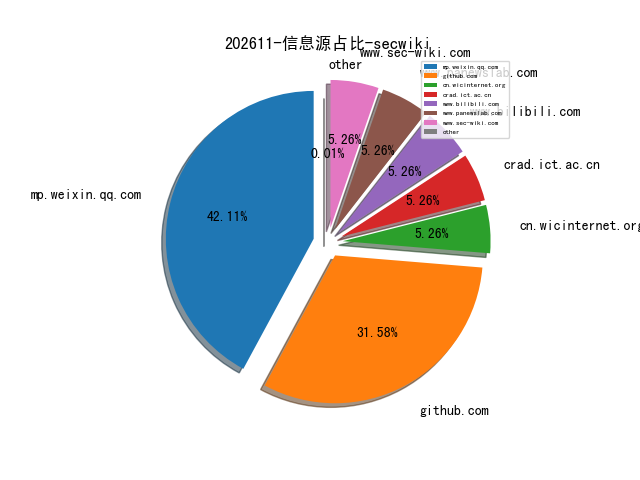
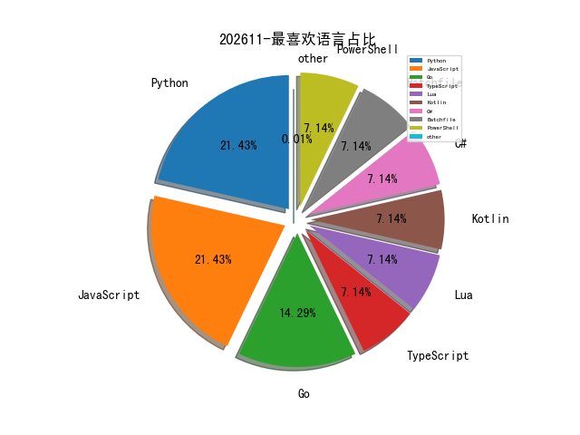

# [数据--所有](README_20.md)
# [数据--年度](README_2026.md)
# 202611 信息源与信息类型占比

# 网络安全书籍 推荐
| date_added | language | title | author | link | size| 
| --- | --- | --- | --- | --- | ---| 
| 2026-11-24 08:20:05 | English | Building Agentic AI Apps with Next.js and TypeScript | unknown | https://www.wowebook.org/building-agentic-ai-apps-with-next-js-and-typescript/ | unknown| 
| 2026-11-24 07:42:31 | English | The Agentic Engineer | unknown | https://www.wowebook.org/the-agentic-engineer/ | unknown| 
| 2026-11-22 15:04:12 | English | Integrating AI into Site Reliability Engineering | unknown | https://www.wowebook.org/integrating-ai-into-site-reliability-engineering/ | unknown| 
| 2026-11-22 14:20:49 | English | Security Operations Monitoring | unknown | https://www.wowebook.org/security-operations-monitoring/ | unknown| 
| 2026-11-22 11:37:55 | English | Data Quality Management with AI | unknown | https://www.wowebook.org/data-quality-management-with-ai/ | unknown| 
| 2026-11-22 10:53:22 | English | Hands-On Graph Neural Networks Using Python, 2nd Edition | unknown | https://www.wowebook.org/hands-on-graph-neural-networks-using-python-2nd-edition/ | unknown| 
| 2026-11-22 10:29:50 | English | Cybersecurity & AI Auditing | unknown | https://www.wowebook.org/cybersecurity-ai-auditing/ | unknown| 
| 2026-11-22 07:34:47 | English | Quantum Computing for AI with Python | unknown | https://www.wowebook.org/quantum-computing-for-ai-with-python/ | unknown| 
| 2026-11-22 07:15:08 | English | Python in Excel for Data Analytics | unknown | https://www.wowebook.org/python-in-excel-for-data-analytics/ | unknown| 
| 2026-11-19 16:59:04 | English | Agentic AI for Platform Engineering | unknown | https://www.wowebook.org/agentic-ai-for-platform-engineering-apress/ | unknown| 
| 2026-11-19 12:07:51 | English | CUDA for LLMs | unknown | https://www.wowebook.org/cuda-for-llms/ | unknown| 
| 2026-11-17 07:30:43 | English | Harness Patterns for Agentic AI with Claude Code and Hermes Agent | unknown | https://www.wowebook.org/harness-patterns-for-agentic-ai-with-claude-code-and-hermes-agent/ | unknown| 
| 2026-11-17 06:57:58 | English | The Mathematics of Large Language Models | unknown | https://www.wowebook.org/the-mathematics-of-large-language-models/ | unknown| 
| 2026-11-17 06:46:34 | English | Digital Defense Diaries | unknown | https://www.wowebook.org/digital-defense-diaries/ | unknown| 
| 2026-11-14 19:01:24 | English | Applied AI with LLMs | unknown | https://www.wowebook.org/applied-ai-with-llms/ | unknown| 
| 2026-11-14 12:04:14 | English | Leveraging Generative AI for Unity Game Development | unknown | https://www.wowebook.org/leveraging-generative-ai-for-unity-game-development/ | unknown| 
| 2026-11-14 19:23:55 | English | Building No-Code AI Agents | unknown | https://www.wowebook.org/building-no-code-ai-agents/ | unknown| 
| 2026-11-09 00:38:33 | English | The Technical Program Manager’s Guide to Practical AI | unknown | https://www.wowebook.org/the-technical-program-managers-guide-to-practical-ai/ | unknown| 
| 2026-11-09 00:26:43 | English | Building Agentic AI Systems, 2nd Edition | unknown | https://www.wowebook.org/building-agentic-ai-systems-2nd-edition/ | unknown| 
| 2026-11-09 00:07:25 | English | The Cybersecurity Executive’s First Year Playbook | unknown | https://www.wowebook.org/the-cybersecurity-executives-first-year-playbook/ | unknown| 
| 2026-11-09 08:17:01 | English | Build Production-Ready AI Agents with the Microsoft Stack | unknown | https://www.wowebook.org/build-production-ready-ai-agents-with-the-microsoft-stack/ | unknown| 
| 2026-11-09 01:27:42 | English | Practical MCP Security | unknown | https://www.wowebook.org/practical-mcp-security/ | unknown| 
| 2026-11-08 08:02:00 | English | Practical Agentic Coding | unknown | https://www.wowebook.org/practical-agentic-coding/ | unknown| 
| 2026-11-03 19:37:23 | English | Graph Engineering for Agentic AI Systems | unknown | https://www.wowebook.org/graph-engineering-for-agentic-ai-systems/ | unknown| 
| 2026-11-03 06:45:12 | English | Python for Engineers and Scientists | unknown | https://www.wowebook.org/python-for-engineers-and-scientists/ | unknown| 
| 2026-11-03 06:36:49 | English | Reinventing Enterprise with SAP Business AI | unknown | https://www.wowebook.org/reinventing-enterprise-with-sap-business-ai/ | unknown| 
| 2026-11-01 16:13:37 | English | Parametric and Generative Design with Rhino Python and Grasshopper | unknown | https://www.wowebook.org/parametric-and-generative-design-with-rhino-python-and-grasshopper/ | unknown| 
| 2026-11-01 15:52:32 | English | AI Risk Management for Financial Institutions | unknown | https://www.wowebook.org/ai-risk-management-for-financial-institutions/ | unknown| 
| 2026-11-01 15:22:49 | English | Agentic Architectures on Azure | unknown | https://www.wowebook.org/agentic-architectures-on-azure/ | unknown| 
| 2026-11-01 00:15:58 | English | Python for AI, Machine Learning, and Deep Learning | unknown | https://www.wowebook.org/python-for-ai-machine-learning-and-deep-learning/ | unknown| 

# 学习视频 推荐
| title | url| 
| --- | ---| 
| 为什么做研究、怎么做研究 | https://www.bilibili.com/video/BV1AX4t6REje/| 

# 微信公众号 推荐
| nickname_english | weixin_no | title | url| 
| --- | --- | --- | ---| 
| 360漏洞研究院 | 360漏洞研究院 360漏洞研究院 | 【已复现】GeoServer 认证前远程代码执行漏洞利用链 | https://mp.weixin.qq.com/s/zLMFOazsQKhTgL06xYbT0A | 5| 
| Oxo Security | Oxo Security Oxo Security | 插件与扫描：安装扫描器，跑一次并读结果 | https://mp.weixin.qq.com/s/k4ooLjTxyzfQyGu4Kne-ug | 1| 
| 倬其安 | Hash先生 Hash先生 | TLS1.3流量威胁检测解密方案浅析 | https://mp.weixin.qq.com/s/FIpnvNkeCTQfS8W8e965oA | 1| 
| 南棋子网络安全盟 | 南棋子 南棋子 | Fastjson 漏洞 | https://mp.weixin.qq.com/s/cj8-eW4Z9m_fLJqxGMlHJA | 2| 
| 君说安全 | JUN哥 JUN哥 | 网络安全行业，2025 年销售减员榜：前十家累计减少 1082 人 | https://mp.weixin.qq.com/s/67Ugg0mw3Q0jccAOkyeYVQ | 8| 
| 开源情报技术研究院 | 暗网分析师 暗网分析师 | 暗网泄露:[2026] atlasair.com 1.2TB 数据库 [包含波音数据] | https://mp.weixin.qq.com/s/xK1XYMh_FsisxMumBRkZjg | 6| 
| 昆仑AI安全实验室 | 昆仑AI安全实验室 昆仑AI安全实验室 | 你扫的是源代码，攻击者读的是你正在发布的那个字节——JS硬编码密钥的2026年真相 | https://mp.weixin.qq.com/s/i6OJXQWsps5ZQadWR3CfZA | 12| 
| 暗镜 | ZM ZM | VOLTA-AUTODOXER 样本分析 | https://mp.weixin.qq.com/s/NpIU2q2Ib2V1Rpg89Ysk_A | 10| 
| 杂杂咱谈 | tuto tuto | Broadcom发布VMware安全更新 VMSA-2026-0011: 一次性修复23个漏洞，4个Critical漏洞需紧急处理 | https://mp.weixin.qq.com/s/kDYYAjXWBqk4m44bSgC6Mg | 6| 
| 棉花糖fans | None | 【附exp】geoserver 未授权RCE！五个cve组合拳！ | https://mp.weixin.qq.com/s/5HuEQj3nB4dkduj0uP3u3w | 2| 
| 祺印说信安 |  | 等级保护建设：安全通信网络—通信传输 | https://mp.weixin.qq.com/s/M5w3Rhv-rRy13krSf5M9lw | 2| 
| 赛博57库 | 赛博57库 赛博57库 | NEBULA : 一个包含36 个攻击技法的学习框架 | https://mp.weixin.qq.com/s/6pATKR0ch6_-8qvWazgGiQ | 4| 
| 鹏组安全 | hello‑xiaoniao hello‑xiaoniao | 小程序渗透新玩法：AI动静结合自动挖洞，看完直接上手 | https://mp.weixin.qq.com/s/2xw5xPlquOo_f1G3wbAolQ | 1| 
| AGI安全 | None | Muse存在漏洞可导致聊天记录被黑客窃取！ | https://mp.weixin.qq.com/s/6GIcM3XoSm5dmMEthPwNgw | 2| 
| BlockSec | BlockSec BlockSec | BlockSec 亮相 2026 新加坡金融科技节，探讨 AI 时代下数字资产合规与支付安全 | https://mp.weixin.qq.com/s/awrot7-YYpqmBqgiOtOBBg | 3| 
| Delta Insights | Wind Wind | 网络安全动态 - 2026.11.24 | https://mp.weixin.qq.com/s/-ZMpEfuIPymO_J6VJmcFsA | 5| 
| FreeBuf |  | Node.js流行库simple-git爆严重漏洞，可导致远程代码执行 | https://mp.weixin.qq.com/s/S5VYp0qilKM2z0L7QhiiJw | 19| 
| GSDK安全团队 | GSDK GSDK | 离线不上传，敏感文档拖一下就转 - Filee | https://mp.weixin.qq.com/s/6k75DKu20NZJOy173HTMgQ | 6| 
| Hacking黑白红 | hacking hacking | 黄仁勋回归讲话细节！11日浮沉，躬身认错 | https://mp.weixin.qq.com/s/UdGflsUoAc9O84xfpuC9gQ | 14| 
| Hunter取证 | None | 【使用说明】零基础上手使用取证猎人DSH_9.1，展开人物关系、团伙关系、资金穿透、时空地图研判等研判任务 | https://mp.weixin.qq.com/s/a3lhyfgvyNxk1v_bSyXOzw | 6| 
| Hx0极客圈 | asaotomo asaotomo | 21.9% → 100% → 95%：把 13 份制度塞进 7B 模型的工程复盘 | https://mp.weixin.qq.com/s/XV3OuQszGIXHAIO8aRFfAg | 4| 
| ISC2网络安全 | ISC2 China ISC2 China | ISC2 AI安全学院助力网络安全从业者构建AI 安全技能 | https://mp.weixin.qq.com/s/MF4soECbHGeKMBtyc-U75g | 5| 
| IoT物联网技术 | . . | 开源，瑞芯微 RV1106 桌面 AI 助手，4寸触控屏、语音交互、Agent 状态实时同步 | https://mp.weixin.qq.com/s/lsaR4LWZM0xNi7IR-qNJSA | 4| 
| Kratos Sec | Kratos Kratos | 帆软 FineReport FVS 插件未授权 RCE 代码分析 | https://mp.weixin.qq.com/s/CgXGY1_ajQBL6_GkfSX9aw | 2| 
| M01N Team | 天元实验室 天元实验室 | AI安全案例分析｜近200万条提示词，竟被第三方窃取? | https://mp.weixin.qq.com/s/7nl21IhfYYreYU1NB2re_g | 1| 
| Ms08067安全实验室 |  | 公开课 , 大模型破甲（11.28） | https://mp.weixin.qq.com/s/7geRKzwEYH19y_LtXMui-A | 4| 
| Ncko | Ncko Ncko | 11月23日漏洞统计：203条，6条重点 | https://mp.weixin.qq.com/s/iQpMZezlgM9EkYMGl76YHw | 16| 
| One security | One One | AI赋能安全实战培训来了 | https://mp.weixin.qq.com/s/iWXd7IpK1mwuiUFqNhBvGw | 1| 
| OnionSec | jishuzhain jishuzhain | 为什么我们更喜欢“加”，而不是“乘”？ | https://mp.weixin.qq.com/s/VvuuJJ_bhH1gL0vIGTU_wA | 10| 
| Ots安全 |  | SSH漏洞：一个257字节的密码如何绕过Alpine Linux上的OpenSSH身份验证 | https://mp.weixin.qq.com/s/pewsk4ysYzIS4ppz89BE8A | 9| 
| SecWiki | 小编 小编 | SecWiki周刊（第664期） | https://mp.weixin.qq.com/s/gpMZeRoWnPo2lfwnIFTOOA | 1| 
| W小哥 | gatsby-sec gatsby-sec | 大模型攻防渗透测试靶场 | https://mp.weixin.qq.com/s/8Rl-QMgaiSOqycYMtl_sZA | 1| 
| YNsec安全实验室 | YNsec YNsec | 【一天一个nacos漏洞·第十七天】【高危】认证绕过 + 开放重定向：OIDC 登录链路两处缺陷 | https://mp.weixin.qq.com/s/u3o3Uxvov5-zFtotT5pzyg | 6| 
| wavecn | SenderSu SenderSu | 利用 AI Agent 执行逆向修补：善意使用并不能替代授权先行 | https://mp.weixin.qq.com/s/ew9iG1EZABsjg1rTuaXJIw | 1| 
| 中国信息安全 | 林卫国 林卫国 | 观点 , 增强生成式内容可信治理 | https://mp.weixin.qq.com/s/U52HonSxk7ZjyiZZl3PjFg | 25| 
| 中国软件评测中心 |  | 【总书记的人民情怀】“持续做大做强先进制造业 | https://mp.weixin.qq.com/s/Nzs4cFi5dCyqvenkZbW64Q | 4| 
| 中孚信息 | 中孚信息 中孚信息 | 直击无形窃泄密风险，中孚信息电磁空间安全体系首次发布 | https://mp.weixin.qq.com/s/UzMLOdMRXxkxFlnMF7A0tw | 6| 
| 中成信息 | 安全实验室 安全实验室 | 【已复现】漏洞通告 , Windows Remote Access API 本地权限提升漏洞(CVE-2026-119853) | https://mp.weixin.qq.com/s/qv-16brQHWdRqJkaE-1n-A | 4| 
| 中通安全应急响应中心 |  | 关于近期安全测试违规事件通报及测试红线重申 | https://mp.weixin.qq.com/s/M2RyU1vSEgB_JcU8RAs-hA | 1| 
| 云天网络空间安全 |  | 云天 · 安全通告（2026年11月24日） | https://mp.weixin.qq.com/s/64P37qfaXpzQ8wSHNbSkBg | 3| 
| 交大捷普 |  | 基础安全产品系列 , 捷普 IDS/IPS系统 | https://mp.weixin.qq.com/s/cbd2WnTAKEB1JIN4TFTKPA | 6| 
| 代码卫士 | Sergiu Gatlan Sergiu Gatlan | CISA：这个思科 RCE 漏洞已遭活跃利用 | https://mp.weixin.qq.com/s/yNZxsGNYPLoowXCpBCEOZw | 12| 
| 企业安全实践 | 企业安全实践 企业安全实践 | 勒索事件日报：2026年-11月-23日 | https://mp.weixin.qq.com/s/Zz8dbVJhQAD5lQbVPKt4dA | 9| 
| 众智维安 |  | 权威图谱再添新证！众智维科技入选CCIA《2026年中国网络安全企业AI能力应用图谱》 | https://mp.weixin.qq.com/s/M9pNqQs5UodTRGuXk5cWZQ | 12| 
| 信息安全国家工程研究中心 | 工信微报 工信微报 | 关注 , 虎扑、懂球帝……工信部通报23款侵害用户权益行为APP及SDK | https://mp.weixin.qq.com/s/9UtRc83Qgm9aDe3lWIPQuQ | 5| 
| 信息安全研究 |  | 科技｜MiniMax 公布内部模型密码分析成果，探索 AI4S 前沿密码学问题 | https://mp.weixin.qq.com/s/lNpZCHzdRISW2pv0gylxXA | 11| 
| 全球技术地图 |  | Anthropic发布：前沿模型网络安全事件的对齐评估和治理启示 | https://mp.weixin.qq.com/s/A6oYMEwP51zTGAbHeyZHCA | 12| 
| 公安部网安局 |  | 净网专项行动 , 公安部网安局公布2026年度使用AI工具编造传播网络谣言10起典型案例 | https://mp.weixin.qq.com/s/Iw6IzLTu-YYMl824BZxSoA | 8| 
| 兰花豆说网络安全 | 承影 承影 | 黑客发来一封\"通知邮件\"，韩国电力巨头才知道：150万人的银行卡，已经被打包 | https://mp.weixin.qq.com/s/xCdcSqX3yX4A9J387nfQwA | 4| 
| 内生安全联盟 |  | 中国科学院院士鄂维南xa0中国科学院院士王建宇：AI时代我们需要什么样的科研人才 | https://mp.weixin.qq.com/s/azgDSSvGTKN2p90XKNUAXA | 14| 
| 剁椒Muyou鱼头 | 剁椒Muyou鱼头 剁椒Muyou鱼头 | 【漏洞预警】卡车卫星定位系统命令执行漏洞 | https://mp.weixin.qq.com/s/lbxXL2c4xWm8xselJYqWjA | 1| 
| 北京张量无限 | 张量无限 张量无限 | 原木智能检尺全面升级：无畏 -45℃ 极寒，作业效率翻倍，数据实时上云 | https://mp.weixin.qq.com/s/GicYNxge8AKjt6rAjdtevA | 1| 
| 北京磐石安科技有限公司 | 小磐 小磐 | 五个阶段，每个阶段都有明确任务 | https://mp.weixin.qq.com/s/WWaN_t7_O6PHVSS1vZdgDQ | 1| 
| 升斗安全 | 升斗安全XiuXiu 升斗安全XiuXiu | 把请求压进 0.7 毫秒，验证码就拦不住了 | https://mp.weixin.qq.com/s/jSmusvafqqGWSYam7nMPiw | 6| 
| 卫界安全-阿呆攻防 |  | Agent渗透测试时的-省钱小技巧 | https://mp.weixin.qq.com/s/TqsdgGVM_c5AYkLw57_Z4Q | 2| 
| 句芒安全实验室 | 句芒安全实验室 句芒安全实验室 | 「Krawl蜜罐+AI爬虫+开源实测：3105条YARA规则让大模型现编假后台」 | https://mp.weixin.qq.com/s/udzWVW_YVlee9e9LTy8paw | 5| 
| 只会看监控的实习生 | 菜狗 菜狗 | 有人投简历？ | https://mp.weixin.qq.com/s/2PCoTYAjvNSq4-jwlRCwdw | 3| 
| 启明星辰安全简讯 |  | 【漏洞通告】Spring Data Elasticsearch SpEL表达式注入漏洞（CVE-2026-123886） | https://mp.weixin.qq.com/s/wRlLLYI7h1EGSDQ1eOdg9w | 8| 
| 启明星辰集团 |  | 网络安全软件市场8项技术领域推荐厂商！ | https://mp.weixin.qq.com/s/UU7cuCMCd_x4t-YgZr8nMg | 4| 
| 哆啦安全 | CCMS CCMS | Android iOS HarmonyOS , 移动设备取证系统V3.0 | https://mp.weixin.qq.com/s/PzzbSu6KYN3mSy1lva7Uow | 3| 
| 国家互联网应急中心CNCERT |  | CNVD漏洞周报2026年第46期 | https://mp.weixin.qq.com/s/DcE4zNCQ9LesmwXCOZc3bQ | 2| 
| 国家网络安全通报中心 |  | 国家计算机病毒应急处理中心检测发现86款违法违规收集使用个人信息的移动应用 | https://mp.weixin.qq.com/s/BFqCrAnaysL723w95JAxnw | 1| 
| 复旦白泽战队 | 复旦白泽战队 复旦白泽战队 | 人物访谈｜黄元敏：立足真实场景，追求学术研究落地价值 | https://mp.weixin.qq.com/s/Np6ePdjy7i5ExHk7dqjCCA | 1| 
| 天威诚信 | 数字信任云服务商 数字信任云服务商 | 某股份制银行SSL自动化实践｜从\"人找证书\"到\"证书找人\" | https://mp.weixin.qq.com/s/_FeUiPxTeP0kD6KJRzmQiA | 3| 
| 天融信 | None | 首批+最高等级！天融信终端安全AIDR率先获智能体安全认证 | https://mp.weixin.qq.com/s/Ha1xsargDMBz9X9fwXz5TA | 10| 
| 奇安信 CERT |  | 【已复现】帆软 FineReport FineVis（FVS）插件未授权远程代码执行漏洞(QVD-2026-115643)安全风险通告 | https://mp.weixin.qq.com/s/4DXlPVgT6C-jXpjSI8HGUQ | 8| 
| 奇安信集团 |  | 奇安信与重庆高新区管委会签署战略合作协议 | https://mp.weixin.qq.com/s/HQpiiuHt8Vz75-AD88eAzQ | 13| 
| 安世加 |  | 出海安全日报，11月24日 | https://mp.weixin.qq.com/s/VL7N2e1B_8UDLzVZcUhNEg | 6| 
| 安信天行 |  | AI自适应攻防演练：重塑政企安全实战新模式 | https://mp.weixin.qq.com/s/Z3DMzlQ-nYoHdgpSssroXA | 3| 
| 安全419 | 安全419 安全419 | 安全419甲方精品采购指南 , 当\"非人\"访问占满日志：无胁科技Web-ITDR 3.0的身份安全新解法 | https://mp.weixin.qq.com/s/DEKvTVY-SnIKQ2yVu6wiaA | 5| 
| 安全内参 |  | CNCERT：关于远控类僵尸网络家族Cling新变种大范围传播的风险提示 | https://mp.weixin.qq.com/s/FhXBq7t24YkXJVCf5WkVhQ | 8| 
| 安全圈 | 安全圈 安全圈 | 【安全圈】OpenAI与思科推Shirudo：AI写eBPF实现零停机热阻断 | https://mp.weixin.qq.com/s/ZA33GrfkXNARGU8LJ4EtLA | 18| 
| 安全圈的那点事儿 | 网络安全9527 网络安全9527 | 6 个 WordPress 插件内置严重后门：黑客无需登录即可执行命令 | https://mp.weixin.qq.com/s/AttLHkmYk_JuPDbppjdkKA | 8| 
| 安全天书 | Hello888 Hello888 | 浏览器密码导出-360篇 | https://mp.weixin.qq.com/s/9lPd-KmZLGyolUMcR04Reg | 3| 
| 安全学习那些事儿 |  | 法国体育用品零售商Decathlon数据泄露 超13.7万名客户邮箱或受影响 | https://mp.weixin.qq.com/s/tKMQV_KTJp-ToTTmob8h7w | 16| 
| 安全牛 |  | 黄仁勋重返NVIDIA CEO岗位，国家安全调查尚未结束；谷歌观测首例全自主AI网络攻击，安全攻防已跨过关键能力门槛, 牛览 | https://mp.weixin.qq.com/s/thLcwhHQBfI3ZaTvHEMLpg | 16| 
| 安博通 | 安博通 安博通 | APEC之后再看算力：安全正在从“配套”走向“内生” | https://mp.weixin.qq.com/s/v9DATUKMGEgfuAONA8H8TA | 2| 
| 小瑶在工地 |  | 今日速递｜BCD 只读枚举也会触发 UEFI 固件同步、Frida 17.27.5 修好 Windows 线程句柄泄漏、Ghostscript 沙箱逃逸经文件上传打到服务器 | https://mp.weixin.qq.com/s/YbsV-NYniazmqBkV0g4zUg | 6| 
| 小白安全成长记 | 小白哥 小白哥 | 古法渗透测试之403绕过技巧 | https://mp.weixin.qq.com/s/ke-dMM_1rrFHCPiIDMOF8w | 5| 
| 小红书技术REDtech | REDtech REDtech | 拆解小红书存储底座 08｜RedKV Proxy 性能优化实战 | https://mp.weixin.qq.com/s/oq3tDxarsJ2JLcB1qSBzOQ | 4| 
| 山石网科新视界 | 山石网科 山石网科 | 从芯片到数据｜山石网科亮相2026电力行业信息化年会 | https://mp.weixin.qq.com/s/N1Z-USCJHKc34YDr_mKiuQ | 11| 
| 弥天安全实验室 | 峰哥说安全 峰哥说安全 | 只要肯烧Token,没有挖不穿的企业 | https://mp.weixin.qq.com/s/uDAC0HDzDnQ_EqFM5ZmoFg | 3| 
| 微步在线研究响应中心 |  | 原创漏洞 , VMware vCenter Server 未授权管理员用户创建漏洞 | https://mp.weixin.qq.com/s/jkjqyaXmwlAi2LBNhnoAeA | 4| 
| 挽风安全 | 挽风 挽风 | 加密随机 IV 如何热加载重写加密照常爆破 | https://mp.weixin.qq.com/s/LXkdMnh22EGWIKhzpBQbkw | 3| 
| 掌控安全EDU | zkaq-flysheep zkaq-flysheep | 利用邮箱漏洞寻找突破口打穿目标内网 | https://mp.weixin.qq.com/s/tKi7ag9kJFy_rSTarurK8g | 6| 
| 数世咨询 |  | 439亿美元！CrowdStrike 拟收购 Zscaler，刷新全球网络安全并购纪录 | https://mp.weixin.qq.com/s/-Y956VxwhURvCzPFGKklRA | 9| 
| 新蜂网络安全实验室 | 彭瑞 彭瑞 | cookie_secure缺失漏洞实验 | https://mp.weixin.qq.com/s/pN9viibCUo5LW32uxB54gw | 1| 
| 星宇Sec | 佚名 佚名 | 【风险提醒】躺平CTF平台负责人疑似存在欺诈行为 | https://mp.weixin.qq.com/s/B6ipTjOyh70v7Lcha0_AFQ | 8| 
| 梆梆安全 | 梆梆安全 梆梆安全 | 国家计算机病毒应急处理中心通报86款违规应用，教育、医疗、出行等多类App信息共享与授权问题值得关注 | https://mp.weixin.qq.com/s/SW4BlHdM804iz0w089GY1Q | 6| 
| 梓陌说科技 |  | 橘子 7 第三批公测机型解析｜23款机型名单与功能变化要点 | https://mp.weixin.qq.com/s/3VPkvL4JUSW4xywBXBlouw | 12| 
| 正在思考ing | 正在思考ing 正在思考ing | 2026 一带一路暨金砖国家技能发展与技术创新大赛之网络安全防护治理实战技能赛项（华东赛区）选拔赛 | https://mp.weixin.qq.com/s/8GhqbbcnimIalkdFci1BnQ | 1| 
| 武汉网络安全 |  | 理事动态 , 国家电网第四批次集采调度类软件100%中标，全年中标率超98%！ | https://mp.weixin.qq.com/s/G6lmfmyS7YuAWAhx_rLG3A | 15| 
| 沧海讲安全 |  | 漏洞挖掘实战：从月入几百到几万，我的 SRC 掘金之路 | https://mp.weixin.qq.com/s/OSLUGZgH2U-UvkuGAM-sUA | 2| 
| 泷羽Sec | 仙草里没有草噜丶 仙草里没有草噜丶 | 近期0day复现到 ARTEX 自动化攻击测试，这款WAF神了 | https://mp.weixin.qq.com/s/kPAkeGK7cR_7v9_1ZLqhvQ | 1| 
| 浩凯信安 | 浩凯Security 浩凯Security | Agent渗透测试时的-省钱小技巧 | https://mp.weixin.qq.com/s/CfYaWGsa7nOIKp5JvAF0eg | 1| 
| 渊亭科技 |  | 深度报告丨Palantir全景动态本体技术研究报告：动态本体与同类技术对比（第六章） | https://mp.weixin.qq.com/s/lmJ8pWzf4XDfk75yX8xXqg | 2| 
| 渊亭防务 | 渊亭防务 渊亭防务 | 深度报告丨Palantir全景动态本体技术研究报告：动态本体与同类技术对比（第六章） | https://mp.weixin.qq.com/s/q9VPeybBvmc0xBmzx1ISSg | 8| 
| 源影安全团队 | 易富贤 易富贤 | 【已复现】CVE-2026-123903 VMware vCenter Server 389端口该未授权管理员创建漏洞 | https://mp.weixin.qq.com/s/LzAy5IJA-IlQs_PHylMb7w | 2| 
| 独眼情报 | 🅰🅸 🅰🅸 | 南京大学斥资3000万元部署AI监控系统 | https://mp.weixin.qq.com/s/joRSmhNwRSYxtWdayf6OyA | 11| 
| 猫头鹰OSINT | Owllntel Owllntel | 邮箱、泄露数据与Telegram记录，如何拼出“麒麟”幕后人物？ | https://mp.weixin.qq.com/s/AzC1QSwyWeK_3U-ru9yMQQ | 3| 
| 王二狗的it日记 | 王二狗的 it 日记 王二狗的 it 日记 | 企业路由系统推荐 | https://mp.weixin.qq.com/s/qb5gsuWNu1SCjJoYK9cMxw | 2| 
| 白帽子罗棋琛 | Max Luo Max Luo | 交易所安全架构01｜客户身份与账户访问 | https://mp.weixin.qq.com/s/ifbKdc64lQwIc9j3Q4Ov4A | 3| 
| 白帽少年 | AlanHR AlanHR | 【安全运营】SIEM 规则建设 | https://mp.weixin.qq.com/s/VNa899ma6iRp9I_Ysy6YOA | 2| 
| 白泽安全实验室 | BaizeSec BaizeSec | 法国黑客利用AI智能体开展“AI增强型”网络攻击活动 | https://mp.weixin.qq.com/s/dkFrCXZpOtb-mhcBiyhqgA | 2| 
| 看雪学苑 | 看雪课程 看雪课程 | 『本周更新2节』冰与火的战歌：Windows内核攻防实战 | https://mp.weixin.qq.com/s/lMFTfcIphEX9f5K_3TZApw | 18| 
| 知攻善防实验室 | ChinaRan404 ChinaRan404 | 大洞速修！GeoServer RCE 漏洞！ | https://mp.weixin.qq.com/s/yzagzLrLlerbda6l2Q0VPA | 4| 
| 秦安战略 | 秦安战略 秦安战略 | 秦安：民主党人也是拼了，动用所有权力调查黄仁勋，特朗普也躲不了 | https://mp.weixin.qq.com/s/hWc8NpOx7W5iBsHKthcZEQ | 29| 
| 红队安全圈 | 红队安全圈 红队安全圈 | 6款WordPress插件藏后门，能远程写shell CVE-2026-135202 | https://mp.weixin.qq.com/s/oDAejSiqYcgDG1N4oC-osw | 6| 
| 绿盟科技 |  | 关于远控类僵尸网络家族Cling新变种大范围传播的风险提示 | https://mp.weixin.qq.com/s/evZ9pVgU1aeoXbH1OgsKHQ | 9| 
| 网络安全和信息化 |  | 公安部网安局公布2026年度使用AI工具编造传播网络谣言10起典型案例 | https://mp.weixin.qq.com/s/uJxx77umNqn9XR6rrbMY0w | 14| 
| 网络安全直通车 | guowei guowei | 智算中心（AIDC）  清单 | https://mp.weixin.qq.com/s/RLnLpbvjWjdeOH0DVWUNkw | 12| 
| 网络安全透视镜 | 网络安全透视镜 网络安全透视镜 | 【速修】GeoServer 未授权远程代码执行漏洞(含POC) | https://mp.weixin.qq.com/s/c3Jg0ZhMH2ceFFvorvf_Qg | 13| 
| 网络空间信息安全学习 |  | 在 iPad 上运行安卓系统！火爆全网的 Andarium 体验怎么样？ | https://mp.weixin.qq.com/s/1vbhUV9z2K51DFShnQo4Qg | 1| 
| 老皮的碎碎念念 |  | 26数证杯初赛-服务器wp | https://mp.weixin.qq.com/s/Semp9Y_DJG9Q051vAb3veA | 2| 
| 聚铭网络 |  | 聚铭网络荣获《一种基于密码学累加器的行为异常检测方法及相关设备》发明专利 | https://mp.weixin.qq.com/s/7bV2jX81d7Io46HEbUxECA | 3| 
| 腾讯安全应急响应中心 | 腾讯悟空代码安全 腾讯悟空代码安全 | 漏洞膨胀的真相：4 万条告警为什么只留下 250 条 | https://mp.weixin.qq.com/s/31dS1Gq60g7tFtqFwYxLkw | 2| 
| 菜根网络安全杂谈 | Caigensec Caigensec | 网络安全行业欢迎每一位有志者 | https://mp.weixin.qq.com/s/0j2tF9kXq0wTeXPpq_Ep8g | 5| 
| 蚁景网安 |  | MCPHub 高危漏洞实录：零凭证访问与授权后命令执行 | https://mp.weixin.qq.com/s/nMIaNT3aG6Am24M_UskOMg | 4| 
| 表哥带我 | 泼猴 泼猴 | 美股半导体股深夜暴跌 | https://mp.weixin.qq.com/s/26jD93YuHzfMNJHNH9RXeA | 15| 
| 观安信息 |  | 观安参编｜《智能体安全护栏能力要求》正式发布，筑牢智能体全链路安全底座 | https://mp.weixin.qq.com/s/82gfBWfzSq-6bthlbogs3Q | 3| 
| 谈思实验室 |  | 从 QUNIX 到 QNX：一家加拿大公司卖的到底是什么 | https://mp.weixin.qq.com/s/91bzNcTHLISmf3256i_o0w | 20| 
| 谷安培训 | Aaron Aaron | AgenticPenTest v1.1.7 更新：Agent 编排、证据联动与升级修复 | https://mp.weixin.qq.com/s/9uY1GoKLL65l6JmB7u5xRw | 8| 
| 贝爷讲攻防 | WorkBuddy小助手 WorkBuddy小助手 | 当年看不懂抖音的人，现在又看不懂WorkBuddy了 | https://mp.weixin.qq.com/s/2yCHfkUB2CKG6_E8eVPwzQ | 5| 
| 赛博生存指南 | Unit 42 Unit 42 | 打电话偷数据：Com 系钓鱼团伙的高调窃案，与伪装成 Chrome 的扩展 C2 | https://mp.weixin.qq.com/s/cDUA0O2d2_0cQ7OnomIAyA | 6| 
| 赛博研究院 | 赛博研究院 赛博研究院 | 特朗普力挺黄仁勋复职，美国离不开 AI ！ | https://mp.weixin.qq.com/s/kgbBJMbaZABWSaMMaJ5Wew | 7| 
| 赛查查 |  | 2026数证杯初赛wp(无人机方向) | https://mp.weixin.qq.com/s/XDw12pSrTSgDHWA3o5Axfg | 48| 
| 迷雾光航 | 流岁金沙 流岁金沙 | APP渗透测试之基础环境配置 | https://mp.weixin.qq.com/s/i2gYi3UckCxHUGxGkpG_RA | 1| 
| 野猪与安全 | 耶度 耶度 | 展厅电子屏已全面失守，传统“接了网就能播”的布展思维彻底失效 | https://mp.weixin.qq.com/s/CcZj6jH8hOQINitvSLkkFg | 1| 
| 长亭安全应急响应中心 |  | 【已复现】GeoServer 未认证远程代码执行漏洞（CVE-2026-129242 等 5 个 CVE） | https://mp.weixin.qq.com/s/8t8s8R-u2iDTS3UnoFLyIA | 3| 
| 长亭安全观察 | 夺旗猫 夺旗猫 | 用 AI 做代码审计，长亭送你一套完整落地方案！ | https://mp.weixin.qq.com/s/wY1YoZh2KYE4nkkjsPg6Fg | 4| 
| 长城杯网数智安全大赛 |  | 中国信息安全测评中心授权澳门科技大学成为澳门首家CISP培训机构 | https://mp.weixin.qq.com/s/8h-3mKhLY-qa1G8mvi4Gag | 1| 
| 阿里安全响应中心 |  | 团队招聘｜云产品安全保障专家（资产与供应链） | https://mp.weixin.qq.com/s/vNke62KFuyRJBuP1x0ymUw | 1| 
| 青藤云安全 | 青藤AI观察室 青藤AI观察室 | Gartner：补丁打得快，是个虚荣指标 | https://mp.weixin.qq.com/s/VM_j0HZfree32qAelgNYoQ | 3| 
| 顺丰安全应急响应中心 |  | 关于 SFSRC 平台恢复收录、V7.0 规则施行及测试报备要求的公告 | https://mp.weixin.qq.com/s/T4c5TodfMmZoEAW6Js7mOw | 1| 
| 飓风网络安全 |  | 【高危漏洞预警】GeoServer未认证远程代码执行漏洞链（CVE-2026-129242 等 5 个 漏洞） | https://mp.weixin.qq.com/s/CdlrAdsnyqxDLsMs7fHz_A | 1| 
| 飞天诚信 | 飞天诚信 飞天诚信 | 又上电视啦！BRTV《特别关注》采访飞天诚信 | https://mp.weixin.qq.com/s/k0n5Yc-T3AU1hUIXcKEBSA | 4| 
| 马哥网络安全 | 点击关注👉 点击关注👉 | 算法岗收缩，机会在哪？一篇带你看懂 AI 时代岗位地图 | https://mp.weixin.qq.com/s/S-X_vh0TwLnhO3ccimbr-g | 9| 
| 黑客技术与网络安全 | 权限提升中 权限提升中 | AI已经变成一场秀，谁拿了AI项目意味着高绩效，然后全团队帮这个人想AI咋做，给太子陪读的即视感！ | https://mp.weixin.qq.com/s/JPJcBg9LhQlni_uTAWkyFA | 4| 
| 黑客技术家园 | 黑客技术家园 黑客技术家园 | 普通人如何学习C语言 | https://mp.weixin.qq.com/s/iH4yMf1BeYVPI2qwUSWR5A | 1| 
| 黑鸟 | 黑鸟 黑鸟 | 无需反汇编器，AI 或已具备读懂机器码的能力 | https://mp.weixin.qq.com/s/XyJUfmpnMC_SzE8dTuBpRg | 4| 
| 306Safe | ladon ladon | 马斯克把“GTA”装进特斯拉：FSD V15 推送 | https://mp.weixin.qq.com/s/cn_Xsloya3DCOmXRrgkjDQ | 2| 
| AI安全推进计划 |  | 为什么每个权限都「最小」，Agent 依然可以删库、外泄与提权——权限的组合效应 | https://mp.weixin.qq.com/s/jAFaarNl8n7HBYZFhGpbUg | 4| 
| Aaron与安全的那些事 | Aaron Aaron | AgenticPenTest v1.1.7 更新：Agent 编排、证据联动与升级修复 | https://mp.weixin.qq.com/s/BhkGyJVKHf6mJviI_t4VuA | 2| 
| C4安全 | youki youki | 多 Agent 协作扫描 - AI代码审计与漏洞挖掘平台 | https://mp.weixin.qq.com/s/pC0RooQCjnEBcZYVPahQRQ | 2| 
| Coder小Q | Litt1eQ Litt1eQ | 【杂谈】AI 生成的文字，水印藏在哪儿？ | https://mp.weixin.qq.com/s/zO3vmW8Ya-jg7zrT6KFzFw | 2| 
| CppGuide |  | 永久密钥：DLEI5-8NOEQ-PXK2Z-SOJLA-UM9CY | https://mp.weixin.qq.com/s/FlEa_8_Qv0A1oMsovrsCmA | 2| 
| E安全 |  | FBI 核心执法数据库NCIC疑遭入侵，影响范围尚不清楚 | https://mp.weixin.qq.com/s/93K4W7QIXTYAI1hV97NO3A | 1| 
| GTG网络安全实验室 | GTG-Hardy GTG-Hardy | AI法案合规第一步：一张判定清单，分清你的产品到底是不是AI系统 | https://mp.weixin.qq.com/s/nZDYh74FUWBbZ-ZCX-KfiQ | 3| 
| Ghost Wolf Lab | Ghost Wolf Lab Ghost Wolf Lab | Ed25519可塑性 | https://mp.weixin.qq.com/s/2PtSU0A0pXq7oB00p3nDjg | 1| 
| HACK之道 | Jaysen13 Jaysen13 | Burp微信小程序渗透测试利器 | https://mp.weixin.qq.com/s/CS1kFZvGYklzjbKMX4oDWA | 4| 
| Hack分享吧 | dollmarker dollmarker | 从敏感文档到组件指纹——这款Chrome插件让教育SRC猎洞效率翻倍 | https://mp.weixin.qq.com/s/pSS-0FuQcvW9Gng4dK-NSw | 1| 
| Nday Poc | None | H3C ER8300G2路由器 信息泄露漏洞 | https://mp.weixin.qq.com/s/-VNwfkSKxDmm5aC2fSLjIQ | 4| 
| kali笔记 | 大表哥吆 大表哥吆 | 还在用NC转发端口?试试 Socat 吧 | https://mp.weixin.qq.com/s/O_Kj5uxQBjBY7yRq6gNaHA | 4| 
| ljnljn学习之路 | ljnljn ljnljn | 2026美亚杯团体赛wp参与成员 | https://mp.weixin.qq.com/s/36S3o5MkcnKRu9V7FAngmQ | 2| 
| night安全 | YGnight YGnight | 【漏洞预警】PHP爆出时区缓存释放后使用RCE(POC已公开)CVE-2026-129496 | https://mp.weixin.qq.com/s/ypMOe4bQeJ8urUTv17CWtg | 3| 
| sec随谈 | sec随谈 sec随谈 | Mongoose 堆溢出远程代码执行漏洞已在 7.24 中修复 | https://mp.weixin.qq.com/s/6-0dXOcUwab8ru58xfVdZw | 4| 
| 一己之见安全团队 | 这小子嘴硬 这小子嘴硬 | 采访篇——“偏远地区”安全岗位人 | https://mp.weixin.qq.com/s/oneun0ibn1NdSAK-qBA-yg | 1| 
| 丁爸 情报分析师的工具箱 | 丁爸 丁爸 | 【资料】情报研究指南 | https://mp.weixin.qq.com/s/U65ZAhQrS1Hx11B9ZMIz6w | 11| 
| 乌雲安全 |  | 【已复现】nginx 多个远程代码执行漏洞（nginx2root） | https://mp.weixin.qq.com/s/tjcIF5J5_z76-V9LaYzsfA | 5| 
| 卡巴斯基威胁情报 | 卡巴斯基 卡巴斯基 | KICS for Networks 5.0 中的 MLEP：机器学习如何助力监控工控设备的网络行为 | https://mp.weixin.qq.com/s/mmgLtvyjxIYTupiS1MR7Nw | 2| 
| 围巢安全笔记 | 围巢安全笔记 围巢安全笔记 | CMS漏洞-后台那个上传按钮比前台所有洞都值钱 | https://mp.weixin.qq.com/s/QN9k9SY4uAjeDOSWi93K4Q | 5| 
| 夜组OSINT | NightTeam NightTeam | 跨国国防和航空航天供应链\"180TB\"数据泄露 | https://mp.weixin.qq.com/s/o-l2BYIYjN0vQz8AK3NqOg | 2| 
| 天懋信息 |  | 主动安全监管护航 , 天懋信息圆满完成APEC会议重保支撑任务！ | https://mp.weixin.qq.com/s/N3g-jyN4Q__U2lFk0U_PQQ | 2| 
| 天际友盟 | 天际友盟 天际友盟 | [1123] 一周重点情报汇总｜天际友盟情报站 | https://mp.weixin.qq.com/s/WnOIXKs9Wm_25fDS7qK08A | 3| 
| 威努特安全网络 | 李豪 李豪 | 私有云超融合平台从0到1建设指南：实施要点与避坑清单 | https://mp.weixin.qq.com/s/rjz_3kJKC9-nV4wSenMsxg | 3| 
| 安全喵喵站 | 斯元 Z-ONE 斯元 Z-ONE | 泰国倒计时！网安出海 2027｜从Cybersec Aisa 2027，开启CLMVT和亚太市场 | https://mp.weixin.qq.com/s/JqKHKTssDvqPEyrLxmWqdw | 4| 
| 安全圈动向 | Kit Chung Kit Chung | 无认证 RCE 风险！深度拆解 F5 BIG-IP 今日 6 大 9.8 分高危漏洞：从 TMM 内核崩溃到云原生 CNF 排查全攻略 | https://mp.weixin.qq.com/s/4ehJxux8zMn71HakgmJ86Q | 3| 
| 安全客 | 欢迎关注→ 欢迎关注→ | 全球第九的超算被黑，丢的是 4224 把 SSH 私钥 | https://mp.weixin.qq.com/s/6UcY3AXwCZhWuhzHoLFkTg | 4| 
| 安全诸子 | 陈看山 陈看山 | 一个被遗忘4年的账号，10分钟撬开云端：AI黑客ARTEX如何逼停Bitrise？ | https://mp.weixin.qq.com/s/bM5AvlZX6WRt-zT1xd_s0Q | 8| 
| 安恒信息 |  | 《中国信息安全》：Mythos类模型对网络安全的系统性冲击与防御范式重构 | https://mp.weixin.qq.com/s/rtLz6LqK6nT2vQRkpq51Rw | 12| 
| 实战安全研究 |  | 漏洞复现 , 用友NC expertschedule 存在SQL注入漏洞 | https://mp.weixin.qq.com/s/MlbBQEkechPep2Ene-4A7A | 6| 
| 山水SRC | 山水SRC 山水SRC | 前端 CSS 类禁用绕过漏洞 | https://mp.weixin.qq.com/s/oNmUuq5p4ro37g3NaHsCzQ | 5| 
| 州弟学安全 | 爱州 爱州 | 反诈实录｜记一次渗透诈骗平台，又要有缅北人员挨电棒了 | https://mp.weixin.qq.com/s/0iVng3nItBOkI1o5GRcrTQ | 2| 
| 开源网安 |  | 软件安全开发综合实践结课回顾 | https://mp.weixin.qq.com/s/qD-aSfUb6QyoxNwK_TXhkQ | 1| 
| 微步在线 |  | FBI WARNING , ARTEX被美FBI列为重点威胁 | https://mp.weixin.qq.com/s/qzhfbXXvYyorZs6p4neAMw | 4| 
| 我的安全视界观 | aerfa21 aerfa21 | AI渗透：没拿到 shell，数据面反而更值钱 | https://mp.weixin.qq.com/s/Y8HjrEp2Rk7h12PO7OttoA | 3| 
| 星辰之雪 | 禹司凤 禹司凤 | 三令五申，让Ai接管！！ | https://mp.weixin.qq.com/s/zvT6XEEdxxuPRpLNvnQDhw | 2| 
| 李白你好 | 助力行业的 助力行业的 | 暗网泄露：GTA 6 PC版“限量访问”，15刀即可下载PC端游戏进行别样体验 | https://mp.weixin.qq.com/s/E_t6wkalSDNe4JE5Xq53dA | 3| 
| 极客零零七 | 极客零零七 极客零零七 | 《网络安全周报：第20261122期》 | https://mp.weixin.qq.com/s/BiWhOjuawo9h3ZMv8qlj5A | 3| 
| 棉花糖网络安全工具箱 | 棉花糖糖糖 棉花糖糖糖 | JNDI-Injection-Exploit：一条命令拉起 RMI、LDAP、HTTP 三台服务器，JNDI 注入验证从此变成一条链接的事 | https://mp.weixin.qq.com/s/t_K-K239yCXH9CABnf5cHw | 6| 
| 永信至诚 |  | 永信至诚发布「观微台」业务系统上线安全检查平台，限时开放50个AI红队体检名额，邀您内测 | https://mp.weixin.qq.com/s/xyla-z9mAVyaUucNLZrflg | 3| 
| 汇能云安全 |  | OpenRouter 第三方推理服务商遭入侵，数万用户 AI 提示词遭到窃取 | https://mp.weixin.qq.com/s/BazhK15Vbk5kUU6FAETfng | 2| 
| 浅安安全 | 浅安 浅安 | 工具 , shannon | https://mp.weixin.qq.com/s/U3Nox29_JdIEr58JozsAiQ | 9| 
| 渗透安全HackTwo | 星川 星川 | 日记里三个密码，只有一个是真的——数证杯围标案全链路取证复盘 | https://mp.weixin.qq.com/s/4Ustf4PN4hTcpRfwkDyYrQ | 5| 
| 漏洞与事件追踪 |  | 网安周报：没有人按回车，也没有人发现 | https://mp.weixin.qq.com/s/-ReeEPdvP-w5p8xhGZu-KA | 4| 
| 潇湘信安 | Zach Hanley Zach Hanley | 一条请求拿下SYSTEM权限：AhsayCBS CVE-2026-105133/105134技术拆解 | https://mp.weixin.qq.com/s/9l30030CnnnvAA3aDRqihg | 2| 
| 炼石网络CipherGateway | 数据安全建设就找 数据安全建设就找 | 速下载！100页图解《重要数据识别目录(征)》系列国标 | https://mp.weixin.qq.com/s/CIWg9uwBqZicHXG_91CNMQ | 2| 
| 熔城Sec | devildollking devildollking | 用 Marvis 自动翻页采集 + 批量查权重 | https://mp.weixin.qq.com/s/sX7DHvlRBp9Av5wiRl64Iw | 3| 
| 爱拍照的老李 | 爱拍照的老李 爱拍照的老李 | 攻击者的AI代理在医疗影像软件中发现零日漏洞并获得根权限 | https://mp.weixin.qq.com/s/XY7GHzn-jq1x_jiMK8afQQ | 8| 
| 犀牛安全 | Rhinoer Rhinoer | 黑客利用NoisyTCP 的新漏洞可导致 Linux 服务器内核崩溃 | https://mp.weixin.qq.com/s/13X6Mb7rqnK6Wu6MaPO17Q | 2| 
| 神农Sec | Obitoo Obitoo | 一次攻防演练复盘：从 Shiro 默认 Key->内网 270 个库->六百万条业务数据泄露 | https://mp.weixin.qq.com/s/5WmJKwjAEAL9vy7QQJnFDA | 7| 
| 空天感知 | 空天感知 空天感知 | 美国联邦应急署将SAR 卫星灾害监测从按次购买变成服务订阅 | https://mp.weixin.qq.com/s/iYu8VdnqtiyEw8cehzeJyg | 9| 
| 紫禁玄科 | 紫禁 紫禁 | AI智能体11分钟拿下医疗影像服务器root 但修复版你至今装不到 | https://mp.weixin.qq.com/s/NMmpCqtTufaYI9JU893mzg | 1| 
| 红队工坊 | aeverj aeverj | AI 已经能把漏洞串成利用链？Cloudflare 实测 Mythos Preview | https://mp.weixin.qq.com/s/Y5gKucRgo5_2LBJiRijPKQ | 4| 
| 绿洲安全 | Safari Safari | 公共对象上的 Content-Type 覆盖导致存储型 XSS | https://mp.weixin.qq.com/s/imFGNlx_t-_O13Pcq7FUsQ | 2| 
| 网御星云 |  | 御话资讯 , 安全动态，一文速览 | https://mp.weixin.qq.com/s/zZzOh6bCmB6QBu-XETIWog | 4| 
| 网空闲话plus | 网空闲话 网空闲话 | 黑客炫耀帖下的电信危机：ClOwnZ Sec入侵泰国AIS电信公司事件调查 | https://mp.weixin.qq.com/s/C4ApCFArdkDwlNkjMhaiUA | 15| 
| 网络与信息安全参考 | Gaojin Gaojin | 对靶机进行自动化执行致盲EPP的实验记录 | https://mp.weixin.qq.com/s/adGdY7qvD55rzcOXEDbN-A | 14| 
| 网络安全备忘录 | 网络安全备忘录 网络安全备忘录 | 医疗卫生机构网络安全管理办法 | https://mp.weixin.qq.com/s/QbaTXXo_y4ZQ-Ku_cJu6LQ | 1| 
| 网络技术干货圈 | 圈圈 圈圈 | UPS买多大才够用？VA、W、电池容量一次讲清楚 | https://mp.weixin.qq.com/s/WPStGRClos3lO-xZw7mo3A | 5| 
| 网络技术联盟站 | wljslmz瑞哥 wljslmz瑞哥 | 四个网络运维小工具，把 IP 规划与配置核对一次理顺 | https://mp.weixin.qq.com/s/TsimP88rKgmezWzuXegacg | 5| 
| 老肖SOC安全分析笔记 | 安全情报官 安全情报官 | 银狐情报｜一个C2池单日钉住十个样本：全新新加坡机房IENS首现，腾讯云大陆段第二例直连C2曝光 | https://mp.weixin.qq.com/s/WNZjZlvVD7IXxqlLfHBQhg | 5| 
| 自主创新如是说 |  | 一周资讯 | https://mp.weixin.qq.com/s/DIyVsl5BWgsb2_HJ3vx8YQ | 3| 
| 航行资本 | 航行资本 航行资本 | 【20261123】网安市场周度监测Vol.336 | https://mp.weixin.qq.com/s/UK9j3jYb0qUI4PLG7DXsgg | 3| 
| 苏说安全 | 苏说安全 苏说安全 | 续约得提前做 | https://mp.weixin.qq.com/s/YnXIhIbwXmPaf0ryrC5-2Q | 5| 
| 菜鸟学信安 | None | 效率拉满，红队资产搜集工具 | https://mp.weixin.qq.com/s/Fc4kCHvpQyVSarEBM9CvDg | 3| 
| 菜鸟学安全 | 炫彩之星 炫彩之星 | 内网渗透权限维持：mimikatz 抓密码+三种后门，重启也能拿回 shell | https://mp.weixin.qq.com/s/f5B9W-Yn5LXyrs9SEt9pxA | 6| 
| 蓝军开源情报 | 019 019 | 【蓝军数据库】《认知取证与用证文献数据库》 | https://mp.weixin.qq.com/s/DmoPP8Gy6CQGMLNE1SNTGA | 32| 
| 赛博看门狗 | 赛博安全狗 赛博安全狗 | 赛博安全狗：Weblate 2026.11之前版本存在关键级账号接管漏洞CVE-2026-134838 (11.23) | https://mp.weixin.qq.com/s/nIsAbdYzP5RCsLp7IdrG_A | 7| 
| 赛欧思安全研究实验室 | SOC SOC | 美国国家情报总监称，政府及企业老旧系统升级将引发更多技术故障 | https://mp.weixin.qq.com/s/1VzW58opnkswJeoagCSM-w | 5| 
| 迷人安全 | 迷人安全 迷人安全 | 工具推荐 , Open ASM 自建攻击面管理平台 | https://mp.weixin.qq.com/s/_Z9wwIRT7zwCyXbB78wXyg | 1| 
| 逆熵寻生 | CabinQ CabinQ | 【工具学习33】crowbar：Kali 里的密码喷洒快手，RDP 和 SSH 私钥一把梭 | https://mp.weixin.qq.com/s/va_casTN4eYw8BURoqZcwg | 6| 
| 道一安全 | 道一安全 道一安全 | 真的有007不降智满血GPT吗？ | https://mp.weixin.qq.com/s/dmOTzUiktgun_xUbUhKKow | 1| 
| 骨哥说事 | 骨哥说事 骨哥说事 | 一张 jpg 图片，如何在服务器上实现RCE【PoC已公布】 | https://mp.weixin.qq.com/s/i24fBJ7TVCVBpyEAwIT-Hw | 7| 
| 高等精灵实验室 | 诺多 诺多 | Argus：电脑卡的时候，到底是哪个进程在偷跑 | https://mp.weixin.qq.com/s/MOM2kOQZ0g-_4uifEtM8SQ | 1| 
| 鸿渐在路上 | 鸿渐 鸿渐 | 这一周，AI 把数学、资本和饭碗各捅了一刀 | https://mp.weixin.qq.com/s/_rHzS-cWb5DaV-CTkF26vA | 3| 
| 黑白之道 | Violet Walker Violet Walker | WorkBuddy 破甲插件发布：两层绕过AI护栏，附下载 | https://mp.weixin.qq.com/s/QdpSPp7szA0OO2WJVgRuaQ | 24| 
| AI简化安全 | dimu dimu | 从安全垂域大模型到通用模型Harness：Corma的1.85亿美元融资，让我们重新思考安全AI的技术路线 | https://mp.weixin.qq.com/s/IsZ7DbvK2Zy7CEjm-xe86Q | 1| 
| CUIT网络空间安全学院 | 融媒体中心 融媒体中心 | “党”韵润航，“班”聚助行丨学院举办2026级新生班委入职经验交流大会 | https://mp.weixin.qq.com/s/11BGr28t7LuDLlE5MAnx6g | 6| 
| ChainSecLabs | ChainSecLabs ChainSecLabs | 网址没变，页面怎么成了钓鱼网站？Across Protocol事件里的签名陷阱 | https://mp.weixin.qq.com/s/tMKNkDZeTXuvuPejBvpSiQ | 1| 
| IoVSecurity | GRCC GRCC | 中央计算SOA全域架构与OTA动态&amp;在役安全（ISMR）实战专项培训2026 | https://mp.weixin.qq.com/s/E-ILfChwyC-lR6uZLgZSFg | 15| 
| Khan安全团队 | 作者 作者 | 国自然中标真不难！十年评审专家1v1本子指导，中标率提升78.6%！专家免费直播答疑！ | https://mp.weixin.qq.com/s/jEsiKrm_owMmhQkIRncxbQ | 15| 
| OSINT情报世界 | 少钧 少钧 | 菲律宾刑侦少校带队绑架中国女商人案 | https://mp.weixin.qq.com/s/Ez7BE6sjeWsXU8joBVxi0A | 4| 
| fullbug | xiejava xiejava | 上手实测：我把 SoduWork的Hub搬到自己服务器上，然后让Agent开始了AI-miniSOC的开发 | https://mp.weixin.qq.com/s/YCNtcc1aubryYJkvljhyog | 3| 
| t1mM9的笔记 | T1mM9 T1mM9 | 26美亚个人赛（手机） | https://mp.weixin.qq.com/s/YpT6HWRSfIdwTelfT-MTIg | 3| 
| 与智慧做朋友 | 李志勇 李志勇 | 推演：数据工作的核心 | https://mp.weixin.qq.com/s/FYiTqbN4dKMZG17npKahpQ | 1| 
| 北山安全 | Simon Koeck Simon Koeck | 如何在 Google 挖到 9 万美元的远程代码执行漏洞 | https://mp.weixin.qq.com/s/Pv2tgeJ4L6LG9zrdGRDC8Q | 1| 
| 威胁情报Z分析 |  | 用 10 行代码屏蔽机器人。无需验证码，对真实客户无任何干扰。免费注册。 | https://mp.weixin.qq.com/s/0booEd7IYv_ao8ZzQF21Sw | 5| 
| 安全分析与研究 | pandazhengzheng pandazhengzheng | 跨域间接提示注入形式化建模 | https://mp.weixin.qq.com/s/pyZfUEpakqZiIG2EqRIi1Q | 1| 
| 安在 | 走狗是狗哥 走狗是狗哥 | 知识星球xa0,xa0网安政策报告PPT周报 | https://mp.weixin.qq.com/s/-GSH52sllcN-Lx8bm4WjOQ | 16| 
| 幻泉之洲 |  | Chrome 给智能体造了个“镜像宇宙”：不碰真实网络，也能测浏览器代理 | https://mp.weixin.qq.com/s/_8ndj0jRNacNAoyAf_gC3A | 6| 
| 强网竞赛 |  | 砥砺十年明大势，智能时代护国安:2026强网论坛议程安排 | https://mp.weixin.qq.com/s/qvUPwWu4zBcS4Go2Yv3QDw | 3| 
| 悟安 | 慧等保 慧等保 | 北京地区等保三级流程自查清单 | https://mp.weixin.qq.com/s/sql0DJSvR29uAk7RKS4rLA | 5| 
| 效能跃迁实验室 | 效能跃迁实验室 效能跃迁实验室 | 【网络安全】SCA Audit：ARTEX 二开静态代码审计平台 | https://mp.weixin.qq.com/s/8w0OnBgZF_-v3EJMDOUceA | 2| 
| 梦之光芒的电子梦 | Monyer 梦之光芒 Monyer 梦之光芒 | 安全可控蓝军Agents体系建设 | https://mp.weixin.qq.com/s/NNcro4Mu5tZlf6h5SM_PeQ | 1| 
| 泷羽Sec-陌离 | 陌离 陌离 | OSCP百日备考30｜客户端攻击：钓鱼文档、Office宏、HTA——以及蓝队怎么一眼识破 | https://mp.weixin.qq.com/s/5gK832ySjZWswbKCGYC7Pw | 1| 
| 知白守黑1024 | 大白 大白 | AI Agent 自主挖出零日并拿下 root：MONAI Label 事件 | https://mp.weixin.qq.com/s/sVgOExjfIcQqU4isPaaDCg | 5| 
| 网安之家-CyberHomestead |  | SpringBoot猎杀时刻 | https://mp.weixin.qq.com/s/-VjZBk_mqLyRiGdo5Q2aEw | 4| 
| 网络安全与等保测评 | 糖果 糖果 | 急聘,,测评机构急聘多名等保测评师，趁早有不少机会 | https://mp.weixin.qq.com/s/MmWX-Qq-gd8Ndzl0Sx3sXQ | 2| 
| 网络安全民工 | 网络安全民工 网络安全民工 | CVE-2026-129448：Apache Roller XML-RPC 反序列化——一次不完整的修复，如何让预认证RCE在三天内冲进KEV | https://mp.weixin.qq.com/s/3u2R1qQrQubc3pOHiPG3dg | 7| 
| 网络空间内生安全大会 | None | 第六届新一代通信网内生安全学术大会暨第九届“强网”拟态防御国际精英挑战赛将于12月3日至6日在南京举行 | https://mp.weixin.qq.com/s/yWOsM8Nwmdw0ml-Shd4xkg | 1| 
| 花鸟在线 | 花鸟 花鸟 | 对抗封锁-域前置C2 | https://mp.weixin.qq.com/s/fYMdk2YhoLAvG7q7-3IvAg | 1| 
| 风铃Sec | wolfsec wolfsec | PHP代码审计-YXCMS-任意文件删除到任意文件读取利用链 | https://mp.weixin.qq.com/s/u0FTaslkQsijfriQno4elg | 2| 
| 鬼麦子 | 鬼麦子 鬼麦子 | 多写些文字，以后上载了，说不定还有我的想法 | https://mp.weixin.qq.com/s/dGdo1rc_aQlam0nM9RStvA | 2| 
| 鱼影安全 | 落寞的鱼 落寞的鱼 | 2026年ISCTF比赛解析部分Writeup（手搓版） | https://mp.weixin.qq.com/s/K3C4bi8sm-Mk1CptgjBVdg | 3| 
| CCIA网安产业联盟 |  | 《2026年网络安全产业创新创业趋势分析报告》发布 | https://mp.weixin.qq.com/s/1wm-qAaxNnD9YIfYBdOVuw | 1| 
| 中国科学院院刊 | 何卓丰 等 何卓丰 等 | 大模型赋能网络安全：机遇与挑战 | https://mp.weixin.qq.com/s/78TqYIRtgZT6Wd_koHuqIQ | 1| 
| 安全学术圈 | 孙德凯 孙德凯 | Palisade Research , LLM 智能体蜜罐：现网环境下的 AI 攻击智能体监测 | https://mp.weixin.qq.com/s/3d6FsZ5_OoTmGpg6uAI-og | 7| 
| 0xSecurity | hyyrent hyyrent | 某ai agent存在mcp未授权命令执行 | https://mp.weixin.qq.com/s/hSZx2bRbgGU5UU1IEG66Pg | 1| 
| 360漏洞云 |  | 360首批签署《网络产品安全漏洞收集平台自律公约》，共筑漏洞治理良性生态 | https://mp.weixin.qq.com/s/0sflZQGfQ02WgvdJLXyMhA | 1| 
| AI安全运营 | 糖果LUA 糖果LUA | Critical Alert：CVE-2026-119618 —— Apache HTTP/2xa0mod_http2xa0竞态条件致堆内存损坏与远程代码执行 | https://mp.weixin.qq.com/s/wYctWk5pMjdd46u1pkYrDg | 1| 
| AJ-SRC | 紫梦千夜 紫梦千夜 | 第1章 末日降临，我在捡纸箱 | https://mp.weixin.qq.com/s/Lb3eQ0iUxL7UVPl0WRtYow | 2| 
| CISP |  | 关于举办第二十届全国大学生信息安全竞赛（创新实践能力赛）暨第四届“长城杯”网数智安全大赛（防护赛）的通知 | https://mp.weixin.qq.com/s/pcXTI3TY-BfO9ntLB6-BXw | 5| 
| Sky的安全观 | 27001.CN 27001.CN | 【全新视角】ISO/IEC 27001：2022基于底层逻辑的解读和实施培训教材（17）7.5 文件化信息 | https://mp.weixin.qq.com/s/pRzoJXs9VPONa1PyBOdNWQ | 1| 
| TJXFire |  | 银行AI用得越深，金融数据安全的账越要重算 | https://mp.weixin.qq.com/s/e6chUlobjfjvdl0ItIuM5g | 3| 
| XatuSec | XATUSEC XATUSEC | 2026-2027学年第一学期西安工业大学网络空间安全协会第五次沙龙成功举办 | https://mp.weixin.qq.com/s/Bf3jTTYDUdfcMcDL4QvEvw | 1| 
| allby森林之家 | 森林之家zbs 森林之家zbs | 数据安全学习：杂项第三课，压缩包开锁指南 | https://mp.weixin.qq.com/s/opH2Keye0E6PxTcDEfGHlg | 5| 
| e安在线 | e安在线 e安在线 | AI引发的漏洞补丁暴涨何时见顶？关键信号出现 | https://mp.weixin.qq.com/s/LnX6u0nnnxEijFjuTR6fiw | 4| 
| 一个努力的学渣 | 一个努力的学渣 一个努力的学渣 | Java内存马如何排查？ | https://mp.weixin.qq.com/s/SahY3Ge6_zlS4lWfy5xq2g | 2| 
| 三千网安 | 念三千 念三千 | 【基础漏洞篇】JWT结构拆解及利用 | https://mp.weixin.qq.com/s/A2zZV5DmYJRvC6hTeZMebA | 2| 
| 三垣网安 |  | 改个参数，数据库就\"吐\"了？聊聊 SQL 注入 | https://mp.weixin.qq.com/s/eQdGAmMnyuDW1uVPAEd-Ow | 2| 
| 三社院信息Sec | 弥生 弥生 | misc复现与知识点总结 | https://mp.weixin.qq.com/s/kI0DZZsZho7ZIIezO0C66Q | 2| 
| 不止Sec | joe1sn joe1sn | 【漏洞】CVE-2023-28252 复现 | https://mp.weixin.qq.com/s/QgsGTgq-V7zxq3_oGdjdGA | 2| 
| 中国网络空间安全协会 |  | 关于开展中国网络空间安全协会人才培养教育专委会（筹）成员单位征集工作的通知 | https://mp.weixin.qq.com/s/koHMOiBqbRVyKIHPtgQqPQ | 7| 
| 亚信安全 | 你信任的 你信任的 | 亚信出席京港澳青年科学家大会 发布智能体信任安全治理体系 | https://mp.weixin.qq.com/s/Rd22PejvGr_YADnAZvKQAg | 3| 
| 任子行 |  | 电信日志留存专用系统 —— 构建数据处理合规证据底座 | https://mp.weixin.qq.com/s/pnQT0LaxGu1WyFDLDILqTw | 2| 
| 信安世纪 | 点击关注→ 点击关注→ | 简讯丨信安世纪参编《词元（Token）安全防护产品能力要求》，助力大模型Token安全体系建设 | https://mp.weixin.qq.com/s/ECVcQ1Wmas93PdUUnm81Gg | 2| 
| 信通云服 | 信通云服 信通云服 | 【漏洞预警】7-Zip LZX解码器堆越界写漏洞可导致远程代码执行（CVE-2026-125742） | https://mp.weixin.qq.com/s/64GiHB2pXfvSoPzJ-lTb7Q | 5| 
| 凌晨一点零三分 | Crypt0 Crypt0 | Crypt0xa0资金行情日报2026-11-12 | https://mp.weixin.qq.com/s/nKjrOoycD-41I4gkPO62sA | 3| 
| 华云安 | 华云安 华云安 | 别只将其当“产品贴标”：这部7月新规，正在将攻击面管理变成企业的必答题 | https://mp.weixin.qq.com/s/DeaVIiMfKAYwO3PiCoSnMQ | 1| 
| 华盟信安 |  | 工信部漏洞库：关于防范Node.js越界写入超危漏洞的风险提示 | https://mp.weixin.qq.com/s/LpfRgo2RGZfpRbvJIS7Psw | 10| 
| 华青融天 |  | 让“看不见、管不住”成为历史：华青融天助力某央企集团网络安全联防联控和穿透式监管建设实践 | https://mp.weixin.qq.com/s/I0vHAwQ4rgVipJHmV4KFIw | 1| 
| 卡卡的网安日记 | 卡卡的网安日记 卡卡的网安日记 | 我宣布这个网站是 网安 圈里的邪修天花板！ | https://mp.weixin.qq.com/s/vhpP6Abj9SncqaiEcjXe7A | 3| 
| 取证与溯源 |  | 第180篇：蓝队分析取证工具箱 V5.11，新增自动化解密、流程图展示等功能 | https://mp.weixin.qq.com/s/LJkh00zABp0saB-1vRUqLg | 2| 
| 塞讯科技 |  | 一句话，接管整个云账号：AI Agent 的权限，已经超出它能管住的范围 | https://mp.weixin.qq.com/s/_bM1NZScbvSglkNIyPOgsQ | 1| 
| 大学生信息安全竞赛 | CISCN CISCN | 关于举办第二十届全国大学生信息安全竞赛（创新实践能力赛）暨第四届“长城杯”网数智安全大赛（防护赛）的通知 | https://mp.weixin.qq.com/s/8Q0E9dAvLUucj4wQuVIMJQ | 1| 
| 太初众测 | 太初众测 太初众测 | 第十届“强网杯”全国网络安全挑战赛-车联网安全专项赛CTF（遴选赛）初赛结果暨复赛安排公告 | https://mp.weixin.qq.com/s/e_hxmlInEGe2doZ-Jap1Sw | 1| 
| 奇安信威胁情报中心 | 威胁情报中心 威胁情报中心 | 四次阻断，四次改道：AI 自主入侵已经走到哪一步 | https://mp.weixin.qq.com/s/4zpv1uShrTOh7cTDdHc-Kg | 4| 
| 好靶场 | 好靶场 好靶场 | 十月月赛排名结果 | https://mp.weixin.qq.com/s/q62g95FqiQJJrWTBqKk-xA | 3| 
| 字节跳动安全中心 |  | ByteSRC发布《AI 辅助安全测试 AGENTS.md》指引及违规白帽处罚公告 | https://mp.weixin.qq.com/s/NAE0ArVikarVL6tfm_ePeQ | 1| 
| 字节跳动技术团队 | OpenViking OpenViking | OpenViking 3D理解模型上线轴测八视图及PMI解析 | https://mp.weixin.qq.com/s/c_1XnUC4_3VvBBAM-md4lA | 1| 
| 安全新说 | 安全新说 安全新说 | 4842万元！68个安全项目两日集中定标 | https://mp.weixin.qq.com/s/rup1r2CtXuynuAtJYMoPQw | 6| 
| 安安是个小妹妹 | 安爸 安爸 | 黄仁勋再爆婚外情，女主是下属副总！董事会要罢免，股价大跌 | https://mp.weixin.qq.com/s/YfU_lyoALGQ5jTk2AE4KTQ | 1| 
| 小谢取证 | 小谢AGI 小谢AGI | AI安全观察,湘易办的清晨六点，和 50 美元一次的攻击 | https://mp.weixin.qq.com/s/_J75gyroqgQCzerLrBsUbQ | 1| 
| 广东网警 | 公安部网安局 公安部网安局 | 人民日报：网络安全防护没有“边角地带”（金台锐评） | https://mp.weixin.qq.com/s/q50PgVh0gfiJIYaFO48DpQ | 3| 
| 搜狐安全 |  | 浅谈AI生态中的安全风险 | https://mp.weixin.qq.com/s/NjJQXtnqj9IO4hcZdkXvWg | 1| 
| 新华三主动安全 | 新华三盾山实验室 新华三盾山实验室 | Apache OFBiz 任意代码执行漏洞(CVE-2026-83542)通告【已复现】 | https://mp.weixin.qq.com/s/7xS2j97WBNYd-wD6jQnSOg | 2| 
| 极验 | 极验 极验 | 为什么拦截率达到90%，黑产攻击仍然不会停止？ | https://mp.weixin.qq.com/s/VJPbTGuMwhpQyWA7t6KlbA | 2| 
| 河南等级保护测评 | None | 数据安全风险评估开始了 | https://mp.weixin.qq.com/s/F0kNsNudI4CltaFvO5WEyw | 3| 
| 深圳市网络与信息安全行业协会 |  | 国家数据集团当前企业合作生态布局 | https://mp.weixin.qq.com/s/nNu3_ud4XU-MRplBNchwvQ | 4| 
| 火绒安全 | 火绒安全 火绒安全 | 诚邀渠道合作伙伴共启新征程 | https://mp.weixin.qq.com/s/qxzr-IUXoBd1glHVFEKLzw | 11| 
| 爱奇艺技术产品团队 |  | AI短片之后，如何真正迈向长片创作？ | https://mp.weixin.qq.com/s/OuuED2pB8Xhf8kgRYRyZEw | 1| 
| 珞安科技 | 自主研发技术驱动 自主研发技术驱动 | 智能体驱动下的工控渗透测试 | https://mp.weixin.qq.com/s/s9ldWGCQZ-urImmJybtx2g | 1| 
| 生有可恋 | hyang0 hyang0 | 联通送一个月的 coding plan | https://mp.weixin.qq.com/s/lI4Alur1xtNrjQetHlWyFQ | 7| 
| 知远战略与防务研究所 | 知远所 知远所 | 【推荐】知远全球军事基地设施全彩图册 | https://mp.weixin.qq.com/s/Q8MfftKY2MLMhAwn_J3S-Q | 29| 
| 知道创宇 |  | 知道创宇荣获“2025年度北京市互联网党建重点企业” | https://mp.weixin.qq.com/s/ZlgCWiI59ozX1DFIvdJ1Yw | 4| 
| 网易智企-易盾 | AI驱动的 AI驱动的 | AI时代，游戏版权保护如何应对新挑战？网易智企分享安全防护实践 | https://mp.weixin.qq.com/s/_oUXPP14QJ4kHSkVdcecQw | 2| 
| 网络安全启蒙 |  | 誉龙视音频综合管理平台 FindById 存在 SQL 注入漏洞 | https://mp.weixin.qq.com/s/fwbbi4g7QvEaeg3jXmbzUA | 1| 
| 网络安全零零 |  | 学编程必知必会：Linux学习手册，建议收藏 | https://mp.weixin.qq.com/s/2Dgi4X0O95tZINOcsZhd-w | 3| 
| 美亚柏科 | 美亚柏科 美亚柏科 | “美亚杯”冠军竞猜，猜中有奖！ | https://mp.weixin.qq.com/s/q1bQzGA3totSjX2EfSRwVA | 5| 
| 舒克的freestyle | 陈不沉 陈不沉 | AI写完代码，谁来检查安全 | https://mp.weixin.qq.com/s/ENm1QZ8PG1GIPCngnS0uQQ | 1| 
| 补天平台 |  | 联合发布｜《SRC行业授权资产安全测试规范-Agent版》及配套使用手册 | https://mp.weixin.qq.com/s/MtLtU920S9lxemsoS2ZVbw | 2| 
| 讯飞安全 |  | 联合发布｜《SRC行业授权资产安全测试规范-Agent版》及配套使用手册 | https://mp.weixin.qq.com/s/iKFAEeIULpihh4mqOAjigw | 1| 
| 超安全 | HardyXie HardyXie | 安全意识专业人员配比失衡—“人防”短板正在拖垮整体安全防御能力 | https://mp.weixin.qq.com/s/OPZAeabmYy2vRhJ3RRg36Q | 2| 
| 金盾检测股份 |  | 义务明确，能力提效：金盾检测数字化审计系统+私有化AI赋能个保审计 | https://mp.weixin.qq.com/s/lT4hqYpwpodjW4x7LK0dbQ | 2| 
| 鉴帷安全 | 在稻香村养猪 在稻香村养猪 | SSRF绕过备忘录 | https://mp.weixin.qq.com/s/IDllrZZLef59D-OrqJgUiA | 1| 
| 银遁安全团队 | 银遁安全 银遁安全 | 【神人简历品鉴】CEO：你的求职行为，深深的伤害了我的自尊！ | https://mp.weixin.qq.com/s/GkSIt2ro8Elmg1He6S8qVQ | 3| 
| 阿乐你好 |  | 真不错 | https://mp.weixin.qq.com/s/26Xrt-DrMEUicdbiFYnrRg | 3| 
| 随笔漫记安全路 | 零日手记 零日手记 | 64%云环境受影响：Apache HTTP Server爆未认证RCE，HTTP/2一个竞争条件打穿堆内存 | https://mp.weixin.qq.com/s/UkVimorelPpa_yv5PdYYPA | 4| 
| 默安科技 | 值得信赖的 值得信赖的 | 默安AI应用安全检测平台：你的AI应用，测全了吗？ | https://mp.weixin.qq.com/s/2jX0terWxu7EbzKIY2-Gfw | 3| 
| 龙鱼鱼安全实验室 | Mitnick7 Mitnick7 | 视频音频文件万能下载神器 | https://mp.weixin.qq.com/s/EXE678tmyfSwfOXwdbgh8A | 1| 
| AI 数智化实验室 | FDE-Watson FDE-Watson | AI 短剧剧本怎么写：短剧和短片，两套写法 | https://mp.weixin.qq.com/s/HoRa0Qjaehri1Hnx_CD9oQ | 2| 
| AI紫队安全研究 | AI紫队安全研究 AI紫队安全研究 | 暗网博弈：APT情报技术体系 - 连载 第9章 供应链后门与免杀对抗：从SolarWinds到HTA/CHM投递 | https://mp.weixin.qq.com/s/IE22GHMrtwLXMKW6BVOLWA | 6| 
| AI赋能汽车 |  | 2026世界模型行业研究报告 | https://mp.weixin.qq.com/s/hgieGiU3sG7IgJeIuwseYw | 1| 
| CNNVD安全动态 | CNNVD CNNVD | 信息安全漏洞周报（2026年第44期） | https://mp.weixin.qq.com/s/jcXduj8iNs6iZ3BusDiF-w | 1| 
| CNVD漏洞平台 | CNVD CNVD | 上周关注度较高的产品安全漏洞(20261102-20261108) | https://mp.weixin.qq.com/s/RDg94O_ApCxUHA7E8dzE4A | 2| 
| CooperSEC | 老周哈哈 老周哈哈 | 每月对账三小时，他把这套动作录成宏，点一下就跑完 | https://mp.weixin.qq.com/s/Y3Bevt_rd7o0u-S24cicgg | 15| 
| DX安全实验室 |  | 【驻场专栏】11月第二周｜全国长期驻场岗位汇总 | https://mp.weixin.qq.com/s/ejnDGFan6yBptDFzZFyxZw | 1| 
| GGDog Sec | GGDog Sec GGDog Sec | 深信服安全服务校招，一面面经(网络安全) | https://mp.weixin.qq.com/s/FDgX8wEiCi-i-gJLlirxTA | 10| 
| Hx0战队 |  | 仅此 24 小时｜鹰眼 78 元买断永久 PRO，数据卫士 19.9 元终身 VIP | https://mp.weixin.qq.com/s/tnrfKD1XuC16QyJvq-R7bQ | 1| 
| IMPERVA | THALES THALES | 重划信任边界：当 AI 与量子同时改写数据安全 | https://mp.weixin.qq.com/s/aTc3iVgifbF9OXBEvvdNCQ | 1| 
| ITPAPA | ITPAPA ITPAPA | 中国 Token 工厂现状与竞争格局分析 | https://mp.weixin.qq.com/s/2zTYzo3P8JXoHoiPOdZRMQ | 6| 
| KK安全说 | 破天KK 破天KK | 2026年10月网络安全复盘：AI没有黑掉互联网，但真正的风险藏在这5个细节里 | https://mp.weixin.qq.com/s/q5uPNiolTjFJ1zFfnuDA0g | 2| 
| OnePanda-Sec | 人生导师 人生导师 | 阿里 sgmian 签名命令分析 70102 之 VMP 分析 | https://mp.weixin.qq.com/s/9o8l5VGbUE4MlolLsimNtQ | 1| 
| Qsec | Qsec Qsec | Claude 记忆架构深析：从会话笔记到后台 Dreaming | https://mp.weixin.qq.com/s/D9aU6TkKeH9XHWIbW5m_ng | 3| 
| VEDA卫达信息 | 动态防御先行者 动态防御先行者 | 欧洲冷链事件警示：守住工控安全防线 | https://mp.weixin.qq.com/s/jb-jshv08UfxkP29w0v-Pg | 1| 
| Web安全工具库 | Master-0-0 Master-0-0 | 渗透 Agent 单机工作台 -- redagentstrike（11月10日更新） | https://mp.weixin.qq.com/s/LgTnJxXAic0AZmb3yql0kw | 3| 
| 不秃头的安全 |  | AgenticPenTest v1.0 正式开放：Agent 协作渗透测试工作台 | https://mp.weixin.qq.com/s/kXPi-tqhCqkBjfFLmwZ1QQ | 1| 
| 中泊研安全应急响应中心 | 中泊研团队 中泊研团队 | AI 提效有红线：如何平衡效率与商业秘密保护 | https://mp.weixin.qq.com/s/RRRIeM1WB4vL4Oyv4HdKCw | 1| 
| 信安在线资讯 |  | 仿冒GitHub安全工具传播恶意软件，已感染超2000台设备 | https://mp.weixin.qq.com/s/cj33t_v1zzXUoyqtc_Mtfg | 2| 
| 信息安全大事件 |  | 【勒索预警】群晖NAS最新版遭勒索病毒攻击 | https://mp.weixin.qq.com/s/dup0bpKrSGuHu5NJfaUJDw | 2| 
| 关键漏洞目录 | 摄星科技 摄星科技 | 「关键漏洞目录」新增「Google Chrome &lt;157.0.8103.50释放后使用漏洞」等11个漏洞 | https://mp.weixin.qq.com/s/FtgTKrcEDQQ7pzDDyxTf2A | 2| 
| 凌日网络与信息安全团队LapR1skT | LapR1skT LapR1skT | CVE , CVE-2026-98260漏洞复现 | https://mp.weixin.qq.com/s/48DeL0zOFGQ-QD-2smMs9g | 2| 
| 凌曦安全 | 凌曦安全 凌曦安全 | 双十一：实战三合一课程限时优惠 | https://mp.weixin.qq.com/s/F9Pi5cwpt61n_osTKYa6fw | 1| 
| 北京秋风代码科技有限公司 | 秋风 秋风 | 权威认可 , 秋风AI代码审计平台入选信通院2026 OSCAR尖峰实践 | https://mp.weixin.qq.com/s/GhQvsY969jtEjBaikVHOyA | 1| 
| 十二主神 |  | AgenticPenTest v1.0 正式开放：Agent 协作渗透测试工作台 | https://mp.weixin.qq.com/s/UDi_QHgb4FGhR0-Ohskewg | 1| 
| 华顺信安威胁情报中心 |  | 【热点安全风险】11月11日｜N-able 的 N-central 被公开披露 33 个未修复缺陷  ，未认证攻击者可借一条利用链在服务器执行命令 | https://mp.weixin.qq.com/s/rXQtXmqm9tjb8v3XBoRbrQ | 3| 
| 可信安全 |  | 中国信通院【首批】互联网智能体治理 云手机技术能力评估正式启动！ | https://mp.weixin.qq.com/s/dA63JSz577WbyYSIxEcq0g | 3| 
| 四叶草安全 |  | 【 BugFind V1.0 发布 】挑战∞无上限Agent 与无限 Time 游戏：AI 蜂群正式 7*24 小时全面接管代码审计与漏洞挖掘治理！ | https://mp.weixin.qq.com/s/dUUbw6dq3AKmz5bS9vujFg | 4| 
| 夜组安全 | writerosee writerosee | CTF 线下赛用的离线 PHP 速查手册 , 11,930 条条目、196 条实战技巧、990 个payload、PHP 官方中文手册索引 | https://mp.weixin.qq.com/s/QShycf7i49319e9wDQs03w | 1| 
| 天融信教育 |  | 应邀开讲丨天融信教育为辽宁理工职业大学大一新生开展网络安全素养专题讲座 | https://mp.weixin.qq.com/s/xJ-Qz7Gf5keJ8Nr35EDMAw | 4| 
| 安全info | We12 We12 | 企业“数据安全风险评估报告”模版 | https://mp.weixin.qq.com/s/q2M7mIEdQJqYrf4muOZDLg | 3| 
| 安全无界 | pippybear pippybear | 观Hackerone大佬操作之朴实无华的HTML注入 | https://mp.weixin.qq.com/s/h-CulzpGGMw7byCoV2ANnw | 1| 
| 安全视安 |  | AgenticPenTest v1.0 正式开放：Agent 协作渗透测试工作台 | https://mp.weixin.qq.com/s/N4TuFG7BGyMXB31OUDQN1g | 1| 
| 安恒信息CERT | 零日雷达 零日雷达 | 【风险通告】微软11月安全更新补丁和多个高危漏洞风险提示 | https://mp.weixin.qq.com/s/Dp5YVSJSxzeb4Ny-s4uvjw | 1| 
| 小安伴你行 | 小安伴你行 小安伴你行 | 靶标防护应急响应方案 | https://mp.weixin.qq.com/s/T0aRGpR8mL1ofxP5TKl7bQ | 4| 
| 山石网科 | 山石网科 山石网科 | 双十一守护计划｜过保设备也能升级修复版本，山石网科限时开放申请 | https://mp.weixin.qq.com/s/MOBwTbqpA9d8Rtc3YKQvdg | 1| 
| 工业互联网标识智库 |  | 智能体产业发展促进中心（北京）启动试运营 支撑北京智能体可信互联中心产业落地 | https://mp.weixin.qq.com/s/E7nL6hGe0p4PsR9hCuHGhg | 2| 
| 师傅爱喝水 | 师傅爱喝水 师傅爱喝水 | 【舔狗日记】网安版 | https://mp.weixin.qq.com/s/8_Tb5b42mtFOL_vRccBi4A | 1| 
| 建哥聊安全 | 建哥聊安全 建哥聊安全 | 文件包含分类 | https://mp.weixin.qq.com/s/TreusOs7WrPNtewcm6jGdA | 3| 
| 情报分析师 | FF FF | 韩国推进军事反情报机构重组并任命新负责人，韩军情报侦察与反间谍体系调整或增加我周边军事活动被持续监测及中韩安全合作受限风险 | https://mp.weixin.qq.com/s/BDJ68bKuTwbSt-_pw5BSRA | 3| 
| 情报分析师Pro | FF FF | 韩国推进军事反情报机构重组并任命新负责人，韩军情报侦察与反间谍体系调整或增加我周边军事活动被持续监测及中韩安全合作受限风险 | https://mp.weixin.qq.com/s/xBMlAbXGh_79UpGlMGAn0w | 2| 
| 星夜AI安全 | 星夜AI安全 星夜AI安全 | SetWinEventHook 注入实战 , swh-inject：用无障碍 API 把 DLL 送进别人进程 | https://mp.weixin.qq.com/s/9bH4djJR1u3jVFd0sSPvKQ | 4| 
| 晟晖科技 |  | 漏洞通告,Apache OFBiz服务器端模板注入漏洞(CVE-2026-85627) | https://mp.weixin.qq.com/s/tt_gZcbuQXbwFU8JI-wRMA | 2| 
| 暗影安全 | 67626d 67626d | chrome最新版，2026-11-11，0day，附检测脚本 | https://mp.weixin.qq.com/s/bnarhoqJAVKQl5_tHPcvHw | 2| 
| 淋烟雨漫江南 | xiaolong xiaolong | 记一次nacos3.x的搭建和漏洞复现过程(超详细) | https://mp.weixin.qq.com/s/FJHz17SXsNxyCctSu24ylQ | 1| 
| 湘安无事 | 深情哥 深情哥 | 网传某易办疑似被ARTEX攻击 | https://mp.weixin.qq.com/s/tjotOVpxTOJ7mgtCAWsdGg | 2| 
| 爱喝酒烫头的曹操 |  | 关于致远互联协同管理平台COP-A9存在未授权源码组件下载漏洞的漏洞预警 | https://mp.weixin.qq.com/s/Iqx7SlVylkh-co17uzFKkg | 1| 
| 犀利猪安全 | 西瓜猪 西瓜猪 | 网传X易办大早上遭AI小子使用ARTEX攻击(直接梭哈），批量发送测试短信！！ | https://mp.weixin.qq.com/s/Oa40YAYiGKAH5AYIsunDFg | 1| 
| 狗窝集团 |  | [吃瓜]某政务系统疑似被ai小子攻破 | https://mp.weixin.qq.com/s/ZGyxqguijuFywjVP7k9hLA | 1| 
| 矢安科技 | 不断超越的 不断超越的 | 权威发布 , 矢安科技入选IDC Agentic BAS 推荐厂商 | https://mp.weixin.qq.com/s/2KUM-0He_EnHFuYIyrpI6A | 1| 
| 穹苍经略 | 夸父 夸父 | 安全产品趋势以及安全厂商布局趋势 | https://mp.weixin.qq.com/s/LU19xzJyhlveu5pEn053jg | 1| 
| 维度攻防 | 维度攻防 维度攻防 | 新型恶意工具 GhostFrame 曝光！可接管 VMware ESXi，无需植入虚拟机即可窃取 Windows 凭证 | https://mp.weixin.qq.com/s/ApDTbGzmFf3CPRBQo41Y8w | 8| 
| 网络安全007 |  | AgenticPenTest v1.0 正式开放：Agent 协作渗透测试工作台 | https://mp.weixin.qq.com/s/mB2t2i6xuBJk9W5-bg-TCA | 2| 
| 网络安全威胁和漏洞信息共享平台 | NVDB NVDB | 关于防范Node.js越界写入超危漏洞的风险提示 | https://mp.weixin.qq.com/s/2VXT7X-DvrJHkEwKokRJ7A | 2| 
| 网络安全老宋 | 宝十八 宝十八 | 护网90%失分 影子资产，12字段台账 | https://mp.weixin.qq.com/s/vnA9KrjexuDaAIZsFC9vYw | 13| 
| 老鑫安全 | 老鑫安全 老鑫安全 | 双11九折优惠,V26-27老鑫安全培训 | https://mp.weixin.qq.com/s/DjZEbau1FSnsxgWMHwLs-w | 1| 
| 融云攻防实验室 | by 融云安全-sm by 融云安全-sm | 渝融云XDR+安全GPT： 让AI全天候自动运营 | https://mp.weixin.qq.com/s/kiGYBEqMHbyGZPC9N6IPgQ | 1| 
| 谛听ditecting | 谛听网络安全团队 谛听网络安全团队 | 谛听 工控安全月报 , 10月 | https://mp.weixin.qq.com/s/e0bXIGBwmiatYGJu3DbWhg | 1| 
| 运维安全入门 | 不懂安全的运维 不懂安全的运维 | RustScan：内网全端口超速扫描深度实测 | https://mp.weixin.qq.com/s/-vugcEhHk00pdfjYCFxbFQ | 3| 
| 隐雾安全 | 隐雾安全 隐雾安全 | 一年制红队零基础就业班｜完整课程目录 | https://mp.weixin.qq.com/s/nDsc_FmXsetkk0ixBnQ-9Q | 2| 
| 首席安全官 | 小编 小编 | 医院数据随意导出，测试服务器遭控制：护网2026通报三起案件 | https://mp.weixin.qq.com/s/KpLFwHn9d28Q_JQgczy8CQ | 3| 
| 黑熊安全 |  | AgenticPenTest v1.0 正式开放：Agent 协作渗透测试工作台 | https://mp.weixin.qq.com/s/xa34Z-2bpsbyUCTI34KgzQ | 1| 
| 360数字安全 |  | 校企共探数智育人新路径，华北理工大学轻工学院一行莅临360参观交流 | https://mp.weixin.qq.com/s/zXDHUU1_uDyqPr3RtOravg | 1| 
| ADLab | 启明星辰 启明星辰 | 【ADLab原创漏洞】Samsung MediaProvider跨用户及任意文件读写高危漏洞 | https://mp.weixin.qq.com/s/djknLoXh7WmydxnB9Z1bcQ | 2| 
| ChainReactor |  | CYBER 1.0 发布：AI黑客正式走入企业级生产环境 | https://mp.weixin.qq.com/s/YWwKpPr1HgyNmYI3rQkD3Q | 1| 
| Eonian Sharp | 永恒之锋实验室 永恒之锋实验室 | 双十一活动 , ESD/ESP功能更新 | https://mp.weixin.qq.com/s/BItDCOenKcsipFgwQZPrIw | 1| 
| HackSee安全生活 | None | 两个功能为手机支付多一道安全防护。 | https://mp.weixin.qq.com/s/d56WthnVXQmqRkR8V8RVJA | 2| 
| HnuSec | HnuSec HnuSec | 专题讲座：科创领航·竞赛赋能 | https://mp.weixin.qq.com/s/upQeBp72BdPCMGEARIrt5w | 1| 
| ISC2北京分会 |  | 来看看这一年AI在企业安全场景的真实落地进展 | https://mp.weixin.qq.com/s/npMX0RM468toCPBX1PuVyg | 3| 
| RiftSight | h0x h0x | Tailscale自建Derp节点 | https://mp.weixin.qq.com/s/xZDY1JHybzDxXJrBMzmxGQ | 1| 
| SkillLab | SKillLab SKillLab | 别再手动挖洞了：我把源码审计做成了 7×24 小时不停机的流水线 | https://mp.weixin.qq.com/s/-PAgIAFIrYmGPm3bob8xcw | 1| 
| huan666 | huan666 huan666 | 10 秒拿下所有资产：一键完成资产测绘，信息收集到底有多快 (免费使用) | https://mp.weixin.qq.com/s/eJJWa_STSYRybXMvK_iO7g | 1| 
| 一只岸上的鱼 | 弈秋 弈秋 | Apple M芯片如何选择本地大模型部署工具 | https://mp.weixin.qq.com/s/-lff7DxN-gPSxkPFc6vbwA | 3| 
| 信息安全与通信保密杂志社 | Cismag Cismag | 安恒信息MAF获公安部第三研究所大模型安全防护围栏（增强级）证书 | https://mp.weixin.qq.com/s/gqnML-91j7OyJKLVmXIF0A | 8| 
| 北京路劲科技有限公司 | 北京路劲科技 北京路劲科技 | 等保测评命令——信锐网络设备（SunnyG） | https://mp.weixin.qq.com/s/0rq-KVp328N-ATnI7oWe5g | 2| 
| 华为安全 |  | 国家标准化指导性技术文件《“人工智能+交通运输”应用安全指引》正式实施 华为作为主要起草单位参编 | https://mp.weixin.qq.com/s/nNKjKgWpWsVNgr0D56eRhw | 1| 
| 合合信息 | 合合君 合合君 | 合合信息名片全能王携手江苏金租，共推金融行业商务社交数智化升级 | https://mp.weixin.qq.com/s/1ISiDjqVyiRNWD5un0P0jA | 1| 
| 墨菲安全 |  | 来看看这一年AI在企业安全场景的真实落地进展 | https://mp.weixin.qq.com/s/CqOUYstsdIf-safQci4PJw | 1| 
| 妮妮的数分日记 | 妮妮的数分日记 妮妮的数分日记 | 人生建议：2026年认真学网络安全，等于05年买房！ | https://mp.weixin.qq.com/s/5gxI5MFbDwUnC6Iq5s2Uwg | 1| 
| 宁盾科技 | 数字身份基础设施 数字身份基础设施 | IDC权威报告收录！宁盾助力企业重构可信身份安全底座 | https://mp.weixin.qq.com/s/pIOI8BDlINtnJDGRWOnXeg | 1| 
| 安全有术 | 刘顺 刘顺 | 人工智能安全治理的总体框架 | https://mp.weixin.qq.com/s/FPQFqjAmLNyZLYwA0TD6HA | 1| 
| 快手安全应急响应中心 |  | 圆桌嘉宾揭晓｜AI在企业安全场景的真实落地进展 | https://mp.weixin.qq.com/s/FAecye-5ibij_jfpYPWo7w | 2| 
| 快手技术 | 快手技术 快手技术 | 快手电商智能补贴实践：从经验发券走向目标驱动的智能营销托管 | https://mp.weixin.qq.com/s/ZBVDlLEOOUfVph7XAZCDkQ | 1| 
| 慢雾科技 |  | 代币化存款：法律合规、安全与反洗钱风险解析 | https://mp.weixin.qq.com/s/SGG-_b0iozf1kHmojA-Viw | 2| 
| 懒虫零信噪 | 懒虫零信噪 懒虫零信噪 | 威胁情报｜威胁行为者声称获取某无人船科技企业14.5GB内部资料，正寻找买家 | https://mp.weixin.qq.com/s/s-3RsZ1c6iQguT2khTfrpw | 2| 
| 我不懂安全 | Vlan911 Vlan911 | 溯源取证-简单的内存取证与流量分析 | https://mp.weixin.qq.com/s/BpD38K7bBw6ytB2Zrpv34Q | 1| 
| 扫地僧的茶饭日常 | kk kk | 资源分享第一期 | https://mp.weixin.qq.com/s/B8riJLWea7ZEykUSo00DVQ | 1| 
| 技术修道场 | Hankzheng Hankzheng | 防得住大模型，防不住前端？复盘 ChatGPT 沙箱逃逸与近期 15 个 AI 致命漏洞 | https://mp.weixin.qq.com/s/oSYPZiDIQH7kWN-VQ0mXbA | 4| 
| 揣摩研习社 | 揣摩研习社 揣摩研习社 | 中科院计算所开源 SkillAtlas：收录超 6500 条大模型智能体攻击轨迹 | https://mp.weixin.qq.com/s/20KeLDC9n4E0CiDB3_qR_Q | 1| 
| 数字序言 | 沐青序 沐青序 | ARTEX二开投毒事件 · 研判与复现 | https://mp.weixin.qq.com/s/XAmfQ03wKjaoLGqYZ-Q8xQ | 1| 
| 数说安全 |  | 11月13日，与快手/火山引擎/京东 安全专家共同探讨AI企业安全落地实践 | https://mp.weixin.qq.com/s/RHgdSVi3CErdhbvJxz-oOw | 2| 
| 松杨网络安全资料库 |  | 一个星号，两种含义：OpenSSH 在 musl 上的认证绕过 | https://mp.weixin.qq.com/s/Xhy5MrlqhfLmxNz4Y7EewQ | 1| 
| 江南信安 |  | 【转载】总部当“大脑”、分支做“手脚”：多智能体如何重构网络安全分级治理 | https://mp.weixin.qq.com/s/yPACKAg0BflIX2eyzIltUw | 3| 
| 深信服千里目安全技术中心 | 深瞳漏洞实验室 深瞳漏洞实验室 | 【漏洞通告】Apache OFBiz 未授权远程代码执行漏洞(CVE-2026-83542) | https://mp.weixin.qq.com/s/RZaHmqN39EbW0njiWuC1iQ | 4| 
| 狐狸说安全 | 狐狸 狐狸 | 天狐渗透工具箱-社区版V5.0全新版本发布~ | https://mp.weixin.qq.com/s/cOJFH7pvc64X_3JZ9kLBdw | 2| 
| 百度安全应急响应中心 | BSRC BSRC | BSRC关于违规测试行为的警示与规范重申 | https://mp.weixin.qq.com/s/f9FPKJh0IbTds8_I9M4Olw | 1| 
| 百晓安全 | phil-fly phil-fly | Uber ADR Discovery 源码笔记 | https://mp.weixin.qq.com/s/QUzdiDRV3ukKESsB2bATLQ | 1| 
| 网安百色 |  | Veeam 发布高危漏洞预警：Linux 内核内存破坏缺陷波及多款备份与恢复组件 | https://mp.weixin.qq.com/s/bNm9LORgQ16hM1WDowpd-A | 2| 
| 网络安全攻防与治理 | snortman snortman | 三分报告都不算：一次券商数据安全风险评估全流程复盘 | https://mp.weixin.qq.com/s/SLl8i9MFHFTnV7C7Qvcj2Q | 2| 
| 老白说攻防 | 老白说攻防 老白说攻防 | 网络安全校招面试题集 | https://mp.weixin.qq.com/s/OGEeQ5vUgCNceUkvkB2XfA | 2| 
| 腾讯技术工程 | 腾讯程序员 腾讯程序员 | AI从Working、Coding到Oncall：腾讯视频如何让知识流动起来？ | https://mp.weixin.qq.com/s/aOV53imdYpJ8Sle24yBoUQ | 3| 
| 蚁景网络安全 |  | 渗透测试必备工具：SQLMap实操指导教程 | https://mp.weixin.qq.com/s/toZzgrvC-Y4Lpsow-D3ntA | 6| 
| 赛宁信息 | cyberpeace cyberpeace | 官宣丨25支战队晋级！第九届“强网”拟态防御国际精英挑战赛决赛名单出炉 | https://mp.weixin.qq.com/s/6wqMqi7ahQw30iqvoG460Q | 2| 
| 迪普科技 |  | 中证协181号文落地，迪普科技防火墙守好交易接入的“门” | https://mp.weixin.qq.com/s/OQ9vFa_eBujgf1MRIozyoQ | 1| 
| 阿里云安全 |  | 一次真实的AI攻击事件：停不下来的攻击链 | https://mp.weixin.qq.com/s/J7cOs6lUVGAdiBCgTfKuwg | 1| 
| 陌笙不太懂安全 | pulseio76 pulseio76 | [工具推荐]一套 AI 驱动的自主代码安全审计系统 -ArgusMind | https://mp.weixin.qq.com/s/n732cSF2Zs4zT0njRtIvEw | 2| 
| 非凡安全 | 先进安服团队选 先进安服团队选 | 新品发布｜可落地的 AISOP 安全运营数字员工 | https://mp.weixin.qq.com/s/BY1lEHRQm6uK65iif40kTQ | 1| 
| 黑卷的IoT攻防日记 | 黑卷 黑卷 | 鉴权算法可离线算：拆 Trane Tracer SC+ 到 root SSH | https://mp.weixin.qq.com/s/RdvarxTHQH6Mjh6vnCOI8Q | 4| 
| ChaMd5安全团队 | paowa paowa | SNOWLIGHT恶意软件分析 | https://mp.weixin.qq.com/s/jcbLZiTxXHFkfw5z00HYYA | 1| 
| DataCon大数据安全分析竞赛 | 全新升级的 全新升级的 | DataCon 2026 报名开启｜当智能体走上赛场，网络安全的下一个命题由你来解! | https://mp.weixin.qq.com/s/JiPXKUnv3fC0xzDvP_pqZQ | 1| 
| Radware |  | Radware 代理信任管理，助力企业安全拥抱 AI 代理经济 | https://mp.weixin.qq.com/s/9aXWTvZOMMeri_UWW9184Q | 1| 
| Z2O安全攻防 |  | 2026年，离职潮彻底消失了。。。 | https://mp.weixin.qq.com/s/nm3GAXTZTObzj1GkWOi6Hg | 2| 
| 信息网络安全杂志 |  | 王子龙教授团队 , 西安电子科技大学面向人工智能模型参数安全的密码分析研究成果被密码学顶级会议ASIACRYPT 2026接收 | https://mp.weixin.qq.com/s/gKWJcgoFYG17bjG0uf-vOg | 6| 
| 信科共创检测认证 |  | 【机构动态】2026 密码产业太湖论坛 , 我司董事长张建国出席并发表开场致辞 | https://mp.weixin.qq.com/s/xKCDPkY4z_23p8alsioXFA | 1| 
| 哈拉少安全小队 | 鬼屋女鬼 鬼屋女鬼 | 吃瓜！课程被盗版了，但是我是这样回答 | https://mp.weixin.qq.com/s/qM8QgTzGqKHWxGecO0Vz-A | 1| 
| 嘉韦思 |  | 域名解析被恶意篡改，却是监管部门先发现？近期网站安全通报事件给运营者的警示 | https://mp.weixin.qq.com/s/ZL_izooX5C7ph-vbD9FY2A | 2| 
| 墨云安全 | 墨云安全 墨云安全 | 42 个 AI 开源项目、174 个漏洞：AI 渗透测试把开源世界\"体检\"了一遍 | https://mp.weixin.qq.com/s/xuLQPfaeEAQWHLXy6hJfXQ | 1| 
| 奇安网情局 | 奇安侦察兵 奇安侦察兵 | 英军被曝向海外派遣网络“狩猎部队”以阻截敌对黑客 | https://mp.weixin.qq.com/s/4CBd35tTPisCiTcHim8P0A | 2| 
| 恒星EDU |  | 申报进行中｜欢迎申报全国数字安全行业产教融合共同体奖项 | https://mp.weixin.qq.com/s/yt2Crdz0EHQilAS9jO87Zg | 1| 
| 星盟安全 |  | 强网杯量子计算挑战赛｜战队队员招募 | https://mp.weixin.qq.com/s/8TIytuNs9UNg_vV5XARTvA | 1| 
| 星盟安全团队 | 星盟安全团队 星盟安全团队 | 强网杯量子计算挑战赛｜战队队员招募 | https://mp.weixin.qq.com/s/WagWjrKcZN5Q48bkLVzwxQ | 1| 
| 权说安全 | 天元实验室 天元实验室 | 全球网络行业热点趋势③：供应链安全与后量子密码学，企业正在补上“长期信任”底座 | https://mp.weixin.qq.com/s/SQLErG0pUPj67Zy9pbCNyA | 1| 
| 深信服科技 |  | 内存价格居高不下，内存分层能否托住高校核心业务？深信服×新开普实测作答 | https://mp.weixin.qq.com/s/bxwPNBCyxGqWahbZ9hW3ZQ | 2| 
| 漏洞盒子 |  | 白帽Token Plan限时回归，薅定双11直播间！ | https://mp.weixin.qq.com/s/qfHHG8vdepowlpJnnbi5kQ | 1| 
| 猎洞时刻 | 猎洞时刻 猎洞时刻 | 从反编译到响应体：两款 App 会员/广告权益越权的完整挖掘链 | https://mp.weixin.qq.com/s/oauqwvb67ydp01blky1raw | 1| 
| 碳泽信息 |  | 碳泽安全快讯 | https://mp.weixin.qq.com/s/A0kX0CG4YJEv2KbpTKJnRw | 1| 
| 简单读写 | Uysieot Uysieot | 一个七水的八年级的几何题，好难啊 | https://mp.weixin.qq.com/s/0TFXmUuZEEUi2gFGHmtnXg | 1| 
| 篝火信安 | 宝儿姐 宝儿姐 | 一天2小时，收入110+，赚点小钱很简单了，别总想着赚大钱 | https://mp.weixin.qq.com/s/ub4RqDwuzgaY81PW3vpvLQ | 1| 
| 网站安全说 | 护卫神 护卫神 | 新手也能自动巡检服务器安全，让威胁无处可藏 | https://mp.weixin.qq.com/s/FLNcXLrzM7qcfVy7kQkI9A | 2| 
| 网络侦查研究院 | 子午猫 子午猫 | 印度USI报告研判，大语言模型正重塑军事开源情报生产范式 | https://mp.weixin.qq.com/s/OzlkZK3gDimsxvjXONzF-w | 9| 
| 船山信安 | 奋斗的小浪 奋斗的小浪 | GitHub AI 渗透一周报：本周 17 个新项目（Agent / 编排 / MCP / Skills） | https://mp.weixin.qq.com/s/InYRinFWKZTg4M3OTKUOrw | 5| 
| 计算机与网络安全 |  | 2026上半年网络安全威胁全景：APT持续高发，边界设备与供应链成“新突破口” | https://mp.weixin.qq.com/s/Hryd6DfHPamMsEffWUu5YQ | 8| 
| 雷池SafeLine | 专注web防护的 专注web防护的 | 502、配置不生效、日志查不到？这份雷池问题排查指南请收好 | https://mp.weixin.qq.com/s/KpgfhcnQxfcgn46BC-GS5A | 1| 
| 黑客联盟l | hackerson hackerson | 国外大神用AI做的项目，比YouTube平台推荐算法更懂你 | https://mp.weixin.qq.com/s/YogpLKS1BFWLD5XXVsrq5g | 2| 
| 天才少女Alpha | 机器人小明 机器人小明 | 之前审计工具的小小成果 | https://mp.weixin.qq.com/s/c0v0cyvjcof1cUWt6iS5UA | 1| 
| 数澜窥察 | 点这里关注→ 点这里关注→ | 一文讲透 MCP、Skill 和 Tools：Agent开发到底该怎么选？ | https://mp.weixin.qq.com/s/9LVW6hillzOjY9LPIy9bhg | 1| 
| 暗网哨兵 | 暗网哨兵 暗网哨兵 | 台湾积电（全球领先半导体芯片制造商）疑遭大规模员工个人信息泄露！4.6万条数据在暗网叫卖，起价3比特币 | https://mp.weixin.qq.com/s/SFC-xCoYdoexjqkopXyCUw | 3| 
| 锐安全 | 晓兵Jason 晓兵Jason | 从侠客行到驯龙记，安全世界到底发生了啥？ | https://mp.weixin.qq.com/s/RvnVGBhYNVxe6kJspfWHTQ | 1| 
| CKCsec安全研究院 | 鲲鹏杯组委会 鲲鹏杯组委会 | 【鲲鹏杯】一场 \"古法\" CTF：刷屏的不是拿血，而是封禁 | https://mp.weixin.qq.com/s/lnepZXTl-OiZmHm7uNvRFA | 1| 
| EuSRC安全实验室 | EuSRC安全实验室 EuSRC安全实验室 | 第十届强网杯参赛有感（附题目附件） | https://mp.weixin.qq.com/s/J55DnxBuWtl6FvpdmROEkA | 1| 
| MessFreeSecurity | MessFeel MessFeel | SSHole（CVE-2026-123158）：密码够长，就能登进不允许密码登录的账户 | https://mp.weixin.qq.com/s/NHuR7u-5SueT0F_lrBdvDA | 2| 
| N1bbl3 | N1bbl3 安全团队 N1bbl3 安全团队 | 【漏洞预警】 Windows 画图远程代码执行漏洞（CVE-2026-83844） | https://mp.weixin.qq.com/s/N8ercmCByfUFU-9mV9NxnA | 2| 
| NowSec | JacobWang JacobWang | 一根数据线，扒出了 iPhone 的隐私盲区： 148 款 App 背后，藏着多少秘密？ | https://mp.weixin.qq.com/s/9ozeSrKDOen_deXNiu_g9w | 2| 
| SecureNexusLab | i3eg1nner i3eg1nner | 本周日晚八点半：OSCP+ 经验分享 | https://mp.weixin.qq.com/s/ocNGa6kJ5xHUIJWQnPZGYA | 2| 
| YunSee-Sec | 鲲鹏杯组委会 鲲鹏杯组委会 | 【鲲鹏杯】一场 \"古法\" CTF：刷屏的不是拿血，而是封禁 | https://mp.weixin.qq.com/s/Boo4cjhgTa23RJJtyHcqZA | 1| 
| secureyang | secureyang secureyang | 国内claude+CC-switch实现完整版claude使用（win+mac） | https://mp.weixin.qq.com/s/ovEDPs7ybBlOgaUVACTSig | 1| 
| 一个不正经的黑客 | 一个不正经的黑客 一个不正经的黑客 | DeepSeek 再崩！ | https://mp.weixin.qq.com/s/XyTStwwLiL6-8AXe7rhgQA | 2| 
| 中南极光网安实验室 | DUNDUN93 DUNDUN93 | 中南大学2026年CTF新生赛兼极光网安实验室招新赛火热开赛 | https://mp.weixin.qq.com/s/36D-sdMi_mKbIKFsUoOgJg | 1| 
| 中国电信安全 |  | 立冬 , 把温暖织成守护 | https://mp.weixin.qq.com/s/8oYp2uwBh3T6Flqs49ewCA | 4| 
| 云晞科技Sec | None | 【鲲鹏杯】一场 \"古法\" CTF：刷屏的不是拿血，而是封禁 | https://mp.weixin.qq.com/s/BrjbcnZSAc_q1-o0neeYNw | 1| 
| 利刃信安 | 利刃信安 利刃信安 | 重要可执行程序完整性保护和来源真实性验证到底能不能用消息鉴别码？ | https://mp.weixin.qq.com/s/3KNPpbvE-52AIuUElbyiUw | 2| 
| 北信源 |  | 北信源荣膺鸿蒙办公商用市场“同舟奖” 正式纳入“擎云鸿途伙伴计划2.0” | https://mp.weixin.qq.com/s/UHY-Yxu6ikM1WIxvX-Xm2g | 2| 
| 吾爱破解论坛 | 吾爱pojie 吾爱pojie | 【开放注册公告】吾爱破解论坛2026年11月11日光棍节开放注册公告 | https://mp.weixin.qq.com/s/UoZ5Zr6kKEOh-RiZKm5YNA | 2| 
| 天御攻防实验室 | 天御 天御 | AI智能体现在能够自主攻破真实企业网络 | https://mp.weixin.qq.com/s/L0R_K3OP-D_gTQSo29Lz6Q | 3| 
| 安帝Andisec | OT工控安全领导者 OT工控安全领导者 | 工业网络安全周报-2026年第42期 | https://mp.weixin.qq.com/s/qmHLiTnOJ5xgl8uA0raAHQ | 1| 
| 小兵搞安全 | simeon的文章 simeon的文章 | 我在《黑客防线》写文章的那个年代 | https://mp.weixin.qq.com/s/gChi4NYtF957vU_gecRt4Q | 1| 
| 小叶Sec | 鲲鹏杯组委会 鲲鹏杯组委会 | 【鲲鹏杯】一场 \"古法\" CTF：刷屏的不是拿血，而是封禁 | https://mp.weixin.qq.com/s/nTnP31ek1CZas5Kt5a-geA | 1| 
| 小胖快学网络安全吧 | 小胖快学网络安全 小胖快学网络安全 | 美国全面禁止AI？ | https://mp.weixin.qq.com/s/OMIOz6dOe0BOYffFwpvqMg | 1| 
| 渝融云安全 |  | 立冬｜岁寒知劲，守网如常 | https://mp.weixin.qq.com/s/sTWOFc9-TgodBlgPq9s1Pw | 1| 
| 滤镜码头 | 滤镜码头 滤镜码头 | “底层黑客有罪论”: 王先生节目中的说法站得住脚吗？（二） | https://mp.weixin.qq.com/s/pEXC_LSUd-LjZTezAx_X2A | 4| 
| 狂做有氧 | LL. LL. | 海外SRC漏洞挖掘：\\\\绕过403 + 接口不校验token字段签发JWT | https://mp.weixin.qq.com/s/v63HFMNS4Mkk25BLyixshQ | 1| 
| 白帽子安全笔记2.0 | 陆安予 陆安予 | 微软数字签名？Loader All红队工具6.8.3发布 | https://mp.weixin.qq.com/s/XkOMFjAblUrTRvhJD9_1nw | 1| 
| 红蓝对抗技战术 | 红蓝对抗技术 红蓝对抗技术 | 攻防技战术动态一周更新 - 20261102 | https://mp.weixin.qq.com/s/Ewx1Ak_vkwvqrivFZFzG3Q | 1| 
| 网络与安全实验室 |  | 每周文章分享-283 | https://mp.weixin.qq.com/s/3dSgBOE6FeQHNDpYd2qkxw | 2| 
| 网络安全实验室 | Flag Flag | 网安证书别乱考，NISP/CISP/PTE 一次分清 | https://mp.weixin.qq.com/s/BRc9j9VtHofOOrflnNpMcQ | 2| 
| 苏州龙信信息科技有限公司 | None | 今日立冬——万物添冬韵，美好藏心间 | https://mp.weixin.qq.com/s/u9-ZZtzRHv8ihrXTkRHTeQ | 2| 
| 赤霄攻防实验室 | 赤霄攻防实验室 赤霄攻防实验室 | 一条300字符的密码登进SSH：OpenSSH十年认证绕过深度复盘（CVE-2026-123158·附PoC） | https://mp.weixin.qq.com/s/3L202EOsN_S09Pbs_RZVLw | 4| 
| 道玄网安驿站 | 道玄安全 道玄安全 | 从资产到控制：安全防护的闭环之道 | https://mp.weixin.qq.com/s/FXQFV7uOHOoUoval_7V7cw | 1| 
| 锦岳智慧 |  | 立冬添暖意，防线常守护｜锦岳智慧祝您平安顺遂 | https://mp.weixin.qq.com/s/Vs1_3OhrVJwij_Z-Ev2e6A | 1| 
| 长弓三皮 | 长弓三皮 长弓三皮 | buuctf-cf2xa0WEB [极客大挑战 2019]Knife writeup | https://mp.weixin.qq.com/s/LXeDChFFjbEyCP704AVrkA | 3| 
| 黑客街安全团队 | zhuanfa zhuanfa | 搜狗输入法 DNS 劫持与 DarkVigil 后门全链拆解 | https://mp.weixin.qq.com/s/UaAb1Bjd2fEhLhwwProiRQ | 1| 
| 黑帽渗透技术 | 暗夜铭少 暗夜铭少 | AI 智能体做渗透测试（十六）：多 Agent 的记忆分层与上下文工程 | https://mp.weixin.qq.com/s/SXnjoGr9WvGUELjGW_UvKw | 22| 
| 龙哥网络安全 | 龙哥网络安全 龙哥网络安全 | 同样搞 IT，为什么有人被裁，有人却被猎头追着挖？ | https://mp.weixin.qq.com/s/L0E4RE5vKOaC3CcCIdJ4Lw | 3| 
| 智能威胁分析实验室 | 小编 小编 | 学术成果 , 网络流量分类和生成方法研究综述 | https://mp.weixin.qq.com/s/X-U42ssyGeY42Oeg30WlCw | 1| 
| APT-101 | APT-101 APT-101 | Agentic AI 红队检查清单 —— 输出处理不当（Improper Output Handling） | https://mp.weixin.qq.com/s/kfLQfBgRyOOPVMDANPQUng | 1| 
| ISC平台 |  | AI与安全界年度“创新奥斯卡”再启航，ISC.AI 2026创新百强申报启动 | https://mp.weixin.qq.com/s/Y03ANtBp_sE7vxioAqkYsg | 1| 
| OA大助手 |  | 泛微E9获取表字段清单的快捷方法 | https://mp.weixin.qq.com/s/Ky7YSL0oIuEnMsbmu5RIvg | 2| 
| TQSec网络安全 | 大圣 大圣 | Atlas 310P 单卡部署实测 | https://mp.weixin.qq.com/s/LW3vJ13ai3B5YYxEs4Ds1g | 1| 
| Timeline Sec | Rj45 Rj45 | 一次利用AI辅助设计红队免杀工具的实践 | https://mp.weixin.qq.com/s/c2KAtaDVIRjMRZz7YlafNw | 1| 
| Z0安全 | Z0安全 Z0安全 | MindSearch-RCE复现：AI搜索一句提问直接拿shell （CVE-2026-105135） | https://mp.weixin.qq.com/s/d8qh0ZwlNojTrNQMfaq7HA | 1| 
| crackme安全实验室 | crackme.net crackme.net | 我对元认知的看法：近我商、远他商、远心理咨询师商和智商 | https://mp.weixin.qq.com/s/6opgazwVOtUQO_8pasjYiQ | 2| 
| three安全之路 | mao mao | 前端加密是纸老虎：一次「信封加密」的自解密实录 | https://mp.weixin.qq.com/s/o7DEtd4o3nzyFRXI1Jg82A | 1| 
| 云南启安科技 | 云南启安 云南启安 | WordPress Core 竞争条件远程代码执行漏洞(CVE-2026-119977) | https://mp.weixin.qq.com/s/f9LAzWdphLJ5XGI0hy5DiA | 1| 
| 内存余响 |  | 被攻陷的运维跳板机：后门、持久化与横向扫描排查【附靶机链接】 | https://mp.weixin.qq.com/s/UyVBjcwTm-T9QMuGUd5dVw | 1| 
| 北邮 GAMMA Lab | 翟新龙 翟新龙 | 专题解读 , 过程性知识图谱近期发展概览 | https://mp.weixin.qq.com/s/kukzSpQDusMv0HaVBt_iEw | 1| 
| 奇安信XLab | 奇安信X实验室 奇安信X实验室 | 警惕 cwpdoor：寄生在 Control Web Panel 中的零检出被动后门 | https://mp.weixin.qq.com/s/hDkWyDkCUIFVvYOt-uM1IQ | 1| 
| 威胁猎人Threat Hunter | 情报运营团队 情报运营团队 | 10月被水军围攻品牌TOP20：国内恶意网络水军风险洞察 | https://mp.weixin.qq.com/s/yOR2JiZdqh-XTShp_POJeg | 1| 
| 安全帮Live |  | 2027 年最赚钱的 AI 创业方向 | https://mp.weixin.qq.com/s/uJTn4MmedA0IXI5eoe1r0Q | 1| 
| 安天垂直响应平台 |  | ARTEX 流行 Fork 镜像供应链投毒事件分析 | https://mp.weixin.qq.com/s/Mlq4JR0ol-b7xHAOZRiUMQ | 1| 
| 安服驻场记 | buluo buluo | 以案释法｜3个典型案例，带你了解破坏计算机信息系统罪 | https://mp.weixin.qq.com/s/pjLoVyDp9FrFvipK_0T6GA | 1| 
| 小猫信安 | None | 如何设计一个漏洞挖掘 Agent：从 LLM 原理到四层架构与核心代码 | https://mp.weixin.qq.com/s/E72ee6-9WH19lzD1bJdUAQ | 1| 
| 工联安全众测 |  | 收藏！党的二十届五中全会学习手账来了 | https://mp.weixin.qq.com/s/gH861R37S5JU612nCFq09g | 1| 
| 希泽Sec | 添柴不加火 添柴不加火 | 只有10个端口地址，怎么在清单外挖到 SQL 注入漏洞？ | https://mp.weixin.qq.com/s/hABhIPnVFrczWn5G8hKdag | 1| 
| 平航科技 | 航哥 航哥 | 【AI实战】跨检材关联、对比分析，AI+一次厘清！ | https://mp.weixin.qq.com/s/JEHrdTxCyrnNkAVbNBzcfA | 1| 
| 广州网警 | 广州网警 广州网警 | 护网—2026 , 网警聚焦不履行数据安全保护义务或网络安全保护义务违法行为，依法作出行政处罚 | https://mp.weixin.qq.com/s/N2m__T59_lkApPmKTKto8w | 1| 
| 德斯克安全小课堂 | 让数据更安全 让数据更安全 | 你装的盗版 ANSYS，本身就是一个\"举报器\" | https://mp.weixin.qq.com/s/Wj5hcs7r9Ezj1Ahlj8H2Kw | 1| 
| 技术分享交流 | TP微客 TP微客 | 腾讯混元大模型Hy4重磅发布，限时免费使用 | https://mp.weixin.qq.com/s/6yf5U5Cgeg7VBSJRz3XQEA | 1| 
| 明焰安全 | FYRE SHLD FYRE SHLD | 币安63亿被盗、路由器老漏洞、PHP补丁被抢跑……这一周发生了什么？ | https://mp.weixin.qq.com/s/1FR4uZzdw0mDiTGp0RnA0w | 1| 
| 海哥网络安全 | 海哥网络安全 海哥网络安全 | AI挖漏洞爆火，一篇带你了解用Work Buddy挖漏洞的全流程！ | https://mp.weixin.qq.com/s/dolPp82OIF2eSmFcJPLIAA | 1| 
| 滴滴技术 |  | 滴滴自动驾驶项目获中国汽车工程学会科学技术奖特等奖 | https://mp.weixin.qq.com/s/06rGcnIoqKWtVxMww-8sOg | 1| 
| 白帽子社区团队 | 无问社区 无问社区 | 网安模型季度冲量调用说明 | https://mp.weixin.qq.com/s/JNhze4OGpnk_J59dlnEy5A | 2| 
| 等保测评和商密评估 | 糖果 糖果 | 福建密评机构招聘多名密评测评师（持证），你可以了解一下。 | https://mp.weixin.qq.com/s/2QYcFPmE2Sr31HAyOanYIA | 1| 
| 网安寻路人 | 标准编制核心组 标准编制核心组 | 解析Agent的 Harness设计逻辑（国标制定思路解析之三） | https://mp.weixin.qq.com/s/JekiJMyV1heroofl4_7_cA | 2| 
| 网络安全学习室 | 网安学习室 网安学习室 | AI 安全攻防实验室 01｜Workbuddy+Skill，提示词逃逸安全研究 | https://mp.weixin.qq.com/s/xurmb7yA42BmnfJ_ltKedg | 2| 
| 网络安全者 | ITroyeSivan ITroyeSivan | DeepSeek Harness Desktop 的安全测试插件 -- aker | https://mp.weixin.qq.com/s/zn9MrKFQIR6NuPV5jXSpgg | 1| 
| 网络小斐 | 小斐Lab 小斐Lab | 实战！使用夜莺 Nightingale 统一监控 48+ 台 RoCE 智算交换机 | https://mp.weixin.qq.com/s/tK4_z4l3rhaixDV1lsf5sA | 1| 
| 腾讯安全威胁情报中心 | 腾讯安全威胁情报中心 腾讯安全威胁情报中心 | 你的 AI 编程助手，可能正在后台替木马“打工”：恶意软件 Iris C2Agent 深度分析 | https://mp.weixin.qq.com/s/1zpJ4bcP8ojLLHjxwAfU8w | 1| 
| 逆向有你 |  | JS逆向 -- js 事件 事件循环 和异步（二） | https://mp.weixin.qq.com/s/Emgvv8YrgqU3gKeJ-ZOARw | 2| 
| 重生信息安全 | None | 一场假面试，盗走 63 亿美元：币安被盗案全过程 | https://mp.weixin.qq.com/s/0drkJYDKskJPx1dGvViI9g | 1| 
| 金盾信安 |  | 关保联盟 , 关于开展“关键信息基础设施安全检测评估能力评价”的报名通知 | https://mp.weixin.qq.com/s/gQQz_6gWCxtIxbNvPndL-g | 4| 
| 闪石星曜AI攻防实验室 | 润霖@闪石星曜 润霖@闪石星曜 | 想学AI 代码审计及漏洞研究，不知道该如何入手？听我讲几句...... | https://mp.weixin.qq.com/s/mQa_ZZUzULtiisF8EsTZAg | 1| 
| 雷盾信安 | 雷盾信安 雷盾信安 | 从合规达标到风险收敛：AI加密时代的安全运营新标尺 | https://mp.weixin.qq.com/s/RvmjaIJ2j4cx4Da5C_KuFg | 1| 
| AI+网络安全笔记 | 渊渟鹤峙 渊渟鹤峙 | Agent的长期记忆治理：拆解ZoneClaw，给Agent长期记忆上一道“权限锁” | https://mp.weixin.qq.com/s/wSxb73dupU_GqqdlBqC70g | 1| 
| DeepPhish | 深海捕鱼 深海捕鱼 | 你买的防火墙，挡不住一封“HR 发来的邮件” | https://mp.weixin.qq.com/s/Yn3HR0dAp9nHPKoZXPamAQ | 1| 
| KCon 黑客大会 | KCon 组委会 KCon 组委会 | KCon 2026圆满举办：“弈智”破局，推动AI安全从“示险”走向“解法”（附公开PPT下载链接） | https://mp.weixin.qq.com/s/35zdml7OdFv3IYrfySOOvw | 1| 
| SPEEDCoding | 李逍遥 李逍遥 | RSA详解 | https://mp.weixin.qq.com/s/h-c2QyFuw1HXK8avdgJnqA | 1| 
| Yak Project | Yak Yak | 像打补丁一样做代码扫描：一次让审计快60%的硬核优化 | https://mp.weixin.qq.com/s/XDLGKjS_Sn3RKPTkfor1rA | 1| 
| solar应急响应团队 | solarsec solarsec | 2026-10月Solar应急响应公益月赛排名及官方题解 | https://mp.weixin.qq.com/s/3tJdnW0DUCuu3BPjGN3J-Q | 1| 
| 三未信安 |  | 三未信安携三大安全方案精彩亮相2026安博会 | https://mp.weixin.qq.com/s/DxioHgpRNacAxKDmjcK6dg | 1| 
| 中资网安 | CACT CACT | 热点速览 , 每周网安大事件（20261026-20261101） | https://mp.weixin.qq.com/s/RKZs_Q0M1BiFDMuF3HnWHA | 1| 
| 九河下稍的安全笔记 |  | 一篇迟来的反思与分享 | https://mp.weixin.qq.com/s/ChzF5QgpulRaNCw5iLV-yg | 1| 
| 像梦又似花 | CyberSecGuy CyberSecGuy | 看片不用找字幕！这款本地播放器实时生成双语字幕，完全离线免费 | https://mp.weixin.qq.com/s/eweN49qbuC_FH_gL4IoQKw | 1| 
| 六边形攻防安全 | None | X上有人对最近币安被盗事件做的可视化视频 | https://mp.weixin.qq.com/s/U6RX-oF5-uWWo5R4JUq7EQ | 2| 
| 国际云安全联盟CSA上海代表处 |  | 从可信可控到产业赋能：CSA构建标准、评估、人才与应用的AI安全体系 | https://mp.weixin.qq.com/s/deFoQkEPAY5I5hatkwy1Fw | 1| 
| 奶牛安全 | debugeeker debugeeker | 数据泄露情报2026.11.4：洛杉矶富人俱乐部Brentwood数据泄露（有富豪资料） | https://mp.weixin.qq.com/s/iuy-HQV6Bf-EoOhkb79TMQ | 2| 
| 安全威胁纵横 | HackerNews HackerNews | 一场假面试，偷走 63 亿美元：朝鲜黑客是这样骗过币安工程师的 | https://mp.weixin.qq.com/s/mrYTt6mbXtHbXIad4Wh8sQ | 1| 
| 安全邦官方订阅号 | 安全邦 安全邦 | 内网IoT智能设备：智能考勤、投影仪也是内网安全突破口 | https://mp.weixin.qq.com/s/kzM_GFF2kkWfYr8m6sY2tg | 1| 
| 安领荟科技 | 服务关键少数的 服务关键少数的 | 临沂·闭门晚宴 , AI应用：从纸面规划到业务落地 | https://mp.weixin.qq.com/s/48DtCrdnDEoILRwTFn1VuA | 1| 
| 寰宇密阁 | 寰宇秘阁 寰宇秘阁 | 入侵检测系统（3） | https://mp.weixin.qq.com/s/Om9K8M166CHbBudonn09ZA | 2| 
| 探知安全 | 探知安全 探知安全 | 【安全速报】11月4日高危漏洞紧急预警 | https://mp.weixin.qq.com/s/za-NsRc5TRijY0rij76M6Q | 2| 
| 撅人 | None | 每日安全预警 ｜ ClickHouse 数据库漏洞风险通报（2026-11-04） | https://mp.weixin.qq.com/s/UG11ozkYHPHc9KQOrgSerA | 2| 
| 百灵猫开源情报分析师 | 罗城OSINT 罗城OSINT | 关于美智库评估中美小型反应堆竞争的研判报告 | https://mp.weixin.qq.com/s/a1jFBNLjw5fZkxMisI2Tvw | 1| 
| 盛邦安全WebRAY |  | 乍得凌晨断网，两张手机卡共用哪条路？ | https://mp.weixin.qq.com/s/O4P1nd9ajiH-i4hee_Gdkg | 1| 
| 等级保护测评 | 公安部网安局 公安部网安局 | 护网对不履行数据安全保护义务或网络安全保护义务违法行为，依法作出行政处罚 | https://mp.weixin.qq.com/s/3WdRWiQps2_lq9qdCTGYWQ | 1| 
| 网络与信息安全学报 |  | 初步日程 , 第四届“数据要素流通与安全”学术会议（11月13-15日 西安） | https://mp.weixin.qq.com/s/3KmcPHK52D9HoFJUQBobzg | 1| 
| 网络个人修炼 | ralap ralap | Linux 蓝队应急响应“一把梭”检查脚本 | https://mp.weixin.qq.com/s/kXYfuz_dmlkT9_IvYny5bA | 1| 
| 网络安全白帽营 | 老王 老王 | Kali Linux 2026.3 正式发布！6 大新工具加入， 再迎重磅更新！ | https://mp.weixin.qq.com/s/QbdpiOKzUebOLOcv8aJ9tA | 1| 
| 腾讯科恩实验室 | 腾讯科恩实验室 腾讯科恩实验室 | BinaryAI 支持本地 Agent 调用：把云端二进制安全带进日常工作流 | https://mp.weixin.qq.com/s/CdK7k7VbGGvj6PUm0USBnQ | 1| 
| 苏州信息安全法学所 |  | 深入领会李强总理2026年世界互联网大会乌镇峰会主旨演讲  强调加强战略性、前瞻性、体系化布局的重要性和紧迫性 | https://mp.weixin.qq.com/s/vEzAkGSTnEMiZaeQBpujmw | 1| 
| 虎符网络 |  | 直击乌镇｜从人力到智能，虎符网络 AI 原生安全分析与溯源平台重磅亮相 | https://mp.weixin.qq.com/s/P7mcsmrEae5VITfJgw0ccA | 1| 
| 邪灵工作室 | 李华峰 李华峰 | 考试系统2026年11月4日更新 | https://mp.weixin.qq.com/s/csiI8-RwDWFAIxHWZZPK-g | 1| 
| Hack All Sec | HKAS HKAS | 护网工资拖了一年：从催款到法院，我把这场拉锯战打到底了 | https://mp.weixin.qq.com/s/CUlz7jGWVrZ_OHBgVju63g | 1| 
| MicroPest | MicroPest MicroPest | 收录上万逆向成果的仓库，一份避免重复劳动的“避坑指南” | https://mp.weixin.qq.com/s/QxzB_3l_R0UDbAD2EdL3RQ | 1| 
| cs攻防 | 网安cs 网安cs | 群晖 NAS 遭遇勒索攻击：最新版本也未能幸免？从 C3RB3R 事件看 NAS 安全风险 | https://mp.weixin.qq.com/s/MypipwTxU9PM5R5bOL1c-g | 1| 
| low洞百出 | low洞百出 low洞百出 | 【AI赋能案例分享-25】AI辅助+人工分析简直太过完美！ | https://mp.weixin.qq.com/s/UTZMIFpNBzPnvubFXKlc7Q | 1| 
| 中新赛克 |  | 国家级示范落地！中新赛克 × 中国信通院项目入选国家标志性重大应用场景清单 | https://mp.weixin.qq.com/s/qwh3mKHk70o5KnHiXG6PUQ | 1| 
| 云鼎实验室 |  | Linux Kernel IPv4 TCP 释放后使用漏洞（CVE-2026-98432）风险通告 | https://mp.weixin.qq.com/s/3K26lQSx2OkwhRdaSlu1qg | 1| 
| 信安保密 |  | 石梁：榆林——从边塞驼城到能源重镇，从黄沙漫天到绿意盎然 | https://mp.weixin.qq.com/s/ifMP07ztNChOcL9k2036Eg | 4| 
| 信安百科 | alicy alicy | CVE-2026-108097 , Drupal Field UI远程代码执行漏洞（POC） | https://mp.weixin.qq.com/s/5DjYqKV6mhwj-Cdg-Cerwg | 2| 
| 信息网络安全公安部重点实验室 |  | 第三届“数证杯”电子数据取证分析大赛启动报名 | https://mp.weixin.qq.com/s/wyuFQifYTd1w4cSoinaSxw | 1| 
| 减熵实验室 | 袁立志 袁立志 | 大模型抹平信息差以后，我开始怀疑知识创作与分享的意义 | https://mp.weixin.qq.com/s/StaFMFvOVkcS0G6ikibESg | 1| 
| 国家信息安全服务资质 |  | 2026年第二期信息安全服务资质宣讲交流会顺利举办 | https://mp.weixin.qq.com/s/MR8UeOI9rlhrR9h8EE_CDg | 1| 
| 墨雪飘影 | 墨雪飘影漏洞平台 墨雪飘影漏洞平台 | 【挂马实录】医者不自医，服务器被挂马了 | https://mp.weixin.qq.com/s/KOhJ4rizRKIj071Xox6E8w | 1| 
| 安全社 | 0xShe 0xShe | 起底黑产入侵iPhone 无感盗U程序 | https://mp.weixin.qq.com/s/BcGEfmOZRbSjb-0HRSoFWQ | 1| 
| 小新的安全运营笔记 | 小新 小新 | 用 Wireshark 看懂扫描与真实攻击——永恒之蓝（MS17-010）告警研判指南 | https://mp.weixin.qq.com/s/2q3ydL7uz2kUthMy7oWP5w | 1| 
| 攻防SRC | 喜吾安璇 喜吾安璇 | 智能渗透benchmark-V2版本将于11月10日上线 | https://mp.weixin.qq.com/s/uO0dh3IPlH__0gpw8Y5vLw | 1| 
| 星河安全 | 星河君 星河君 | 国家级示范落地！中新赛克支撑的中国信通院项目入选国家标志性重大应用场景清单 | https://mp.weixin.qq.com/s/MisH2wA-8UCBwHkynpc7rw | 1| 
| 月的造梦星球 | 月 月 | SSO暴露资产下隐藏的登录接口 | https://mp.weixin.qq.com/s/ft_QzDCH09WeeMyi-iB6Mg | 1| 
| 极客安全 | 国信中心 国信中心 | 每周网络安全简讯 ( 2026年 第44周 ) | https://mp.weixin.qq.com/s/2-53NcHHwGF76E6PR_QIJw | 2| 
| 榫卯江湖 | CFC4N CFC4N | 旁观者eCapture：支持龙芯，text 模式看完整 HTTP | https://mp.weixin.qq.com/s/h7BcbK41XLCT1Lja4DA8Jw | 1| 
| 深圳网安培训学院 | 培训中心 培训中心 | 2026年10月23日职业技能等级认定评价结果公示 | https://mp.weixin.qq.com/s/Jfs02iZ_EFgJqNrac3CBKg | 1| 
| 满天星星的AI+红队梦 | 满天星星 满天星星 | 赏金src经验分享 | https://mp.weixin.qq.com/s/vNpM8MIgFEkjlPCZTZTzmQ | 1| 
| 电子取证wiki |  | 第三届“数证杯”电子数据取证分析大赛启动报名 | https://mp.weixin.qq.com/s/qPOor9UkOTaim8I7Skiwrg | 1| 
| 略懂安全的三秋 | 略懂安全的三秋 略懂安全的三秋 | [AI]使用DSH插件渗透 | https://mp.weixin.qq.com/s/_NLbXNu2gY1JBriG8WFQVA | 1| 
| 百炼G33K | wonderful wonderful | 永恒之蓝！靶机练习之blue | https://mp.weixin.qq.com/s/dLSo7k1Co3w-ejkk_JMWeg | 1| 
| 硅步security | dalizi dalizi | 送给受够了在 Windows File中里反复横跳的你 | https://mp.weixin.qq.com/s/1NseKE--Ae4tTfZvRVpt7A | 1| 
| 秋风的安全之路 |  | 说明 | https://mp.weixin.qq.com/s/2Uq3u0V3JoA6X-WwKmmwBQ | 1| 
| 网络空间安全研究院UESTC | 工程研究中心 工程研究中心 | “图灵班”前沿技术大讲堂第二十一讲开讲啦 | https://mp.weixin.qq.com/s/9EkkKp0Tkoq0nYszJRXzDQ | 1| 
| 网际思安 | 网际思安 网际思安 | “税务文件”里藏着远控木马：银狐新团伙“镜昙”控制5834台设备 | https://mp.weixin.qq.com/s/hgaV1l_soow35pf6bZDtVQ | 1| 
| 羊羊羊的forensic |  | 第三届“数证杯”电子数据取证分析大赛启动报名 | https://mp.weixin.qq.com/s/MeVVlLWXIMaAp781ZuJCCQ | 1| 
| 老登的安全观 | iconic iconic | 湖南8家医院被通报 | https://mp.weixin.qq.com/s/mE2mYt5TSmvOsThAf8B5Fg | 1| 
| 胡八说AI | 胡巴 胡巴 | 空气炸锅没放油，锅底的油从哪儿来？ | https://mp.weixin.qq.com/s/amAeGJXaUrap5BxIi7dYBw | 1| 
| 蓝星安全 | 蓝星安全 蓝星安全 | AI安全知识库正式上线了 | https://mp.weixin.qq.com/s/UPNtbIuCDk08bgZHr4CqWw | 2| 
| 货拉拉安全应急响应中心 | 刘鹏飞 刘鹏飞 | 棱镜——红队智能体探索 | https://mp.weixin.qq.com/s/dq74YYEet-Mn92-EHPrnHg | 1| 
| 零时科技 | 零时科技 零时科技 | 【安全月报】, 10月加密货币领域因安全事件损失约65亿美元 | https://mp.weixin.qq.com/s/X6YDNyC2qNwjouQkDD6DBQ | 1| 
| 雷神众测 | 雷神众测 雷神众测 | 雷神众测漏洞周报2026.10.26-2026.11.1 | https://mp.weixin.qq.com/s/W4VypBQ9eDjwxeFkg3ZulA | 1| 
| 驯海隔壁白帽子 |  | 金秋相逢，共赴网安,2026年金秋社团文化节暨网安协招新结果公示 | https://mp.weixin.qq.com/s/lIJO6H_perAmMHZzczjmTQ | 1| 
| Gh0xE9 | 佚名 佚名 | 2025香港CTF WEB WRITEUP | https://mp.weixin.qq.com/s/DX-4_fHnjj4NiKApkmBoRw | 1| 
| IceByte-Sec | IceByte IceByte | 谁再叫他美国大豆包，我跟他急！ | https://mp.weixin.qq.com/s/Vm7TH_zHd2ALEE8LMNIrrA | 1| 
| 卡布奇诺的派对 | 斯诺克视野 斯诺克视野 | 63亿美元、20分钟：币安史上最大劫案，FBI已介入，钱还追得回来吗？ | https://mp.weixin.qq.com/s/cczvUn2sRmLwHfdoXnA0Ag | 1| 
| 大眼睛网络安全 | bigeye_sec bigeye_sec | 暗网美国国土安全部雇员数据分析(2) | https://mp.weixin.qq.com/s/UKQIOg5FjqoSYIGKRit6kg | 1| 
| 数缘信安社区 | 数缘科技 数缘科技 | 【ASIACCS 2027】Dec 11@Macau, China | https://mp.weixin.qq.com/s/n_crELcEeJLHISjB9KjJbw | 4| 
| 知树安全团队 | 鼹鼠 鼹鼠 | 小迪全套（2023、2024、2025、逆向） | https://mp.weixin.qq.com/s/rHIBbcf80kuqNGwHWeUXrA | 1| 

# 私人github账号 推荐
| github_id | title | url | p_url | p_profile | p_loc | p_company | p_repositories | p_projects | p_stars | p_followers | p_following | repo_lang | repo_star | repo_forks | 
| --- | --- | --- | --- | --- | --- | --- | --- | --- | --- | --- | --- | --- | --- | ---| 
| Dest1ny-Sec | Des-CTF-Knowledge: 2026 CTF 知识库 | https://github.com/Dest1ny-Sec/Des-CTF-Knowledge/ | https://github.com/Dest1ny-Sec?tab=followers | What do you want 🥶 | China | None | 9 | 0 | 6 | 0 | 0 | Python,Go,JavaScript | 0 | 0 | 1| 
| Mafifrizi | ARES ：自主红队交战平台 | https://github.com/Mafifrizi/ARES/tree/main | https://github.com/Mafifrizi?tab=followers | 21.y.o | KOTA TANGERANG | None | 6 | 0 | 6 | 0 | 0 | Python | 0 | 0 | 1| 
| angusdevgo | Seep-Reverse-Lab：面向 AI Agent 的多平台客户端逆向工程工作... | https://github.com/angusdevgo/Seep-Reverse-Lab/blob/main/README.zh.md | https://github.com/angusdevgo?tab=followers |  | None | None | 18 | 0 | 51 | 0 | 0 | C#,Lua,JavaScript,PowerShell,Kotlin | 0 | 0 | 1| 
| qiwentaidi | Hephaestus: 安全测试平台 | https://github.com/qiwentaidi/Hephaestus/tree/developer | https://github.com/qiwentaidi?tab=followers |  | None | None | 23 | 0 | 39 | 0 | 0 | Go,Batchfile,JavaScript | 0 | 0 | 1| 
| qybaihe | BLA：反 AI 逆向防御工具 | https://github.com/qybaihe/bla/blob/main/docs/readme/README_zh.md | https://github.com/qybaihe?tab=followers | Creator of mu (μ) & BLA. Contributor to LobeHub. Undergrad who won $20k+ across 3 AI hackathons in 6 mos 🏆 Building agent harnesses | None | None | 131 | 0 | 68 | 0 | 0 | Python,TypeScript | 0 | 0 | 1| 
| samugit83 | redamon: Open-source, self-hosted AI penetration testing f... | https://github.com/samugit83/redamon | https://github.com/samugit83?tab=followers |  | None | www.devergolabs.com | 44 | 0 | 14 | 0 | 0 | Python,TypeScript | 0 | 0 | 1| 

# 日更新程序
`python update_daily.py`