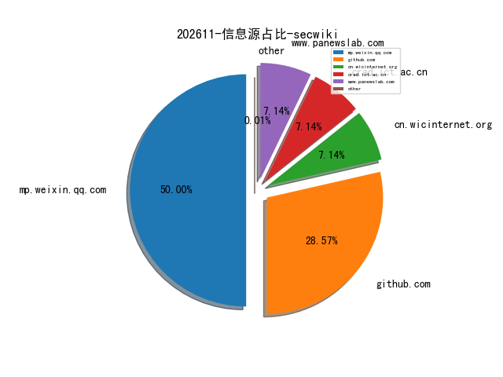
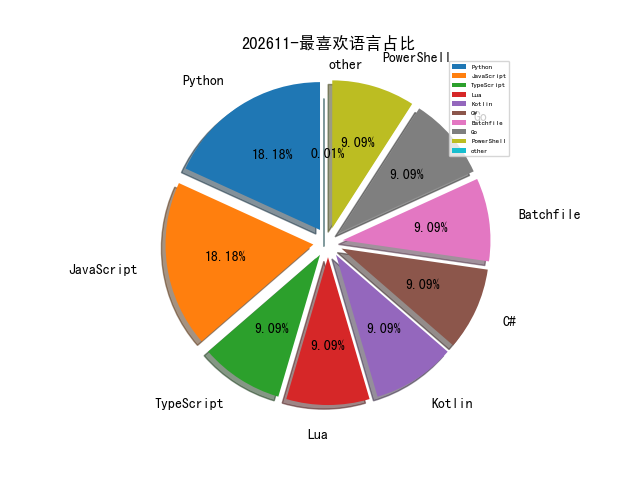

# [数据--所有](README_20.md)
# [数据--年度](README_2026.md)
# 202611 信息源与信息类型占比

# 网络安全书籍 推荐
| date_added | language | title | author | link | size| 
| --- | --- | --- | --- | --- | ---| 
| 2026-11-03 19:37:23 | English | Graph Engineering for Agentic AI Systems | unknown | https://www.wowebook.org/graph-engineering-for-agentic-ai-systems/ | unknown| 
| 2026-11-03 07:38:33 | English | The Technical Program Manager’s Guide to Practical AI | unknown | https://www.wowebook.org/the-technical-program-managers-guide-to-practical-ai/ | unknown| 
| 2026-11-03 07:27:42 | English | Practical MCP Security | unknown | https://www.wowebook.org/practical-mcp-security/ | unknown| 
| 2026-11-03 07:07:25 | English | The Cybersecurity Executive’s First Year Playbook | unknown | https://www.wowebook.org/the-cybersecurity-executives-first-year-playbook/ | unknown| 
| 2026-11-03 06:45:12 | English | Python for Engineers and Scientists | unknown | https://www.wowebook.org/python-for-engineers-and-scientists/ | unknown| 
| 2026-11-03 06:36:49 | English | Reinventing Enterprise with SAP Business AI | unknown | https://www.wowebook.org/reinventing-enterprise-with-sap-business-ai/ | unknown| 
| 2026-11-01 16:13:37 | English | Parametric and Generative Design with Rhino Python and Grasshopper | unknown | https://www.wowebook.org/parametric-and-generative-design-with-rhino-python-and-grasshopper/ | unknown| 
| 2026-11-01 15:52:32 | English | AI Risk Management for Financial Institutions | unknown | https://www.wowebook.org/ai-risk-management-for-financial-institutions/ | unknown| 
| 2026-11-01 15:22:49 | English | Agentic Architectures on Azure | unknown | https://www.wowebook.org/agentic-architectures-on-azure/ | unknown| 
| 2026-11-01 00:15:58 | English | Python for AI, Machine Learning, and Deep Learning | unknown | https://www.wowebook.org/python-for-ai-machine-learning-and-deep-learning/ | unknown| 

# 微信公众号 推荐
| nickname_english | weixin_no | title | url| 
| --- | --- | --- | ---| 
| 360漏洞研究院 | 360漏洞研究院 360漏洞研究院 | 【在野利用】Oracle E-Business Suite TCF 未认证 SQL 注入（CVE-2026-101767） | https://mp.weixin.qq.com/s/bleXx84z4l-EL-Q6gXV94A | 2| 
| ADLab | 启明星辰 启明星辰 | 【复现】Linux内核IPv4 TCP释放后重用漏洞（CVE-2026-98432） | https://mp.weixin.qq.com/s/K3Vu6gbUYg3tY87Y-i_56Q | 1| 
| APT-101 | APT-101 APT-101 | Agentic AI 红队检查清单 —— 输出处理不当（Improper Output Handling） | https://mp.weixin.qq.com/s/kfLQfBgRyOOPVMDANPQUng | 1| 
| Delta Insights | Wind Wind | 网络安全动态 - 2026.11.05 | https://mp.weixin.qq.com/s/OxXPuTkDjrrm8XKYwzSmZg | 2| 
| GGDog Sec | GGDog Sec GGDog Sec | 拿到offer的，可以写一份《出(腾，节，亭，服，盟，奇)表》了…… | https://mp.weixin.qq.com/s/1UC2cfTaQQZpazaXw22Vlw | 1| 
| HackSee安全生活 | None | 保护隐私从关闭手机授权开始 | https://mp.weixin.qq.com/s/MhTfsggKhO_AtyIkBNi0kg | 1| 
| Hacking黑白红 | hacking hacking | Claude Code华裔女产品负责人跳槽OpenAI ，去搞“人控Agent” ! 暴露AI发展方向 | https://mp.weixin.qq.com/s/qNLzGQ2MJq5zwOjiySdEyA | 3| 
| ISC2网络安全 | ISC2 China ISC2 China | 【4CPE活动预告】ISC2北京分会AI与安全技术沙龙丨AI时代企业安全风险治理实践 | https://mp.weixin.qq.com/s/J0yLnJhOHVYg9kMdx0Ek1g | 2| 
| ISC平台 |  | AI与安全界年度“创新奥斯卡”再启航，ISC.AI 2026创新百强申报启动 | https://mp.weixin.qq.com/s/Y03ANtBp_sE7vxioAqkYsg | 1| 
| Khan安全团队 |  | ARTEX 投毒后门 | https://mp.weixin.qq.com/s/Krp9BlXDMcIQ49EU0WGQzg | 3| 
| Nday Poc | Superhero Superhero | 用友时空KSOA select.jsp SQL注入漏洞 | https://mp.weixin.qq.com/s/c952I8VjUVrq3jU2T8j_RQ | 2| 
| OA大助手 |  | 泛微E9获取表字段清单的快捷方法 | https://mp.weixin.qq.com/s/Ky7YSL0oIuEnMsbmu5RIvg | 2| 
| OnionSec | jishuzhain jishuzhain | 当 AI 已经足够聪明，人类为什么还在成为瓶颈？ | https://mp.weixin.qq.com/s/Ji2IC94AJ-8d11ANgFaz3w | 3| 
| Ots安全 |  | 验签之后，包被换了：Debian/Ubuntu APT 高危漏洞与两分钟自查 | https://mp.weixin.qq.com/s/9mHUzCHtluzgOwOTIZC3FA | 3| 
| TQSec网络安全 | 大圣 大圣 | Atlas 310P 单卡部署实测 | https://mp.weixin.qq.com/s/LW3vJ13ai3B5YYxEs4Ds1g | 1| 
| Timeline Sec | Rj45 Rj45 | 一次利用AI辅助设计红队免杀工具的实践 | https://mp.weixin.qq.com/s/c2KAtaDVIRjMRZz7YlafNw | 1| 
| Web安全工具库 | FLIAZ FLIAZ | 多智能体安全测试系统 -- 灵枢（SpiritScout） | https://mp.weixin.qq.com/s/8mxWsCx7MLKWscKYkFcvVg | 1| 
| YNsec安全实验室 | YNsec YNsec | 【一天一个nacos漏洞·第五天】【严重】鉴权配置缺陷 | https://mp.weixin.qq.com/s/Uwj9TeXsnIG9kbpPbn04ZA | 3| 
| Z0安全 | Z0安全 Z0安全 | MindSearch-RCE复现：AI搜索一句提问直接拿shell （CVE-2026-105135） | https://mp.weixin.qq.com/s/d8qh0ZwlNojTrNQMfaq7HA | 1| 
| allby森林之家 | allby森林之家 allby森林之家 | 币安63亿美元盗窃案：深度解析背后的秘密 | https://mp.weixin.qq.com/s/2_XgupnkL6LW3O9B7bVD7g | 2| 
| crackme安全实验室 | crackme.net crackme.net | 我对元认知的看法：近我商、远他商、远心理咨询师商和智商 | https://mp.weixin.qq.com/s/6opgazwVOtUQO_8pasjYiQ | 2| 
| three安全之路 | mao mao | 前端加密是纸老虎：一次「信封加密」的自解密实录 | https://mp.weixin.qq.com/s/o7DEtd4o3nzyFRXI1Jg82A | 1| 
| 三千网安 | 念三千 念三千 | 红队快速打点篇-手把手带你部署ScopeSentry | https://mp.weixin.qq.com/s/5kFhkiwKxeyLMfk1fJKCzw | 1| 
| 中国信息安全 |  | 《中国信息安全》杂志2026年第10期目录 | https://mp.weixin.qq.com/s/PxFDGgfX6n7mEnD8ycMvfA | 13| 
| 中国电信安全 |  | 成绩公布！第二十届 “创优杯” 技能竞赛安全赛道复赛圆满收官 | https://mp.weixin.qq.com/s/3ki0NIH4dPTv_KrQkhd5Hg | 3| 
| 中国网络空间安全协会 |  | 面向2030的人工智能治理框架：全球共识与中国方案咖荟在浙江乌镇举行 | https://mp.weixin.qq.com/s/ypp05y-YBElmfpcIS3WmDg | 4| 
| 云南启安科技 | 云南启安 云南启安 | WordPress Core 竞争条件远程代码执行漏洞(CVE-2026-119977) | https://mp.weixin.qq.com/s/f9LAzWdphLJ5XGI0hy5DiA | 1| 
| 代码卫士 | Ravie Lakshmanan Ravie Lakshmanan | Barracuda 修复两个漏洞，可绕过授权和获取 root 权限 | https://mp.weixin.qq.com/s/_gyyQgV-h93wFizo0u-6zg | 6| 
| 信息安全与通信保密杂志社 | Cismag Cismag | 天融信出席中国-东盟信息港论坛，分享“从数据跨境到安全AI应用”创新实践 | https://mp.weixin.qq.com/s/iQ_WdENYqxrYb-Ra5KMhQw | 6| 
| 信息安全国家工程研究中心 | NERCIS NERCIS | 继欧洲超市冷柜之后，法国血库遭到黑客攻击 | https://mp.weixin.qq.com/s/cTzEmDJFYv0M-G-Nh6Vs1Q | 3| 
| 信通云服 | 信通云服 信通云服 | 【漏洞预警】TeamViewer 整数溢出漏洞可导致远程代码执行（CVE-2026-111585） | https://mp.weixin.qq.com/s/HGjIVPSs0Mi_KB32kKtoog | 3| 
| 全球技术地图 |  | 太空经济的创新版图与新兴技术 | https://mp.weixin.qq.com/s/Ec_J90yCIGEqAXmQZUNC3g | 5| 
| 关键漏洞目录 | 摄星科技 摄星科技 | 「关键漏洞目录」新增「Apple多款产品WebKit组件安全绕过漏洞」等2个漏洞 | https://mp.weixin.qq.com/s/h_wJTiCug-u3tb6s6SHc8A | 1| 
| 内存余响 |  | 被攻陷的运维跳板机：后门、持久化与横向扫描排查【附靶机链接】 | https://mp.weixin.qq.com/s/UyVBjcwTm-T9QMuGUd5dVw | 1| 
| 内生安全联盟 |  | 图解：携手构建全球开放人工智能行动倡议 | https://mp.weixin.qq.com/s/9-IPUClPye5sULSAkZx3gA | 6| 
| 凌晨一点零三分 | Crypt0 Crypt0 | Crypt0xa0资金行情日报2026-11-05 | https://mp.weixin.qq.com/s/vEm2ZR8TSgIg12s5jWSb0A | 1| 
| 利刃信安 | 利刃信安 利刃信安 | 下级证书截止时间晚于上级证书截止时间对证书链验证有何影响？ | https://mp.weixin.qq.com/s/XDCU0n7c10w_i-hboxoTDQ | 1| 
| 北信源 |  | 爱传再现伦敦世界旅游交易会 aitranHotel破解酒店多语种接待瓶颈 | https://mp.weixin.qq.com/s/JYXSi_sD7ZdFdsT8-FgzUA | 1| 
| 北邮 GAMMA Lab | 翟新龙 翟新龙 | 专题解读 , 过程性知识图谱近期发展概览 | https://mp.weixin.qq.com/s/kukzSpQDusMv0HaVBt_iEw | 1| 
| 升斗安全 | 升斗安全XiuXiu 升斗安全XiuXiu | 群里喊『几十块查任何人底细』？做了多年渗透的我，把水搅明白了 | https://mp.weixin.qq.com/s/hlISmRituCoEmPKnrIZ75A | 3| 
| 卡卡的网安日记 | 卡卡的网安日记 卡卡的网安日记 | 教师个人工作台保姆级搭建指南  （附提示词） | https://mp.weixin.qq.com/s/fdILebKlHJA-BsXjkk3O8Q | 1| 
| 启明星辰安全简讯 |  | 【漏洞通告】WordPress Core远程代码执行漏洞（CVE-2026-119977) | https://mp.weixin.qq.com/s/Q9tG95L62Sd_cyjm8WFsQw | 3| 
| 吾爱破解论坛 | 吾爱pojie 吾爱pojie | 吾爱破解论坛技术区“AI”新规已正式上线 | https://mp.weixin.qq.com/s/tRJr1qwnuMp6-29RdyKrgg | 1| 
| 哆啦安全 | 云天实验室 云天实验室 | AI安全工程师五层必备技能 | https://mp.weixin.qq.com/s/r_VpdVYobTe4FGn_v7GVsw | 2| 
| 四叶草安全 | 小草 小草 | 乌镇声音 , 四叶草安全董事长马坤出席世界互联网大会网信人才发展论坛，共话AI时代网安人才培养 | https://mp.weixin.qq.com/s/AwPpLFxZ9_U8g4drkm7ezg | 1| 
| 天御攻防实验室 | 天御 天御 | OpenAI开发了一套自主漏洞挖掘流水线，具备创造新型漏洞利用技术的能力 | https://mp.weixin.qq.com/s/DyQIlQ0N2rg0FBtislOvSw | 2| 
| 奇安信 CERT |  | 【已复现】Synology DSM 身份认证绕过漏洞(CVE-2026-13639)安全风险通告 | https://mp.weixin.qq.com/s/6OD1diTo_RgE9Kfs0DyoEg | 2| 
| 奇安信XLab | 奇安信X实验室 奇安信X实验室 | 警惕 cwpdoor：寄生在 Control Web Panel 中的零检出被动后门 | https://mp.weixin.qq.com/s/hDkWyDkCUIFVvYOt-uM1IQ | 1| 
| 奇安信威胁情报中心 | 威胁情报中心 威胁情报中心 | 当“加载模型”变成“执行未知代码”：AI 供应链中的 GPU 挖矿陷阱 | https://mp.weixin.qq.com/s/gYvIdC7C4Co7GTIj_nqueQ | 2| 
| 奇安信集团 | 安全内参 安全内参 | AI访问权限遭盗用，多家企业损失近千万元 | https://mp.weixin.qq.com/s/vP8IqM05NkhDxcQN1aZtFw | 5| 
| 奇安网情局 | 奇安侦察兵 奇安侦察兵 | 美国网络司令部选择莱多斯公司继续开发统一网络任务规划平台 | https://mp.weixin.qq.com/s/pbEGZCEUaykvU5uGQVuOVQ | 1| 
| 威胁猎人Threat Hunter | 情报运营团队 情报运营团队 | 10月被水军围攻品牌TOP20：国内恶意网络水军风险洞察 | https://mp.weixin.qq.com/s/yOR2JiZdqh-XTShp_POJeg | 1| 
| 安全419 | 安全419 安全419 | 安全419甲方精品采购指南 , \"先窃取、后解密\"倒计时：格尔软件如何为金融业铺好抗量子迁移之路 | https://mp.weixin.qq.com/s/fbTXmtd_4YOG8GvoSsT3OA | 2| 
| 安全内参 | 安全内参编译 安全内参编译 | 亚洲六大航空龙头数据泄露：因IT供应商遭入侵 | https://mp.weixin.qq.com/s/K4JxyppFytZMldoLxwc4VA | 4| 
| 安全圈 |  | 【安全圈】币安63亿被盗余震！Coinbase转超99%资产至冷钱包 | https://mp.weixin.qq.com/s/2IIh19MeE8nT7nDL0zBSxw | 3| 
| 安全学习那些事儿 |  | 日本必客家美乐集团1490万条客户信息泄露 | https://mp.weixin.qq.com/s/3E-UWziB4LzGVBmLiUtGKw | 8| 
| 安全学术圈 | 孙德凯 孙德凯 | 浙江大学 , 用轨迹自适应诱饵拖住、引开并化解自主渗透智能体 | https://mp.weixin.qq.com/s/CmRiLbNu9SHd-80tEdJG2Q | 2| 
| 安全帮Live |  | 2027 年最赚钱的 AI 创业方向 | https://mp.weixin.qq.com/s/uJTn4MmedA0IXI5eoe1r0Q | 1| 
| 安全新说 | 安全新说 安全新说 | 2599万元！40个安全项目两天内定标 | https://mp.weixin.qq.com/s/PEJ06xvCLqkShW_OhtASww | 2| 
| 安全牛 |  | 世界互联网大会发布AI安全治理报告，聚焦模型评测与风险协同处置；CNNVD 发布 10 月漏洞通报：PHP出现超危远程代码执行漏洞, 牛览 | https://mp.weixin.qq.com/s/f9g2TYoZo3bcswcKC8cqfA | 6| 
| 安在 | 安在 安在 | 未来CSO · FDE启学营 , 首期即将开课，课表正式公开 | https://mp.weixin.qq.com/s/Pbfv9IvtXKctDWBdU7Q6tg | 7| 
| 安天垂直响应平台 |  | ARTEX 流行 Fork 镜像供应链投毒事件分析 | https://mp.weixin.qq.com/s/Mlq4JR0ol-b7xHAOZRiUMQ | 1| 
| 安恒信息 |  | 乌镇安恒书院举办AI重塑安全服务研讨会，安全能力Token化实践获关注 | https://mp.weixin.qq.com/s/8OnBayH8JMtocGvUEwO75g | 7| 
| 安服驻场记 | buluo buluo | 以案释法｜3个典型案例，带你了解破坏计算机信息系统罪 | https://mp.weixin.qq.com/s/pjLoVyDp9FrFvipK_0T6GA | 1| 
| 小猫信安 | None | 如何设计一个漏洞挖掘 Agent：从 LLM 原理到四层架构与核心代码 | https://mp.weixin.qq.com/s/E72ee6-9WH19lzD1bJdUAQ | 1| 
| 小瑶在工地 |  | 今日速递｜Haiou 提示广告、临时 Root、OpenAI 948 | https://mp.weixin.qq.com/s/GTvHJCCQmBHT95V8o7v4dw | 1| 
| 小白安全成长记 | 小白哥 小白哥 | 漏洞预警:又可以root android手机了，大家来了解一下，带poc的那种，CVE-2026-98260 | https://mp.weixin.qq.com/s/v-b5E3oWHcwUOCNIQoAHYQ | 3| 
| 山石网科新视界 | 山石网科 山石网科 | 山石方案｜某合资车企ASIC防火墙国产化替换案例 | https://mp.weixin.qq.com/s/Z6uAzpOt8hUgZOFgUD-MQw | 6| 
| 工联安全众测 |  | 收藏！党的二十届五中全会学习手账来了 | https://mp.weixin.qq.com/s/gH861R37S5JU612nCFq09g | 1| 
| 希泽Sec | 添柴不加火 添柴不加火 | 只有10个端口地址，怎么在清单外挖到 SQL 注入漏洞？ | https://mp.weixin.qq.com/s/hABhIPnVFrczWn5G8hKdag | 1| 
| 平航科技 | 航哥 航哥 | 【AI实战】跨检材关联、对比分析，AI+一次厘清！ | https://mp.weixin.qq.com/s/JEHrdTxCyrnNkAVbNBzcfA | 1| 
| 广东网警 | None | 泄露三千余名艺人信息，追星黑产链被连根铲除！ | https://mp.weixin.qq.com/s/PU6MyRq4v1HPH4V5T1QiNQ | 1| 
| 广州网警 | 广州网警 广州网警 | 护网—2026 , 网警聚焦不履行数据安全保护义务或网络安全保护义务违法行为，依法作出行政处罚 | https://mp.weixin.qq.com/s/N2m__T59_lkApPmKTKto8w | 1| 
| 德斯克安全小课堂 | 让数据更安全 让数据更安全 | 你装的盗版 ANSYS，本身就是一个\"举报器\" | https://mp.weixin.qq.com/s/Wj5hcs7r9Ezj1Ahlj8H2Kw | 1| 
| 快手安全应急响应中心 |  | 报名开启｜快手安全11月北京沙龙 | https://mp.weixin.qq.com/s/PItHw_RRZmcO8gvlEsMtlw | 1| 
| 悟安 | 悟安 悟安 | 定级报告高频退回原因梳理 | https://mp.weixin.qq.com/s/ZrfkupmE3f_0GP0SEtuq5A | 1| 
| 技术分享交流 | TP微客 TP微客 | 腾讯混元大模型Hy4重磅发布，限时免费使用 | https://mp.weixin.qq.com/s/6yf5U5Cgeg7VBSJRz3XQEA | 1| 
| 掌控安全EDU | zkaq-r2u0z zkaq-r2u0z | 记AI渗透下的一次小通杀 | https://mp.weixin.qq.com/s/9S9WP5xFcyjVFh4keP7RNw | 2| 
| 数世咨询 |  | KCon 2026圆满举办：“弈智”破局，推动AI安全从“示险”走向“解法”（附公开PPT下载链接） | https://mp.weixin.qq.com/s/n8kHCr3MJWGmwvfVYAIomg | 5| 
| 明焰安全 | FYRE SHLD FYRE SHLD | 币安63亿被盗、路由器老漏洞、PHP补丁被抢跑……这一周发生了什么？ | https://mp.weixin.qq.com/s/1FR4uZzdw0mDiTGp0RnA0w | 1| 
| 星夜AI安全 | 星夜AI安全 星夜AI安全 | 本以为整段加密就够躲过 EDR 内存扫描，没想到真正要藏的是明文生命周期：Voidgate 把明文压到 15 字节 | https://mp.weixin.qq.com/s/fJ9761bMuVL4DRHuTIOaWA | 2| 
| 暗网哨兵 | 暗网哨兵 暗网哨兵 | 菲律宾副总统办公室、空军、劳动部等连环“崩盘”！数千万条机密与隐私数据被曝光 | https://mp.weixin.qq.com/s/yXONrhRC0Uj_U8VkqwNr9A | 2| 
| 杂杂咱谈 | tuto tuto | 腾讯旗下 Level Infinite 游戏启动器曝严重供应链攻击：多款热门 PC 游戏疑遭植入木马 | https://mp.weixin.qq.com/s/gQbXspyjdYhln6HwFsoAIQ | 1| 
| 极验 | 极验 极验 | 当机器流量进入结算，平台该在哪里止损？ | https://mp.weixin.qq.com/s/8_T8Mls5F9WRA2l9_0aM8Q | 1| 
| 梓陌说科技 |  | ColorOS 17 正式版看下来，流畅和 AI 是真下了功夫 | https://mp.weixin.qq.com/s/KH7KxkEmLLqTmAiT0dM1IQ | 6| 
| 棉花糖网络安全工具箱 | 棉花糖糖糖 棉花糖糖糖 | 118 条漏洞 PoC 被塞进一个仓库：中间件、CMS、OA 的 Getshell 姿势一次拉满 | https://mp.weixin.qq.com/s/maGwZb_KW7WNe6KqZ53nng | 3| 
| 武汉网络安全 |  | 理事动态 , 华为领导一行到访德发交流座谈 | https://mp.weixin.qq.com/s/CpN2SiToyB6kiKI-RO8wYw | 2| 
| 沧海讲安全 |  | 图片里居然还能隐藏病毒？一文讲透网安里的图片隐写 | https://mp.weixin.qq.com/s/EzG08mi17kbapcyFuqIMOA | 1| 
| 海哥网络安全 | 海哥网络安全 海哥网络安全 | AI挖漏洞爆火，一篇带你了解用Work Buddy挖漏洞的全流程！ | https://mp.weixin.qq.com/s/dolPp82OIF2eSmFcJPLIAA | 1| 
| 深信服千里目安全技术中心 | 深瞻情报实验室 深瞻情报实验室 | 【高级威胁追踪(APT)】一起针对第三方支付机构的定向攻击工具包披露 | https://mp.weixin.qq.com/s/__6JSuGbZre6wlhi09FtIA | 2| 
| 深信服科技 | 信服云 信服云 | 华泰证券×深信服，携手打造新一代数智基础设施！ | https://mp.weixin.qq.com/s/w--2cvfhbCodHEM4g6LXhw | 1| 
| 渊亭防务 | None | 美日“利剑27”联合演习全景复盘：兵力、课目与意图 | https://mp.weixin.qq.com/s/eTDh5LQajbY21Oo5L2rk1g | 2| 
| 源影安全团队 | 源影网安 源影网安 | 【已复现】CVE-2026-101767 Oracle EBS AppsTCFServer SQL注入漏洞 | https://mp.weixin.qq.com/s/lXbreLbDjEpIAkXkxj3ieg | 1| 
| 滤镜码头 | 大局为重 大局为重 | 被某省公安厅抓捕之后（一） | https://mp.weixin.qq.com/s/KcD8MiPmAESP1AW9bPRsyw | 3| 
| 滴滴技术 |  | 滴滴自动驾驶项目获中国汽车工程学会科学技术奖特等奖 | https://mp.weixin.qq.com/s/06rGcnIoqKWtVxMww-8sOg | 1| 
| 潇湘信安 | PANews PANews | 63.4亿美元惊天大劫案！币安安全事件全复盘：从虚假招聘到AI工具沦陷，黑客如何层层突破防线？ | https://mp.weixin.qq.com/s/eV10gv5XzGETUNrELg8f4g | 1| 
| 独眼情报 | 🅰🅸 🅰🅸 | 以后找漏洞，谁还能干得过 AI 公司？ | https://mp.weixin.qq.com/s/TCjEUcsrnhloBTX3VYlNBw | 4| 
| 白帽子社区团队 | 无问社区 无问社区 | 网安模型季度冲量调用说明 | https://mp.weixin.qq.com/s/JNhze4OGpnk_J59dlnEy5A | 2| 
| 知远战略与防务研究所 | 知远所 知远所 | 知远防务论坛·2026：开源情报理论与实践研讨会 | https://mp.weixin.qq.com/s/997mgSV42YMYWu00DKaYYQ | 14| 
| 知道创宇 |  | AiPy 首获 Microsoft 官方致谢，Windows 内核 Win32k 漏洞获 CVE 编号 | https://mp.weixin.qq.com/s/hwfpPgQkBZMmJMOJ65Vs2A | 2| 
| 神农Sec | 神农Sec 神农Sec | 【提高挖洞效率】Burpsuite杂包强过滤src漏洞挖掘 | https://mp.weixin.qq.com/s/wkK2wWB5XWJZ_e20et4eTQ | 3| 
| 秦安战略 | 秦安战略 秦安战略 | 秦安：解放军会不会对菲律宾先实施军事打击？黄岩岛“关门打狗”还是自卫反击，中国从法理到实力，都具有碾压性，军事打击可能性大增！ | https://mp.weixin.qq.com/s/1IkI8eWAp5qApD4iwUZoxQ | 15| 
| 空天感知 | 空天感知 空天感知 | 韩国公布“K-Moonshot 太空任务 2035”：先不拼规模，拼一颗 100 公斤验证星 | https://mp.weixin.qq.com/s/HlHaOqmNFcy1DN37J3E5TQ | 2| 
| 等保测评和商密评估 | 糖果 糖果 | 福建密评机构招聘多名密评测评师（持证），你可以了解一下。 | https://mp.weixin.qq.com/s/2QYcFPmE2Sr31HAyOanYIA | 1| 
| 红队工坊 | aeverj aeverj | Cobalt Strike 免费平替 Adaptix C2 启动：配置命令与控制监听器 | https://mp.weixin.qq.com/s/wDGHfE8Mx7kSnF-5raDSZw | 2| 
| 网安寻路人 | 标准编制核心组 标准编制核心组 | 解析Agent的 Harness设计逻辑（国标制定思路解析之三） | https://mp.weixin.qq.com/s/JekiJMyV1heroofl4_7_cA | 2| 
| 网御星云 |  | 解读 ,《国家信息化“十五五”规划》：安全为何被列为一项支撑 | https://mp.weixin.qq.com/s/hC3zjoACHIi5P66ogHxJNA | 2| 
| 网络侦查研究院 | 子午猫 子午猫 | 苏仙公安连阻多起送金投资诈骗，900余克涉诈黄金交付前被拦截 | https://mp.weixin.qq.com/s/Wf5KjTauU-VXE4e3VQT6CA | 6| 
| 网络安全007 | FL_Clover FL_Clover | AI双杀：当渗透工具被投毒，当交易所被\"面试\"黑客 | https://mp.weixin.qq.com/s/PC60QIlTH3JEBMGfb9XI4w | 1| 
| 网络安全和信息化 |  | 一线艺人行程200元，普通艺人150元……三千多名艺人信息被泄露！详情披露 | https://mp.weixin.qq.com/s/JU_6cO8-UHZNfXgXlNjYOg | 6| 
| 网络安全学习室 | 网安学习室 网安学习室 | AI 安全攻防实验室 01｜Workbuddy+Skill，提示词逃逸安全研究 | https://mp.weixin.qq.com/s/xurmb7yA42BmnfJ_ltKedg | 2| 
| 网络安全实验室 | Flag Flag | 国家计算机病毒应急处理中心2027年合同制工作人员招聘 | https://mp.weixin.qq.com/s/9y_4kUf7rzEwVzlrGDDibw | 1| 
| 网络安全攻防与治理 | snortman snortman | 未来三年网络安全公司会被大模型公司降维打击 | https://mp.weixin.qq.com/s/fBN1crNaq7nqPEL6pMB-4A | 1| 
| 网络安全直通车 | guowei guowei | ERP/WMS/MES/PDM 区别 | https://mp.weixin.qq.com/s/nYR91MlzHq4FuRcxBS0eGw | 6| 
| 网络安全者 | ITroyeSivan ITroyeSivan | DeepSeek Harness Desktop 的安全测试插件 -- aker | https://mp.weixin.qq.com/s/zn9MrKFQIR6NuPV5jXSpgg | 1| 
| 网络安全透视镜 | 网络安全透视镜 网络安全透视镜 | 花费120 万美元，让AI 找出 948 个 Linux 提权漏洞，价值数千万美元 | https://mp.weixin.qq.com/s/gb1euoIw29RHGs_jkwA50g | 7| 
| 网络小斐 | 小斐Lab 小斐Lab | 实战！使用夜莺 Nightingale 统一监控 48+ 台 RoCE 智算交换机 | https://mp.weixin.qq.com/s/tK4_z4l3rhaixDV1lsf5sA | 1| 
| 网络技术干货圈 | 圈圈 圈圈 | 国产超智融合，正在跑出硬核科研成果 | https://mp.weixin.qq.com/s/QXmkReg1qkYOaHZS8ikIoA | 2| 
| 老白说攻防 | 老白说攻防 老白说攻防 | 237页Burp Suite 实战指南 | https://mp.weixin.qq.com/s/wiSzmfmbHXBcDq4vYHqHGw | 1| 
| 聚铭网络 |  | 当AI让漏洞有了机器产能，补丁却还靠人海战术 | https://mp.weixin.qq.com/s/YY276xUMifRlbUNeo9S2Zg | 1| 
| 腾讯安全威胁情报中心 | 腾讯安全威胁情报中心 腾讯安全威胁情报中心 | 你的 AI 编程助手，可能正在后台替木马“打工”：恶意软件 Iris C2Agent 深度分析 | https://mp.weixin.qq.com/s/1zpJ4bcP8ojLLHjxwAfU8w | 1| 
| 腾讯技术工程 | 腾讯程序员 腾讯程序员 | 可直接喂给 WorkBuddy 的实战模板 , 零基础构建策划团队 Skill | https://mp.weixin.qq.com/s/VHeUhLcg06hgBnmdKbjVTg | 2| 
| 船山信安 | 夜游神 夜游神 | 安全意识普及：钓鱼邮件、弱密码、U 盘，三件事先做好 | https://mp.weixin.qq.com/s/4JwNQWKY-e5Jm5ndHVwE3A | 2| 
| 苏州龙信信息科技有限公司 | 龙小信 龙小信 | 喜报丨能力验证圆满完成！龙信科技鉴定实力再获权威认可 | https://mp.weixin.qq.com/s/CV5AT-ByTbsrhIQcnGbsCA | 1| 
| 蚁景网安 |  | BurpSuite 安装汉化激活教程 | https://mp.weixin.qq.com/s/jVdMTzhMmdNx6WC9olSsEQ | 2| 
| 蚁景网络安全 |  | 【免费领】国内第一部XSS跨站脚本攻防技术教程 | https://mp.weixin.qq.com/s/9JTc6ed_ddJDdxdIfAZKng | 4| 
| 表哥带我 | 泼猴 泼猴 | 【吃瓜】如何看待手机系统中的数据采集拉低性能 | https://mp.weixin.qq.com/s/FcwpfYLiU2DVepBk7zh4Zg | 4| 
| 观安信息 |  | 观安信息亮相香港金融科技周 共筑金融业可信AI安全防线 | https://mp.weixin.qq.com/s/HKaPkQ5S0-OD7wnrTEcGIA | 1| 
| 谈思实验室 |  | 汽车网络安全不能只做一次渗透测试：TARA如何把风险贯穿研发与供应链？ | https://mp.weixin.qq.com/s/daUhV2abLSFG_ys21p3GJQ | 6| 
| 赛博研究院 |  | NIST发布超级智能安全事件管理报告，提出完善人工智能安全响应机制 | https://mp.weixin.qq.com/s/s7qdsnJ41M9GgC5XAcbsvg | 1| 
| 赛宁信息 |  | 关于举办2026年“经纬杯”交通运输网络安全大赛决赛的通知 | https://mp.weixin.qq.com/s/U53qxH75eNQxpmmU8n5ZYw | 1| 
| 赛查查 |  | buuctfxa0WEB [强网杯 2019]随便注 writeup | https://mp.weixin.qq.com/s/HLMkS2V8kPLW2QzdSBp6PA | 20| 
| 赤霄攻防实验室 | 赤霄攻防实验室 赤霄攻防实验室 | 升级的几秒钟就是攻击窗口：WordPress Core 未认证 RCE 深度分析（CVE-2026-119977·附PoC） | https://mp.weixin.qq.com/s/633gT8r7Wc22XhRvR_7N1w | 3| 
| 逆向有你 |  | JS逆向 -- js 事件 事件循环 和异步（二） | https://mp.weixin.qq.com/s/Emgvv8YrgqU3gKeJ-ZOARw | 2| 
| 逆熵寻生 | CabinQ CabinQ | 【重磅】泛微 e-cology 漏洞利用全路径：前台未授权 RCE 与一键综合利用 | https://mp.weixin.qq.com/s/Qmfqkmy-b8tDqC_-oOKVnA | 2| 
| 重生信息安全 | None | 一场假面试，盗走 63 亿美元：币安被盗案全过程 | https://mp.weixin.qq.com/s/0drkJYDKskJPx1dGvViI9g | 1| 
| 金盾信安 |  | 关保联盟 , 关于开展“关键信息基础设施安全检测评估能力评价”的报名通知 | https://mp.weixin.qq.com/s/gQQz_6gWCxtIxbNvPndL-g | 4| 
| 长亭安全观察 | 夺旗猫 夺旗猫 | 首发！长亭驭元率先适配统信 UOS ，助力国产系统，安心用 AI | https://mp.weixin.qq.com/s/wjAWPh9QMv0gZZWYeEcFyQ | 2| 
| 闪石星曜AI攻防实验室 | 润霖@闪石星曜 润霖@闪石星曜 | 想学AI 代码审计及漏洞研究，不知道该如何入手？听我讲几句...... | https://mp.weixin.qq.com/s/mQa_ZZUzULtiisF8EsTZAg | 1| 
| 阿乐你好 |  | 纳米核心岗位招聘 | https://mp.weixin.qq.com/s/FQgBh7qiOpBN0Hut1wcrkQ | 1| 
| 随笔漫记安全路 | 0x00 0x00 | Postman被抓包：偷改AI编程工具配置，还替你点了“同意” | https://mp.weixin.qq.com/s/dkehhf6x1KPoscAYuzaIaw | 2| 
| 雷盾信安 | 雷盾信安 雷盾信安 | 从合规达标到风险收敛：AI加密时代的安全运营新标尺 | https://mp.weixin.qq.com/s/RvmjaIJ2j4cx4Da5C_KuFg | 1| 
| 飞天诚信 | 飞天诚信 飞天诚信 | 香港证监会（SFC）要求身份认证技术升级 飞天诚信FIDO Security Key助力互联网券商 | https://mp.weixin.qq.com/s/aSSDZxs-FcLG34eJpeKDQQ | 1| 
| 黑卷的IoT攻防日记 | 黑卷 黑卷 | 绕过 Carbonara 补丁：拆 MediaTek DA2 堆溢出 heapb8 到任意代码执行 | https://mp.weixin.qq.com/s/RE1g2wcOVHy41-HyjzjLqA | 2| 
| 黑客技术与网络安全 | 权限提升中 权限提升中 | 离职电脑没清干净，公司用恢复软件把和新公司的聊天、项目资料全挖了出来，然后拿着这些证据索赔。 | https://mp.weixin.qq.com/s/i7yj8shvqFyvkcrrcbaLuw | 2| 
| AI+网络安全笔记 | 渊渟鹤峙 渊渟鹤峙 | Agent的长期记忆治理：拆解ZoneClaw，给Agent长期记忆上一道“权限锁” | https://mp.weixin.qq.com/s/wSxb73dupU_GqqdlBqC70g | 1| 
| AI紫队安全研究 | AI紫队安全研究 AI紫队安全研究 | AI简历点开就中木马！Lazarus全新FlashHole行动：借银行安全软件入侵，GitHub当C2，全程内存无迹可寻 | https://mp.weixin.qq.com/s/Z5No4ZELdl8Ftu-CDHStuw | 3| 
| BlockSec | BlockSec BlockSec | 从 NEAR Intents 事件看 NEAR 智能合约安全 | https://mp.weixin.qq.com/s/p61jGLiPaeg3-Ue9lt-6ng | 1| 
| CISP |  | 2026年9月份CISP考试成绩 | https://mp.weixin.qq.com/s/loQE16hXKlP0Pbiw1HjUxg | 1| 
| DeepPhish | 深海捕鱼 深海捕鱼 | 你买的防火墙，挡不住一封“HR 发来的邮件” | https://mp.weixin.qq.com/s/Yn3HR0dAp9nHPKoZXPamAQ | 1| 
| FreeBuf |  | 欧洲多国零售冷链遭网络攻击，凸显行业OT安全短板 | https://mp.weixin.qq.com/s/q5hzEymxoKW2Z9P3Nf0drw | 4| 
| ISC2北京分会 | None | 11月北京AI与安全技术沙龙嘉宾及议题预告 | https://mp.weixin.qq.com/s/W2PsClhzwM9hjxgb8bMbnA | 2| 
| ITPAPA | ITPAPA ITPAPA | AI 把攻击提速之后，为什么身份日志比 AI 特征更重要 | https://mp.weixin.qq.com/s/wouM8VNYN4gU8APFgFiAkA | 1| 
| KCon 黑客大会 | KCon 组委会 KCon 组委会 | KCon 2026圆满举办：“弈智”破局，推动AI安全从“示险”走向“解法”（附公开PPT下载链接） | https://mp.weixin.qq.com/s/35zdml7OdFv3IYrfySOOvw | 1| 
| N1bbl3 | N1bbl3 安全团队 N1bbl3 安全团队 | AI 工具 ARTEX 遭镜像投毒，二开项目被植入后门 | https://mp.weixin.qq.com/s/f0eNvO73cu4Xn3fLPv1cPQ | 1| 
| Qsec | QAC QAC | 币安热钱包事件：攻击者如何走到签名服务前 | https://mp.weixin.qq.com/s/_G4MSBVsx3-b0aDgfpM60w | 2| 
| SPEEDCoding | 李逍遥 李逍遥 | RSA详解 | https://mp.weixin.qq.com/s/h-c2QyFuw1HXK8avdgJnqA | 1| 
| Yak Project | Yak Yak | 像打补丁一样做代码扫描：一次让审计快60%的硬核优化 | https://mp.weixin.qq.com/s/XDLGKjS_Sn3RKPTkfor1rA | 1| 
| night安全 | YGnight YGnight | 【漏洞预警】NetScaler ADC 和 Gateway爆出请求走私漏洞(POC已公开)CVE-2026-88773 | https://mp.weixin.qq.com/s/4bnRM49Muq1503mVHvqAhA | 2| 
| solar应急响应团队 | solarsec solarsec | 2026-10月Solar应急响应公益月赛排名及官方题解 | https://mp.weixin.qq.com/s/3tJdnW0DUCuu3BPjGN3J-Q | 1| 
| 一个不正经的黑客 | 一个不正经的黑客 一个不正经的黑客 | 宇宙交易所砸63亿美金也难买安全教训！ | https://mp.weixin.qq.com/s/Ic1jrp5OI7TuxXgr_vDBGQ | 1| 
| 一个努力的学渣 | 一个努力的学渣 一个努力的学渣 | 什么是内存马？ | https://mp.weixin.qq.com/s/a2-iKjXoAFgum8f74FcSsQ | 1| 
| 三未信安 |  | 三未信安携三大安全方案精彩亮相2026安博会 | https://mp.weixin.qq.com/s/DxioHgpRNacAxKDmjcK6dg | 1| 
| 中孚信息 |  | 补链强链，安全同行 —— 中孚信息携手GBASE，共筑云南信创新生态 | https://mp.weixin.qq.com/s/UFmYHnWt5YV2Fy1Y6W1j4w | 2| 
| 中资网安 | CACT CACT | 热点速览 , 每周网安大事件（20261026-20261101） | https://mp.weixin.qq.com/s/RKZs_Q0M1BiFDMuF3HnWHA | 1| 
| 九河下稍的安全笔记 |  | 一篇迟来的反思与分享 | https://mp.weixin.qq.com/s/ChzF5QgpulRaNCw5iLV-yg | 1| 
| 亚信安全 | 你信任的 你信任的 | 亚信亮相2026世界互联网大会：让智能体从\"放养\"走向\"持证上岗\" | https://mp.weixin.qq.com/s/XMlSRs_TpT_nWswyIA4UvQ | 1| 
| 企业安全实践 | 企业安全实践 企业安全实践 | 勒索事件日报：2026年-11月-03日 | https://mp.weixin.qq.com/s/HTO1Oqq5p5X2B_VueaVfGg | 3| 
| 众智维安 |  | 《美国AI泡沫的结构性风险与破裂前景分析报告》系列补充篇 | https://mp.weixin.qq.com/s/H2xy4gXzove6r8xxlJLkuw | 4| 
| 信息安全研究 |  | 动态｜“银狐”木马专项——恶意域名及恶意IP | https://mp.weixin.qq.com/s/Uyujisx6eOJp84V39tGUog | 5| 
| 信息网络安全杂志 |  | 软件所提出大语言模型复杂执行路径推理能力分析框架 | https://mp.weixin.qq.com/s/86YSWfbDjr-0D_H1or1tDA | 4| 
| 像梦又似花 | CyberSecGuy CyberSecGuy | 看片不用找字幕！这款本地播放器实时生成双语字幕，完全离线免费 | https://mp.weixin.qq.com/s/eweN49qbuC_FH_gL4IoQKw | 1| 
| 六边形攻防安全 | None | X上有人对最近币安被盗事件做的可视化视频 | https://mp.weixin.qq.com/s/U6RX-oF5-uWWo5R4JUq7EQ | 2| 
| 华顺信安威胁情报中心 |  | 【漏洞预警】WordPress 核心更新流程条件竞争远程代码执行漏洞（CVE-2026-119977） | https://mp.weixin.qq.com/s/w2-BbnuQXW214jC2w_3n7A | 1| 
| 句芒安全实验室 | 句芒安全实验室 句芒安全实验室 | 「AI代码审计」brain0拆解：每个commit追到Agent提示词，还查它读了哪些密钥 | https://mp.weixin.qq.com/s/HVopqL4nHmhVEMc7NnbzGA | 2| 
| 只会看监控的实习生 | 菜狗 菜狗 | DSH 玩家注意！一个插件接入多个 AI 模型，还支持本地 API 转发 | https://mp.weixin.qq.com/s/wC7KH855CFYjWtivBHF6yQ | 1| 
| 国际云安全联盟CSA上海代表处 |  | 从可信可控到产业赋能：CSA构建标准、评估、人才与应用的AI安全体系 | https://mp.weixin.qq.com/s/deFoQkEPAY5I5hatkwy1Fw | 1| 
| 天威诚信 | 数字信任云服务商 数字信任云服务商 | SM2消息格式新国标正式实施：国密应用互通有了统一依据 | https://mp.weixin.qq.com/s/3VaQDIrkBM3kP5G0gcf1cw | 1| 
| 天融信 |  | 天融信：当应急响应遇上AI，以人机协同打赢网络攻防遭遇战 | https://mp.weixin.qq.com/s/NlokBdgxJbVpr2uX1KvsUg | 3| 
| 奶牛安全 | debugeeker debugeeker | 数据泄露情报2026.11.4：洛杉矶富人俱乐部Brentwood数据泄露（有富豪资料） | https://mp.weixin.qq.com/s/iuy-HQV6Bf-EoOhkb79TMQ | 2| 
| 好靶场 | 好靶场 好靶场 | 【抽奖】Token羊毛来了，这你不领取一下？ | https://mp.weixin.qq.com/s/kjaRTJFw9RITiQZRGFS06A | 2| 
| 安世加 | 安世加 安世加 | 出海安全日报｜11月4日 | https://mp.weixin.qq.com/s/ieVdYfwX37bvNRr_w4m_rQ | 2| 
| 安信天行 |  | 筑牢数据安全防线，三位一体运营体系破解组织数据治理难题 | https://mp.weixin.qq.com/s/YOdF1EWjskSLo5HBAJh05Q | 1| 
| 安全圈的那点事儿 | 网络安全9527 网络安全9527 | 微软Edge浏览器现已自动拦截恐吓软件攻击中的恶意浏览器通知 | https://mp.weixin.qq.com/s/4Wpr36Yh5w0sJLHT4yKnRg | 4| 
| 安全威胁纵横 | HackerNews HackerNews | 一场假面试，偷走 63 亿美元：朝鲜黑客是这样骗过币安工程师的 | https://mp.weixin.qq.com/s/mrYTt6mbXtHbXIad4Wh8sQ | 1| 
| 安全邦官方订阅号 | 安全邦 安全邦 | 内网IoT智能设备：智能考勤、投影仪也是内网安全突破口 | https://mp.weixin.qq.com/s/kzM_GFF2kkWfYr8m6sY2tg | 1| 
| 安领荟科技 | 服务关键少数的 服务关键少数的 | 临沂·闭门晚宴 , AI应用：从纸面规划到业务落地 | https://mp.weixin.qq.com/s/48DtCrdnDEoILRwTFn1VuA | 1| 
| 寰宇密阁 | 寰宇秘阁 寰宇秘阁 | 入侵检测系统（3） | https://mp.weixin.qq.com/s/Om9K8M166CHbBudonn09ZA | 2| 
| 小红书技术REDtech | None | 如何让 35B 模型做好财报分析与复杂办公？小红书 AllSpark 提出 Navalia | https://mp.weixin.qq.com/s/-Xsg-3NWHlWew6q1H1rHog | 1| 
| 开源情报技术研究院 | None | 威胁情报研判报告：ARTEX 开源项目 Fork 分支投毒与预编译 Docker 镜像后门深度分析 | https://mp.weixin.qq.com/s/zWN5bTnJ7jRvE8s8Sw8MgQ | 3| 
| 强网竞赛 |  | 参赛指南 , 第十届“强网杯”青少年AI应用专项赛竞赛规程 | https://mp.weixin.qq.com/s/8v6IdG2gvUXF832lZegRYA | 1| 
| 微步在线 | 微步情报局 微步情报局 | ARTEX热门Fork被曝携带后门，可导致RCE | https://mp.weixin.qq.com/s/Tu1KY3bZtoLWtJELy3jgJQ | 2| 
| 微步在线研究响应中心 | 微步情报局 微步情报局 | 原创漏洞 , 微步XGPT发现 Apple macOS 多个漏洞 | https://mp.weixin.qq.com/s/QcEMZ57Uibihet7lJCzL9w | 1| 
| 情报分析师 | 无名 无名 | 从2026年美国中期选举，看懂一场让历届总统头疼的大考 | https://mp.weixin.qq.com/s/4b5eP707E7nL3tq9WbSKZg | 1| 
| 慢雾科技 | 慢雾 AML 团队 慢雾 AML 团队 | 美国 OFAC 制裁朝鲜 IT 人员网络相关人员与实体 | https://mp.weixin.qq.com/s/sbkck7BRIsoyojQLzbunPw | 1| 
| 挽风安全 | 挽风 挽风 | Java安全 , 内存马应急响应查杀全流程分析-Listener型 | https://mp.weixin.qq.com/s/4NPYwXXotsR8I0989GOkmg | 1| 
| 探知安全 | 探知安全 探知安全 | 【安全速报】11月4日高危漏洞紧急预警 | https://mp.weixin.qq.com/s/za-NsRc5TRijY0rij76M6Q | 2| 
| 撅人 | None | 每日安全预警 ｜ ClickHouse 数据库漏洞风险通报（2026-11-04） | https://mp.weixin.qq.com/s/UG11ozkYHPHc9KQOrgSerA | 2| 
| 昆仑AI安全实验室 | www.klsec.com www.klsec.com | 短信验证码的2026年真相：你校验的那个“码”，和攻击者实际使用的“码”，可能不是同一个东西 | https://mp.weixin.qq.com/s/tdk2CLR9C8e2BwfyTqJntA | 6| 
| 星宇Sec | 星宇Sec 星宇Sec | 用ARTEX对轰雷池WAF，一键部署后扛住了DeepSeek | https://mp.weixin.qq.com/s/xTL4s1IVptnzvkk1zSudTw | 1| 
| 暗影安全 | 67626d 67626d | ios在野利用涉及ios26、ios27，以发现武器化呈现，请更新至最新版本。 | https://mp.weixin.qq.com/s/LW5tPPBWRuL8Vh5cJWRWfg | 1| 
| 深圳市网络与信息安全行业协会 | NIS研究院 NIS研究院 | 活动报名, 企业舆情风险防控与危机应对实务交流会 | https://mp.weixin.qq.com/s/_h0Z8YKVrV9qheLmhvp5Bw | 1| 
| 湘安无事 | 深情哥 深情哥 | 一句指令如何让AI输出脏话（含妈量极高） | https://mp.weixin.qq.com/s/vE2_uAJrKC_rZ3SuUq8-yQ | 1| 
| 火绒安全 | 火绒安全 火绒安全 | 诚邀渠道合作伙伴共启新征程 | https://mp.weixin.qq.com/s/vkV_x6ncy3FZV-YuJ61keQ | 7| 
| 生有可恋 | hyang0 hyang0 | rclone 同步 webdav 数据 | https://mp.weixin.qq.com/s/VS4tkxPJRppYR5rSqVoYgA | 3| 
| 百灵猫开源情报分析师 | 罗城OSINT 罗城OSINT | 关于美智库评估中美小型反应堆竞争的研判报告 | https://mp.weixin.qq.com/s/a1jFBNLjw5fZkxMisI2Tvw | 1| 
| 盛邦安全WebRAY |  | 乍得凌晨断网，两张手机卡共用哪条路？ | https://mp.weixin.qq.com/s/O4P1nd9ajiH-i4hee_Gdkg | 1| 
| 等级保护测评 | 公安部网安局 公安部网安局 | 护网对不履行数据安全保护义务或网络安全保护义务违法行为，依法作出行政处罚 | https://mp.weixin.qq.com/s/3WdRWiQps2_lq9qdCTGYWQ | 1| 
| 红队安全圈 | 红队安全圈 红队安全圈 | 在野利用：WordPress 升级那几秒可被拿 shell，4.7 起全中招 | https://mp.weixin.qq.com/s/HE_CCUheDSC6svPJkMiaVQ | 2| 
| 绿盟科技 |  | 中心动态 , 中心颁发首张人工智能渗透测试系统检测证书 | https://mp.weixin.qq.com/s/q7aIIeb7-45q9yv83m4tSw | 2| 
| 网络与信息安全学报 |  | 初步日程 , 第四届“数据要素流通与安全”学术会议（11月13-15日 西安） | https://mp.weixin.qq.com/s/3KmcPHK52D9HoFJUQBobzg | 1| 
| 网络个人修炼 | ralap ralap | Linux 蓝队应急响应“一把梭”检查脚本 | https://mp.weixin.qq.com/s/kXYfuz_dmlkT9_IvYny5bA | 1| 
| 网络安全民工 | 网络安全民工 网络安全民工 | CVE-2026-94545：Next.js ImageResponse RCE，PoC 已公开 | https://mp.weixin.qq.com/s/mXVAa9nkhRMb_vzsRPYAeg | 2| 
| 网络安全白帽营 | 老王 老王 | Kali Linux 2026.3 正式发布！6 大新工具加入， 再迎重磅更新！ | https://mp.weixin.qq.com/s/QbdpiOKzUebOLOcv8aJ9tA | 1| 
| 网络安全老宋 | 宝十八 宝十八 | NAS 遭勒索的 4 层攻击链 补丁发了六周，公网 NAS 仍被 1day 收割 | https://mp.weixin.qq.com/s/YuKLMKIkDwNlycM-unGjqg | 6| 
| 美亚柏科 | 美亚柏科 美亚柏科 | 美亚杯开赛在即，使用Qiko3.0练兵趁现在！ | https://mp.weixin.qq.com/s/QhSAfsy6KmcYqCaKiqrZiQ | 2| 
| 腾讯科恩实验室 | 腾讯科恩实验室 腾讯科恩实验室 | BinaryAI 支持本地 Agent 调用：把云端二进制安全带进日常工作流 | https://mp.weixin.qq.com/s/CdK7k7VbGGvj6PUm0USBnQ | 1| 
| 苏州信息安全法学所 |  | 深入领会李强总理2026年世界互联网大会乌镇峰会主旨演讲  强调加强战略性、前瞻性、体系化布局的重要性和紧迫性 | https://mp.weixin.qq.com/s/vEzAkGSTnEMiZaeQBpujmw | 1| 
| 虎符网络 |  | 直击乌镇｜从人力到智能，虎符网络 AI 原生安全分析与溯源平台重磅亮相 | https://mp.weixin.qq.com/s/P7mcsmrEae5VITfJgw0ccA | 1| 
| 谷安培训 | OffSec OffSec | 庆祝 OffSec 成立 20 周年，Learn One 立减 550 美元 | https://mp.weixin.qq.com/s/dKQW81-Hs5iV2gm-q-Gi-g | 2| 
| 贝爷讲攻防 | 南望 南望 | WorkBuddy 搭建教程｜6 分钟打造个人 AI 工作台 | https://mp.weixin.qq.com/s/AbsLYjORfdiz6KlVX_lrIw | 2| 
| 赛博57库 | 赛博57库 赛博57库 | 微软签名的“第二个 ntdll”：tprtdll 免钩子注入与三层兜底检测 | https://mp.weixin.qq.com/s/L7x9s1smthnn74dF2Dn3dQ | 1| 
| 超安全 | HardyXie HardyXie | 全球安全意识与文化专业人士平均年薪82.6万，是高是低？ | https://mp.weixin.qq.com/s/_i4s6DDyizTLGsiquVF5tA | 1| 
| 邪灵工作室 | 李华峰 李华峰 | 考试系统2026年11月4日更新 | https://mp.weixin.qq.com/s/csiI8-RwDWFAIxHWZZPK-g | 1| 
| 马哥网络安全 | 点击关注👉 点击关注👉 | 代码审计的基本概念和流程，白帽黑客必会！ | https://mp.weixin.qq.com/s/_39poIfvWheb5cyztrX2aA | 2| 
| 鸿渐在路上 | 鸿渐在路上 鸿渐在路上 | 我给自己写了个「二代」，第一天它抓到我三个假绿 | https://mp.weixin.qq.com/s/jsx7vJPE_TrpOxP-Tllwkg | 1| 
| 黑客联盟l | None | Chainstack 被黑客入侵 5 天才发现，客户密码哈希被泄露 | https://mp.weixin.qq.com/s/b7MXZydbxppe80RNPsIUaA | 1| 
| 龙哥网络安全 | 龙哥网络安全 龙哥网络安全 | 168 人的护照信息在网上\"裸奔\"了 5 个月，起因只是一个查毒动作 | https://mp.weixin.qq.com/s/TUymy5LmtqAiJMcm_-qLWg | 2| 
| 看雪学苑 | SDC2026 SDC2026 | SDC2026议题回顾 , 从漏洞检测到利用：知识驱动的 RISC-V 硬件安全分析技术 | https://mp.weixin.qq.com/s/il6i6LApqQDTdltIwsYXpA | 4| 
| 306Safe | ladon ladon | 63 亿美元被黑走，起点是一台工程师的电脑 | https://mp.weixin.qq.com/s/bsDJ4TZNCL8s4zl-KYx2QQ | 1| 
| C4安全 |  | 漏洞预警 CVE-2026-119977 WordPress  未认证攻击者可执行代码 | https://mp.weixin.qq.com/s/xTCR2TfbE9ej-lQFuS7TaQ | 1| 
| CUIT网络空间安全学院 | 融媒体中心 融媒体中心 | 网络空间安全学院融媒体中心召开2026-2027学年第一学期第二次例会 | https://mp.weixin.qq.com/s/pQWCojChZ4smcvrNm06pKA | 1| 
| Coder小Q | Litt1eQ Litt1eQ | 【密码学·采样】ML-KEM：中心二项噪声、均匀采样与解封装失败 | https://mp.weixin.qq.com/s/kWAMsyOLjInC4DQQ8IOctg | 1| 
| CooperSEC | 老周哈哈 老周哈哈 | 述职被追问时，先别急着解释 | https://mp.weixin.qq.com/s/cmnw390BXFjfebaeIaJbQA | 3| 
| GTG网络安全实验室 | GTG-Hardy GTG-Hardy | 亚马逊开始管欧盟CRA了：卖家要\"验证合规+CE标志\"，没有文件就找供应商要 | https://mp.weixin.qq.com/s/ZtKRKNdi0n5J-u5VSUrZNg | 1| 
| HACK之道 | xxmdd xxmdd | 破甲作战系统：LLM 安全评测与红队工具链 | https://mp.weixin.qq.com/s/4HggVuDimaEujI2uJpDC6Q | 1| 
| Hack All Sec | HKAS HKAS | 护网工资拖了一年：从催款到法院，我把这场拉锯战打到底了 | https://mp.weixin.qq.com/s/CUlz7jGWVrZ_OHBgVju63g | 1| 
| MicroPest | MicroPest MicroPest | 收录上万逆向成果的仓库，一份避免重复劳动的“避坑指南” | https://mp.weixin.qq.com/s/QxzB_3l_R0UDbAD2EdL3RQ | 1| 
| Ncko | niuko niuko | 网络安全早报·11月01日 | https://mp.weixin.qq.com/s/yESOEbyYDlrsTWRGW3Lh7Q | 3| 
| NowSec | JacobWang JacobWang | PHP2Shell： 这次不是 WordPress 插件，RCE 藏在 PHP 本身 | https://mp.weixin.qq.com/s/WPX8f8SANuQoiTh330A_jQ | 1| 
| SecureNexusLab | i3eg1nner i3eg1nner | DSH 插件市场供应链真实投毒案例解析 | https://mp.weixin.qq.com/s/3ilQOYhjBpyiUMVojMOnig | 1| 
| Z2O安全攻防 |  | 抱歉，团队准备解散了... | https://mp.weixin.qq.com/s/aTH3KaFsnPi0Dai3UP649Q | 1| 
| cs攻防 | 网安cs 网安cs | 群晖 NAS 遭遇勒索攻击：最新版本也未能幸免？从 C3RB3R 事件看 NAS 安全风险 | https://mp.weixin.qq.com/s/MypipwTxU9PM5R5bOL1c-g | 1| 
| e安在线 | e安在线 e安在线 | 网警聚焦不履行数据安全保护义务或网络安全保护义务违法行为，依法作出行政处罚 | https://mp.weixin.qq.com/s/A-Z-OsEtHJ2qC8Ow43myXg | 1| 
| kali笔记 | 大表哥吆 大表哥吆 | 自从用了这款运维工具，女同事都围着我 | https://mp.weixin.qq.com/s/GEc2K05NPUHmCIpsUbJ36A | 2| 
| ljnljn学习之路 |  | 第三届“数证杯”电子数据取证分析大赛启动报名 | https://mp.weixin.qq.com/s/KTu0Q1nJAQT8zUcaxBoxCA | 1| 
| low洞百出 | low洞百出 low洞百出 | 【AI赋能案例分享-25】AI辅助+人工分析简直太过完美！ | https://mp.weixin.qq.com/s/UTZMIFpNBzPnvubFXKlc7Q | 1| 
| sec随谈 | sec随谈 sec随谈 | JetBrains 在证书泄露事件后修复 IDE 及后台服务中的严重漏洞 | https://mp.weixin.qq.com/s/fpZQAzssiBbImWTqd9T10w | 1| 
| 丁爸 情报分析师的工具箱 |  | 【会议】COSINT 2026 议程｜闭门讲习班、深暗网、深伪取证（11.13-11.16）贵阳 | https://mp.weixin.qq.com/s/Ef-0l_bPpak_N4ux74WPYA | 4| 
| 三社院信息Sec | Lovn.🍀 Lovn.🍀 | 【Web刷题合集】9道Web题目复现与详细分析 | https://mp.weixin.qq.com/s/41nqWAR7IgDatRDDsMqyFQ | 1| 
| 中新赛克 |  | 国家级示范落地！中新赛克 × 中国信通院项目入选国家标志性重大应用场景清单 | https://mp.weixin.qq.com/s/qwh3mKHk70o5KnHiXG6PUQ | 1| 
| 乌雲安全 | Ernket Ernket | 二开artex的代码审计平台 , 多 Agent 并行审计源码，资产覆盖可视化！ | https://mp.weixin.qq.com/s/lJ9MQivbxQMHfLrpXXx_kg | 1| 
| 云鼎实验室 |  | Linux Kernel IPv4 TCP 释放后使用漏洞（CVE-2026-98432）风险通告 | https://mp.weixin.qq.com/s/3K26lQSx2OkwhRdaSlu1qg | 1| 
| 信安保密 |  | 石梁：榆林——从边塞驼城到能源重镇，从黄沙漫天到绿意盎然 | https://mp.weixin.qq.com/s/ifMP07ztNChOcL9k2036Eg | 4| 
| 信安在线资讯 |  | 网警聚焦不履行数据安全保护义务或网络安全保护义务违法行为，依法作出行政处罚 | https://mp.weixin.qq.com/s/DfnnSiyhrxE4YnJcbXJKXw | 1| 
| 信安百科 | alicy alicy | CVE-2026-108097 , Drupal Field UI远程代码执行漏洞（POC） | https://mp.weixin.qq.com/s/5DjYqKV6mhwj-Cdg-Cerwg | 2| 
| 信息网络安全公安部重点实验室 |  | 第三届“数证杯”电子数据取证分析大赛启动报名 | https://mp.weixin.qq.com/s/wyuFQifYTd1w4cSoinaSxw | 1| 
| 公安部网安局 |  | 校园身份认证再升级！哈工大接入国家网络身份认证公共服务 | https://mp.weixin.qq.com/s/TOgN2xkNLF4KqWqdvjQZOg | 1| 
| 凌日网络与信息安全团队LapR1skT | LapR1skT LapR1skT | 重庆第二师范学院2026年网络安全大赛(LRTCTF2026)校内组决赛晋级选手名单公布！ | https://mp.weixin.qq.com/s/Iuz96oDp7FZfrklSksyJ2w | 1| 
| 减熵实验室 | 袁立志 袁立志 | 大模型抹平信息差以后，我开始怀疑知识创作与分享的意义 | https://mp.weixin.qq.com/s/StaFMFvOVkcS0G6ikibESg | 1| 
| 北京路劲科技有限公司 |  | 2026年10月网络安全态势感知月报 | https://mp.weixin.qq.com/s/mYI0TTO2wnA2Y2iIPQnzIg | 1| 
| 南棋子网络安全盟 | 南棋子 南棋子 | XXE(外部实体注入)保姆级教程 | https://mp.weixin.qq.com/s/WokkEj9Ty9YA20a5EvM8UA | 1| 
| 取证与溯源 |  | 第三届“数证杯”电子数据取证分析大赛启动报名 | https://mp.weixin.qq.com/s/YRdozJduu-PUiYwFm6nlZQ | 1| 
| 可信安全 |  | 标准研讨 , 《ITOM智能体治理能力要求》第一次标准研讨会即将召开！ | https://mp.weixin.qq.com/s/ZsafMmvFYS91y3mmlKaDag | 1| 
| 嘉韦思 |  | AI时代Web防护的三重困境：如何跳出这场没有终点的追赶战？ | https://mp.weixin.qq.com/s/6_ng7XnIW7JDKes-UvOX2Q | 1| 
| 围巢安全笔记 | 围巢安全笔记 围巢安全笔记 | 银狐木马-从杀软打不开到彻底清干净 | https://mp.weixin.qq.com/s/cyMw5UyFFsR9B2jOGPGrog | 2| 
| 国家信息安全服务资质 |  | 2026年第二期信息安全服务资质宣讲交流会顺利举办 | https://mp.weixin.qq.com/s/MR8UeOI9rlhrR9h8EE_CDg | 1| 
| 墨雪飘影 | 墨雪飘影漏洞平台 墨雪飘影漏洞平台 | 【挂马实录】医者不自医，服务器被挂马了 | https://mp.weixin.qq.com/s/KOhJ4rizRKIj071Xox6E8w | 1| 
| 天际友盟 | 天际友盟 天际友盟 | [1102] 一周重点情报汇总｜天际友盟情报站 | https://mp.weixin.qq.com/s/bK976LjbMrzDVXK7f8fCIA | 1| 
| 威胁情报Z分析 | Z Z | 惊世盗案：一台运维电脑，何以撬动数十亿加密资产 | https://mp.weixin.qq.com/s/M9WsvejyBOlFUmvxgmhxxw | 2| 
| 安全info | We12 We12 | 这款开源数据分类分级工具，为什么值得一试？ | https://mp.weixin.qq.com/s/nUl15T-KyGfzwplAAw7JyQ | 1| 
| 安全喵喵站 | 斯元 Z-ONE 斯元 Z-ONE | 网安出海 2027｜从Cybersec Aisa 2027，开启CLMVT和亚太市场 | https://mp.weixin.qq.com/s/V2UqA8F_tNcPwBla2VKPUA | 2| 
| 安全客 | 欢迎关注→ 欢迎关注→ | 潜伏16年的UEFI漏洞：开机那几秒，你的所有防线都还没上线 | https://mp.weixin.qq.com/s/vhpFnLJcBZ_RyAMIddMmxw | 1| 
| 安全社 | 0xShe 0xShe | 起底黑产入侵iPhone 无感盗U程序 | https://mp.weixin.qq.com/s/BcGEfmOZRbSjb-0HRSoFWQ | 1| 
| 安全诸子 | 陈看山 陈看山 | 第116篇 AI全栈 · 内存马检出方案设计 | https://mp.weixin.qq.com/s/BBOlfIvYaXbLDRtH1-IbkQ | 2| 
| 实战安全研究 |  | 漏洞复现 , 大蚂蚁 (BigAnt) 即时通讯系统 clearUserDevice SQL注入漏洞 | https://mp.weixin.qq.com/s/jCwxX95vldxv_qN7rrwwbg | 2| 
| 小新的安全运营笔记 | 小新 小新 | 用 Wireshark 看懂扫描与真实攻击——永恒之蓝（MS17-010）告警研判指南 | https://mp.weixin.qq.com/s/2q3ydL7uz2kUthMy7oWP5w | 1| 
| 建哥聊安全 | 建哥聊安全 建哥聊安全 | 漏洞复现&amp;服务端模板注入（SSTI）漏洞 | https://mp.weixin.qq.com/s/PQv1YhZUKrKd40JqTfGWkA | 1| 
| 情报分析师Pro | FF FF | 菲推动东盟强化跨境犯罪情报共享，需关注区域执法信息网络扩张对我在东南亚人员、企业数据安全及跨境执法合作空间的潜在影响 | https://mp.weixin.qq.com/s/QoQbV95c7Rcm7ApvA8fg9w | 1| 
| 技术修道场 | Hankzheng Hankzheng | 44个AI智能体组团“打野”，全自动黑客攻击时代已经到来？ | https://mp.weixin.qq.com/s/5RPcZSH7Lc1nzAygai8ypw | 2| 
| 攻防SRC | 喜吾安璇 喜吾安璇 | 智能渗透benchmark-V2版本将于11月10日上线 | https://mp.weixin.qq.com/s/uO0dh3IPlH__0gpw8Y5vLw | 1| 
| 星河安全 | 星河君 星河君 | 国家级示范落地！中新赛克支撑的中国信通院项目入选国家标志性重大应用场景清单 | https://mp.weixin.qq.com/s/MisH2wA-8UCBwHkynpc7rw | 1| 
| 月的造梦星球 | 月 月 | SSO暴露资产下隐藏的登录接口 | https://mp.weixin.qq.com/s/ft_QzDCH09WeeMyi-iB6Mg | 1| 
| 极客安全 | 国信中心 国信中心 | 每周网络安全简讯 ( 2026年 第44周 ) | https://mp.weixin.qq.com/s/2-53NcHHwGF76E6PR_QIJw | 2| 
| 榫卯江湖 | CFC4N CFC4N | 旁观者eCapture：支持龙芯，text 模式看完整 HTTP | https://mp.weixin.qq.com/s/h7BcbK41XLCT1Lja4DA8Jw | 1| 
| 永信至诚 |  | 第十届“强网杯”线上赛收官，「数字风洞」助力网络安全人才培养 | https://mp.weixin.qq.com/s/A4IU1z3IpWsjSWAoWqYneQ | 1| 
| 汇能云安全 |  | FBI 确认：朝鲜黑客 \"TraderTraitor\" 盗走币安 63 亿美元，创史上最大加密货币盗窃案 | https://mp.weixin.qq.com/s/kCL1NbQrCtPeWxThnrNucw | 1| 
| 深圳网安培训学院 | 培训中心 培训中心 | 2026年10月23日职业技能等级认定评价结果公示 | https://mp.weixin.qq.com/s/Jfs02iZ_EFgJqNrac3CBKg | 1| 
| 渗透安全HackTwo | 山河学安全 山河学安全 | 微信小程序漏洞挖掘详解｜抓包、逆向、反编译与实战技巧，SRC 挖掘可直接参考 | https://mp.weixin.qq.com/s/6tByGe3dRVWYWba9c68HDg | 1| 
| 满天星星的AI+红队梦 | 满天星星 满天星星 | 赏金src经验分享 | https://mp.weixin.qq.com/s/vNpM8MIgFEkjlPCZTZTzmQ | 1| 
| 熔城Sec | devildollking devildollking | 【漏洞复现】Discuz! X5.0 认证绕过致数据库沦陷漏洞 CVE-2026-49952 | https://mp.weixin.qq.com/s/DF_hNTCm53geMx2VNrsHVw | 1| 
| 爱拍照的老李 | 爱拍照的老李 爱拍照的老李 | VAPOR PANDA 利用 AI 驱动的 ARTEX 扩大全球间谍活动 | https://mp.weixin.qq.com/s/zmPa-eMN7WxMY3v2g9AvPQ | 3| 
| 猫头鹰OSINT | Owllntel Owllntel | 一个私人AI账号，竟在美国国防网络里“潜伏”了两个月 | https://mp.weixin.qq.com/s/6hfYZebejbEJBGAKS5Behw | 1| 
| 王二狗的it日记 | 王二狗的 it 日记 王二狗的 it 日记 | 网络故障之小交换机 | https://mp.weixin.qq.com/s/mB8KvCIZfeVGpU3Vqdl6IQ | 1| 
| 电子取证wiki |  | 第三届“数证杯”电子数据取证分析大赛启动报名 | https://mp.weixin.qq.com/s/qPOor9UkOTaim8I7Skiwrg | 1| 
| 略懂安全的三秋 | 略懂安全的三秋 略懂安全的三秋 | [AI]使用DSH插件渗透 | https://mp.weixin.qq.com/s/_NLbXNu2gY1JBriG8WFQVA | 1| 
| 白帽子罗棋琛 | Max Luo Max Luo | 交易所安全01：从 Bybit 到币安，黑客如何攻破交易所 | https://mp.weixin.qq.com/s/lfGvB3_OcEFvApuloEP99w | 1| 
| 百炼G33K | wonderful wonderful | 永恒之蓝！靶机练习之blue | https://mp.weixin.qq.com/s/dLSo7k1Co3w-ejkk_JMWeg | 1| 
| 硅步security | dalizi dalizi | 送给受够了在 Windows File中里反复横跳的你 | https://mp.weixin.qq.com/s/1NseKE--Ae4tTfZvRVpt7A | 1| 
| 秋风的安全之路 |  | 说明 | https://mp.weixin.qq.com/s/2Uq3u0V3JoA6X-WwKmmwBQ | 1| 
| 维度攻防 | 维度攻防 维度攻防 | FBI 官宣！63 亿美元惊天失窃，币安遭遇加密史上最大黑客劫案 | https://mp.weixin.qq.com/s/73RxdjJhIUrOAd5dc5aGoA | 2| 
| 网站安全说 | 护卫神 护卫神 | 假蜘蛛、伪蜘蛛、AI蜘蛛，不胜其烦 | https://mp.weixin.qq.com/s/OZtfKMmqb3zoS2ijgqyMdw | 1| 
| 网络与信息安全参考 | Gaojin Gaojin | AI 进威胁情报xa0·xa0谁负责问，谁负责答 | https://mp.weixin.qq.com/s/yawHLCHsO5fVMne2mYX0Rw | 2| 
| 网络空间安全研究院UESTC | 工程研究中心 工程研究中心 | “图灵班”前沿技术大讲堂第二十一讲开讲啦 | https://mp.weixin.qq.com/s/9EkkKp0Tkoq0nYszJRXzDQ | 1| 
| 网际思安 | 网际思安 网际思安 | “税务文件”里藏着远控木马：银狐新团伙“镜昙”控制5834台设备 | https://mp.weixin.qq.com/s/hgaV1l_soow35pf6bZDtVQ | 1| 
| 羊羊羊的forensic |  | 第三届“数证杯”电子数据取证分析大赛启动报名 | https://mp.weixin.qq.com/s/MeVVlLWXIMaAp781ZuJCCQ | 1| 
| 老登的安全观 | iconic iconic | 湖南8家医院被通报 | https://mp.weixin.qq.com/s/mE2mYt5TSmvOsThAf8B5Fg | 1| 
| 老肖SOC安全分析笔记 | 安全情报官 安全情报官 | 银狐情报｜云桶占域名榜三分之二创纪录：AWS香港区首入列，一日冒出四家新C2机房含欧洲首落点 | https://mp.weixin.qq.com/s/Apip1EhaKtsMYzfphOtoOg | 1| 
| 胡八说AI | 胡巴 胡巴 | 空气炸锅没放油，锅底的油从哪儿来？ | https://mp.weixin.qq.com/s/amAeGJXaUrap5BxIi7dYBw | 1| 
| 腾讯安全应急响应中心 | TSRC TSRC | 以攻验界，以测守界｜三款AI产品联合众测，限时开启 | https://mp.weixin.qq.com/s/P4UkS0c8mb3c2PWcCB2WDA | 1| 
| 自主创新如是说 |  | 一图速览二十届五中全会公报 | https://mp.weixin.qq.com/s/yccU8NMzJdWqRBjN2ujo5w | 1| 
| 航行资本 | 航行资本 航行资本 | 【20261102】网安市场周度监测Vol.333 | https://mp.weixin.qq.com/s/nql-TWXXUBLTn5nT-LGYPA | 1| 
| 菜根网络安全杂谈 | Caigensec Caigensec | 网安人，你的“技术+”该加什么？ | https://mp.weixin.qq.com/s/4gNhdgs2Y60zig6QokY2Aw | 1| 
| 菜鸟学信安 | 消失的猪猪 消失的猪猪 | Fastadmin完整渗透思路分享，绕过插件限制，两种靠谱手法实现网站权限拿下 | https://mp.weixin.qq.com/s/q8WPCjN6kesFqhLy9Qz43Q | 1| 
| 菜鸟学安全 | 炫彩之星 炫彩之星 | 冰蝎 4.0 流量检测实战：从密钥协商到 10 个可落地特征 | https://mp.weixin.qq.com/s/7p128WtAx-jGv46Vm_B2_Q | 1| 
| 蓝星安全 | 蓝星安全 蓝星安全 | AI安全知识库正式上线了 | https://mp.weixin.qq.com/s/UPNtbIuCDk08bgZHr4CqWw | 2| 
| 货拉拉安全应急响应中心 | 刘鹏飞 刘鹏飞 | 棱镜——红队智能体探索 | https://mp.weixin.qq.com/s/dq74YYEet-Mn92-EHPrnHg | 1| 
| 赛博生存指南 | mimi3389 mimi3389 | FLARE Learning Hub 出品的 TTD 调试手册 | https://mp.weixin.qq.com/s/oyhDGMuWJfV5boOz8Fik8w | 1| 
| 赛欧思安全研究实验室 | SOC SOC | 币安发生63亿美元资产失窃事件，FBI指向朝鲜黑客组织 | https://mp.weixin.qq.com/s/SZDmGLJcYZ2qI2dL1JeYng | 1| 
| 运维安全入门 | 不懂安全的运维 不懂安全的运维 | pwn.college 实战：把大学安全课程搬上云端的训练体系 | https://mp.weixin.qq.com/s/7b_4kmpePPT14tUajCqBfQ | 1| 
| 长弓三皮 | 长弓三皮 长弓三皮 | buuctfxa0WEB [极客大挑战 2019]Havefun writeup | https://mp.weixin.qq.com/s/vjnxAC9lDC3lZ0aexJKkbQ | 1| 
| 零时科技 | 零时科技 零时科技 | 【安全月报】, 10月加密货币领域因安全事件损失约65亿美元 | https://mp.weixin.qq.com/s/X6YDNyC2qNwjouQkDD6DBQ | 1| 
| 雷神众测 | 雷神众测 雷神众测 | 雷神众测漏洞周报2026.10.26-2026.11.1 | https://mp.weixin.qq.com/s/W4VypBQ9eDjwxeFkg3ZulA | 1| 
| 驯海隔壁白帽子 |  | 金秋相逢，共赴网安,2026年金秋社团文化节暨网安协招新结果公示 | https://mp.weixin.qq.com/s/lIJO6H_perAmMHZzczjmTQ | 1| 
| 鱼影安全 |  | 第三届“数证杯”电子数据取证分析大赛启动报名 | https://mp.weixin.qq.com/s/Q_aP8RG7o66-RzdlkNfiOg | 1| 
| 黑白之道 | Violet Walker Violet Walker | AiScan-N:国产AI全自动化渗透测试平台,扫描、APK逆向、应急一站搞定,附下载 | https://mp.weixin.qq.com/s/MtLFtmwfj3LBMWDYKW4RBw | 10| 
| 默安科技 | 值得信赖的 值得信赖的 | 关于AI网关的N个误区，您中了几个？（2） | https://mp.weixin.qq.com/s/KNbAJIGOdsyTNtfx6R3YcA | 1| 
| Gh0xE9 | 佚名 佚名 | 2025香港CTF WEB WRITEUP | https://mp.weixin.qq.com/s/DX-4_fHnjj4NiKApkmBoRw | 1| 
| Hunter取证 |  | 突发！DeepSeek重磅开源：超级Agent架构！ | https://mp.weixin.qq.com/s/aNs0CBbFc_8HUp7uGTgPVg | 2| 
| Hx0极客圈 | asaotomo asaotomo | DeepSeek 深夜开源「Agent 操作系统」：模型不再是胜负手，调度才是 | https://mp.weixin.qq.com/s/kJE4uv8dJGOIidkbtorWjA | 1| 
| IceByte-Sec | IceByte IceByte | 谁再叫他美国大豆包，我跟他急！ | https://mp.weixin.qq.com/s/Vm7TH_zHd2ALEE8LMNIrrA | 1| 
| IoVSecurity | GRCC GRCC | 智能汽车网络安全与信息安全基础培训课程 2026 | https://mp.weixin.qq.com/s/A20i8QqlU7Me3nByP1SmoA | 3| 
| Kratos Sec | Kratos Kratos | Linux Kernel IPv4 TCP 释放后重用漏洞(CVE-2026-98432) | https://mp.weixin.qq.com/s/7Z2bFZaewpNNryGyV5_dFQ | 1| 
| OSINT情报世界 | 少钧 少钧 | 围猎中亚世纪工程罗贡水电站与中资水电的“罗贡警报联盟” | https://mp.weixin.qq.com/s/VZkwWe1rpXJJz1bmb3TiTg | 1| 
| TJXFire | Yu Yu | “护网—2026”公布三起案例：权限、数据导出、测试系统都要查 | https://mp.weixin.qq.com/s/C6RD-KkrennXzBdvrcZNrA | 1| 
| 一只岸上的鱼 | 弈秋 弈秋 | 号称AI Agent专属云主机的instabox到底能做什么 | https://mp.weixin.qq.com/s/-DvXLW7hCDyqtrAmCa6HFQ | 1| 
| 三垣网安 | None | 只是改了一下 id，我却拿到了数据库名 | https://mp.weixin.qq.com/s/KW56oXP1hXKnGje-0UrrOg | 1| 
| 不止Sec | None | 【WinPwn】 HEVD练习中的UaF利用 | https://mp.weixin.qq.com/s/1IsRkO4lSOMqcZadAvnTRw | 1| 
| 兰花豆说网络安全 | 承影 承影 | 币安63亿美元被盗：企业最大安全隐患就在员工电脑里 | https://mp.weixin.qq.com/s/oNj_DEsIKBBe_KMQusj6ZA | 1| 
| 卡布奇诺的派对 | 斯诺克视野 斯诺克视野 | 63亿美元、20分钟：币安史上最大劫案，FBI已介入，钱还追得回来吗？ | https://mp.weixin.qq.com/s/cczvUn2sRmLwHfdoXnA0Ag | 1| 
| 君说安全 |  | 三季度报告｜三六零前三季度营收63.25 亿元，同比增长 4.23%；归母净利润 3.24 亿元，上年同期为 - 1.22 亿元，扭亏为盈 | https://mp.weixin.qq.com/s/3WxLUWz-PrFNDDr4Xgrvew | 5| 
| 大眼睛网络安全 | bigeye_sec bigeye_sec | 暗网美国国土安全部雇员数据分析(2) | https://mp.weixin.qq.com/s/UKQIOg5FjqoSYIGKRit6kg | 1| 
| 小安伴你行 | 小安伴你行 小安伴你行 | AI 大模型安全架构构建与落地实践 | https://mp.weixin.qq.com/s/X1-N7BMXagtZYvG9w_O__A | 1| 
| 山水SRC | 游山玩水 游山玩水 | 匿名结账折扣码重复使用漏洞 | https://mp.weixin.qq.com/s/oJEgH0JUnP4T1RurN--Szg | 1| 
| 效能跃迁实验室 | 效能跃迁实验室 效能跃迁实验室 | 【网络安全】你的 Agent 真的安全吗：Promptfoo、garak 等 12 款 LLM 安全测试工具 | https://mp.weixin.qq.com/s/U-33nfpP_nRBKAZfOAW0Iw | 1| 
| 数缘信安社区 | 数缘科技 数缘科技 | 【ASIACCS 2027】Dec 11@Macau, China | https://mp.weixin.qq.com/s/n_crELcEeJLHISjB9KjJbw | 4| 
| 暗镜 | ZM ZM | 微软 Teams 将获得基于人工智能的、情境感知型网络钓鱼检测功能 | https://mp.weixin.qq.com/s/2mLVgf90qGVZPasAvtT-NA | 1| 
| 极客零零七 | 极客零零七 极客零零七 | 给 AI 黑客注入“冷静”，它真的更会挖洞了？ | https://mp.weixin.qq.com/s/gSbE68yc4gPNECjr-1LSWQ | 1| 
| 梆梆安全 | 梆梆安全 梆梆安全 | 《个人信息保护法》实施5周年！法度为界，安全为守！ | https://mp.weixin.qq.com/s/q9G0sJI9OvzkPS6to0v7Tg | 1| 
| 河南等级保护测评 | 铸盾安全 铸盾安全 | 国外：一周网络安全态势回顾之第173期 | https://mp.weixin.qq.com/s/hA82TtuOgYo1v-5QdIN9ng | 1| 
| 犀牛安全 | Rhinoer Rhinoer | 哥本哈根大学数据泄露事件导致52.5万人的数据泄露 | https://mp.weixin.qq.com/s/ZdEZosXJL8zlHB6KVI9HlQ | 1| 
| 知树安全团队 | 鼹鼠 鼹鼠 | 小迪全套（2023、2024、2025、逆向） | https://mp.weixin.qq.com/s/rHIBbcf80kuqNGwHWeUXrA | 1| 
| 知白守黑1024 | 大白 大白 | 红队开工前都在跑它，一个域名换回一整张资产关系网 | https://mp.weixin.qq.com/s/87z1pLYyDfOnvfxkZJgbjg | 1| 
| 祺印说信安 |  | 警惕网络安全工作中的经验主义与侥幸心理 | https://mp.weixin.qq.com/s/i_4PAlrjRqs0Uto5SAul8A | 1| 
| 网空闲话plus |  | 追踪黑客者被黑：Chainalysis安全事件回应的得与失 | https://mp.weixin.qq.com/s/uBi99YqsUoxDJItaLdUXoA | 3| 
| 网络与安全实验室 |  | 团队科研成果分享-77 | https://mp.weixin.qq.com/s/4tU1BAuaF091sNfDF3896Q | 1| 
| 网络安全与等保测评 |  | 《全国税务行政处罚裁量基准(2026年版)》自2026年11月1日起施行，本文对企业出口税务行政处罚裁量基准整理与解读 | https://mp.weixin.qq.com/s/WJFx4a59uBS0zmXkUGzvnw | 1| 
| 网络技术联盟站 | wljslmz瑞哥 wljslmz瑞哥 | 三频路由器一定比双频好吗？ | https://mp.weixin.qq.com/s/VmabuSehQ37-eU1euZbPfQ | 1| 
| 苏说安全 |  | WorkBuddy企业版安全白皮书 | https://mp.weixin.qq.com/s/yPzjQaodGu-HB-km5650wA | 1| 
| 蓝军开源情报 | 006 006 | 【会员下载】北约“坚定飞镖2026”演习 | https://mp.weixin.qq.com/s/_rXdQJb2la4GaJDimVa9xA | 8| 
| 计算机与网络安全 |  | 加入网络安全AI安全群 | https://mp.weixin.qq.com/s/Wbh7lS3_AW5JULr0z1ps_g | 2| 
| 赛博看门狗 | 赛博安全狗 赛博安全狗 | 赛博安全狗：锐捷多款交换机固件升级接口缓冲区溢出漏洞CVE-2026-120241可远程利用 (11.01) | https://mp.weixin.qq.com/s/wP9N0AP5BeE5Q4e4tL-zMQ | 1| 
| 骨哥说事 | 骨哥说事 骨哥说事 | 如何用一个链接接管任意 ChatGPT 账户 | https://mp.weixin.qq.com/s/odXloMjZhKscQdVeflrHTQ | 2| 
| 黑帽渗透技术 | 暗夜铭少 暗夜铭少 | RCE 拿到了，却只会用 netcat？这才是真正的反弹 Shell 与 TTY 升级手册 | https://mp.weixin.qq.com/s/WscyjzjGdpfJzoGs73vOCg | 6| 

# 日更新程序
`python update_daily.py`